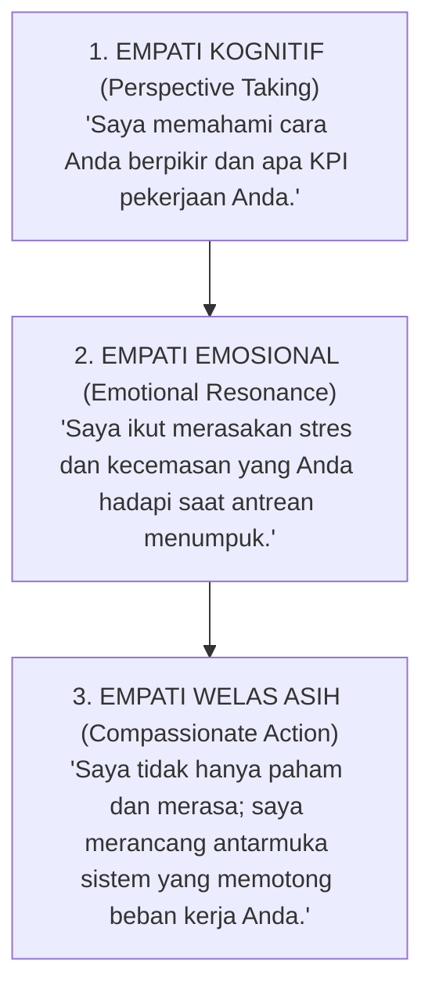
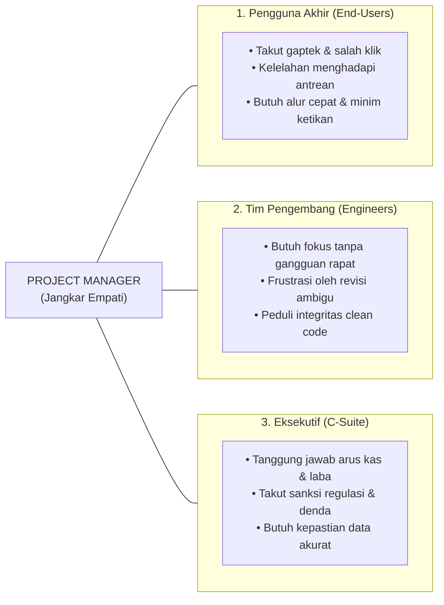

# Modul 06: Empati dalam Manajemen Proyek (Empathy in Project Management)

Di masa lalu, banyak yang memandang Project Manager (PM) ideal sebagai figur yang dingin, kaku, dan hanya berorientasi pada angka (*spreadsheet-driven taskmaster*). Namun di era modern, riset industri membuktikan bahwa **Empati adalah keunggulan kompetitif nomor satu (*The #1 Strategic Advantage*)** yang membedakan proyek yang berhasil diadopsi luas dari proyek yang ditolak secara pasif oleh pengguna.

Empati bukanlah rasa kasihan (*sympathy*); empati adalah **kemampuan intelektual dan emosional untuk melihat dunia dari kacamata orang lain, merasakan beban yang mereka pikul, dan merancang solusi nyata untuk mempermudah hidup mereka**.

---

## 1. Tiga Tingkatan Empati dalam Manajemen Proyek



---

## 2. Spektrum Empati: Tiga Pilar Pemangku Kepentingan

Seorang PM harus memancarkan empati ke tiga arah yang berbeda setiap hari:



---

## 3. Praktik "Job Shadowing": Empati Lapangan Tanpa Filter

Cara terbaik membangun empati bukanlah dengan mengirimkan kuesioner Google Form dari balik meja kerja kantor, melainkan dengan **turun langsung ke lantai operasional (*Gemba Walk / Job Shadowing*)**.

### Prinsip Job Shadowing bagi PM:
1. **Duduk Bersama Mereka**: Duduk di samping kasir, perawat, atau staf admisi selama minimal 2 hingga 4 jam saat jam pelayanan paling sibuk.
2. **Jangan Menginterupsi atau Menggurui**: Jangan berkata *"Bapak salah klik, harusnya yang ini"*. Amati bagaimana mereka kebingungan menavigasi form, di mana mouse mereka terhenti, dan apa yang membuat mereka mendesah frustrasi.
3. **Catat Friksi Emosional**: Catat setiap momen ketika staf harus berpindah aplikasi, menyalin angka manual ke kertas, atau menatap layar loading terlalu lama.

---

## 4. Studi Kasus Riil: Mengubah Penolakan Perawat Menjadi Adopsi Penuh Melalui Shadowing Shift Malam

### Skenario Lapangan
- **Masalah**: Peluncuran formulir Asesmen Keperawatan Rawat Inap RS Indriati mengalami resistensi keras. Tingkat kelengkapan pengisian form digital hanya 28%. Mayoritas perawat kembali mencatat di lembaran kertas.
- **Tuduhan Awal Tim IT**: *"Perawat-perawat senior malas dan tidak mau belajar teknologi baru."*

### Intervensi Empati oleh PM (Dessy Rahmawati Chairullina):
1. **Melakukan Shadowing Shift Malam (Pukul 22.00 - 03.00 WIB)**:
   - PM mengenakan pakaian medis dan mendampingi perawat jaga malam di Bangsal Melati.
2. **Temuan Fakta Lapangan yang Mengejutkan**:
   - Di malam hari, lampu ruangan pasien dimatikan agar pasien istirahat. Layar laptop perawat dengan latar belakang putih menyala (*bright white*) sangat menyilaukan mata dan membangunkan pasien yang sedang tidur kritis.
   - Perawat harus membawa infus dengan satu tangan, sehingga sangat sulit mengetik dengan dua tangan pada keyboard laptop biasa.
   - Form digital yang dirancang tim IT memiliki 45 kolom wajib (*mandatory fields*) yang menuntut pengetikan teks panjang, padahal kondisi pasien tengah malam stabil dan hanya butuh pencatatan tanda vital berkala.
3. **Redesain Antarmuka Berbasis Empati Klinis**:
   - Menambahkan mode redup (*Dark/Muted Theme*) pada tampilan malam.
   - Mengubah 30 kolom teks bebas menjadi checklist cepat satu klik (*Single-Tap Checkboxes*).
   - Menambahkan tombol pintas *"Kondisi Pasien Stabil (Normal Defaults)"* yang langsung mengisi nilai standar dengan satu sentuhan, di mana perawat hanya perlu mengubah angka jika terjadi anomali klinis.
4. **Hasil**:
   - Waktu pengisian asesmen terpangkas dari **14 menit menjadi 90 detik**.
   - Dalam waktu 7 hari, kepatuhan pengisian form digital melonjak dari **28% menjadi 99,4%**.
   - Tim perawat merasa sangat didengar dan dihormati martabat profesinya oleh PM.

---

## 5. Actionable Checklist Empati dalam Proyek

```
[ ] 1. Observasi Langsung: Apakah Anda telah melakukan minimal 2 jam observasi lapangan langsung (Gemba Walk) melihat pengguna menggunakan sistem Anda?
[ ] 2. Validasi Asumsi: Apakah solusi yang Anda rancang berdasarkan fakta kesulitan pengguna, bukan sekadar asumsi pribadi dari balik meja kantor?
[ ] 3. Bahasa yang Manusiawi: Apakah pesan error di sistem Anda menggunakan bahasa yang ramah dan membantu, bukan kode teknis yang menakut-nakuti pengguna?
[ ] 4. Lindungi Waktu Tim: Apakah Anda menghargai kebutuhan waktu fokus tim pengembang dengan tidak mengirimkan pesan pekerjaan di luar jam kerja kecuali darurat P1?
[ ] 5. Mendengarkan Aktif: Dalam rapat, apakah Anda mendengarkan untuk memahami sudut pandang lawan bicara, bukan sekadar menunggu giliran untuk membantah?
```
