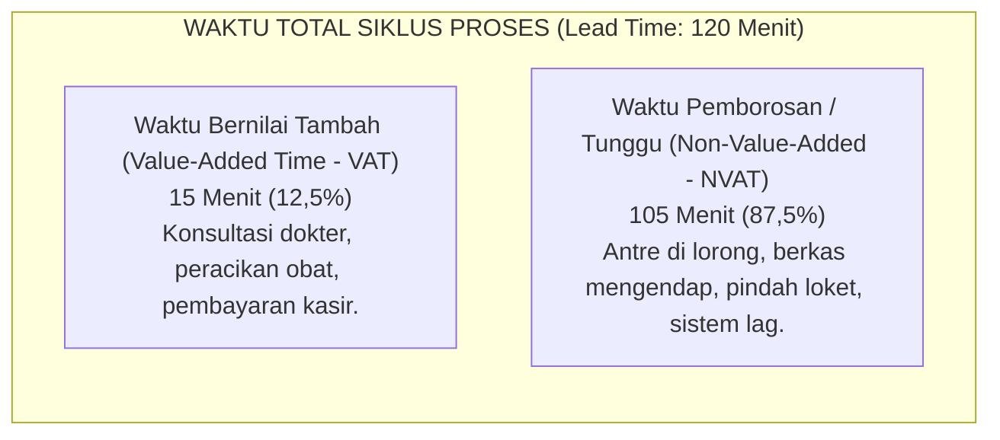
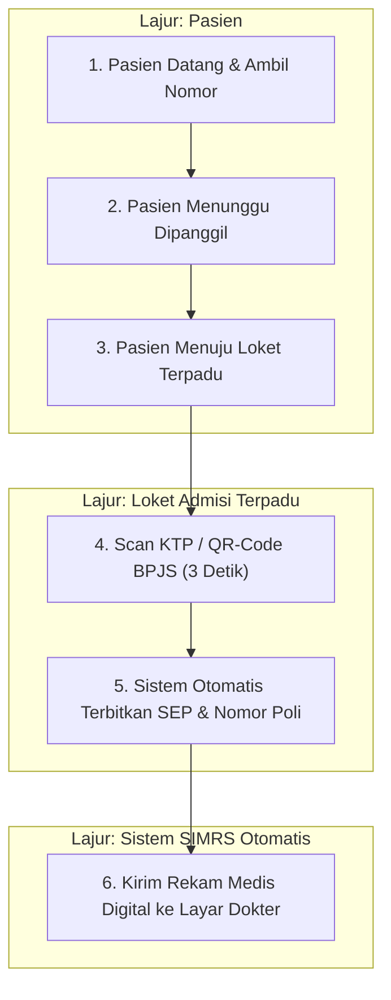
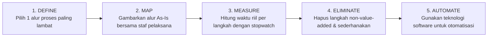

# Modul 07: Peningkatan Proses untuk Pemula (Process Improvement for Beginners)

Di setiap organisasi, baik rumah sakit, perusahaan perbankan, maupun startup teknologi, sering kali ditemukan proses kerja yang berbelit-belit: dokumen yang harus ditandatangani oleh 5 orang berbeda, data yang diketik ulang di 3 aplikasi terpisah, atau berkas yang mengendap berhari-hari di meja verifikator tanpa disentuh.

Ketika ditanya mengapa alur kerjanya seperti itu, jawaban paling umum adalah: *"Dari dulu caranya memang sudah begini."*

**Peningkatan Proses (*Process Improvement*)** adalah disiplin sistematis untuk membongkar kebiasaan lama yang tidak efisien, membuang langkah-langkah yang membuang waktu (*waste elimination*), dan merancang alur kerja baru yang lebih cepat, lebih murah, dan lebih ramah bagi manusia.

---

## 1. Membedakan Waktu Nilai Tambah vs Pemborosan

Dalam setiap proses bisnis, waktu total yang dibutuhkan dibagi menjadi dua kategori utama:



### Rumus Efisiensi Siklus Proses (*Process Cycle Efficiency - PCE*):
$$\text{PCE (\%)} = \frac{\text{Value-Added Time (VAT)}}{\text{Total Lead Time}} \times 100\%$$

- Di banyak proses konvensional, nilai PCE sering kali di bawah **10%**! Tugas seorang Business Analyst dan Project Manager adalah melipatgandakan nilai PCE dengan menyingkirkan waktu tunggu yang sia-sia (*NVAT*).

---

## 2. Mengenali 8 Pemborosan Lean (D.O.W.N.T.I.M.E.)

Akronim **DOWNTIME** adalah panduan pemula untuk mendeteksi pemborosan di lantai kerja:

| Huruf | Jenis Pemborosan | Contoh Nyata di Industri / Rumah Sakit |
| :---: | :--- | :--- |
| **D** | **Defects (Cacat/Salah)** | Salah ketik nomor NIK pasien sehingga klaim BPJS ditolak dan harus diperbaiki manual. |
| **O** | **Overproduction (Kelebihan)** | Mencetak rangkap 5 formulir pendaftaran fisik, padahal yang disimpan hanya 1 lembar. |
| **W** | **Waiting (Menunggu)** | Pasien duduk menunggu 45 menit hanya untuk menunggu dokter menandatangani selembar resep. |
| **N** | **Non-utilized Talent (Potensi Mubazir)** | Perawat berpendidikan S1 menghabiskan 4 jam sehari hanya untuk fotokopi berkas asuransi. |
| **T** | **Transportation (Pemindahan Berkas)** | Kurir harus bolak-balik membawa map rekam medis tebal dari gudang arsip lantai 1 ke poli lantai 3. |
| **I** | **Inventory (Penumpukan)** | Menumpuknya 500 berkas klaim di atas meja verifikator yang belum diperiksa selama 2 minggu. |
| **M** | **Motion (Gerakan Sia-Sia)** | Petugas kasir harus berdiri berjalan 15 meter setiap kali ingin mengambil cetakan nota di printer sentral. |
| **E** | **Extra-Processing (Proses Berlebih)** | Meminta 3 stempel basah berbeda pada surat rujukan yang sudah memiliki barcode QR-code sah. |

---

## 3. Pemetaan Alur Kerja: Diagram Swimlane As-Is vs To-Be

Cara paling efektif untuk menganalisis proses adalah menggunakan diagram jalur renang (*Swimlane Diagram*):



---

## 4. Siklus 5 Langkah Peningkatan Proses Pemula



> **Prinsip Utama**: Jangan pernah mengotomatisasi proses yang rusak! Jika Anda mengotomatisasi proses yang buruk, Anda hanya akan menghasilkan pemborosan yang terjadi dengan kecepatan komputer. Bersihkan prosesnya terlebih dahulu, baru terapkan otomatisasi.

---

## 5. Studi Kasus Riil: Menghapus 5 Titik Hambatan Alur Admisi Pasien

### Konteks Skenario
- **Lokasi**: Loket Pendaftaran Rawat Jalan RS Indriati.
- **Kondisi As-Is Awal**:
  - Pasien harus melewati 4 loket terpisah: Loket Ambil Nomor Antrean $\rightarrow$ Loket Verifikasi Berkas BPJS $\rightarrow$ Loket Cetak SEP $\rightarrow$ Meja Perawat Tensi.
  - Total waktu tunggu pasien: **85 menit**.
  - Komplain pasien sangat tinggi di pagi hari.

### Tindakan Peningkatan Proses oleh BA/PM (Dessy Rahmawati Chairullina):
1. **Analisis Pemborosan**:
   - Ditemukan bahwa berkas kartu pasien dicek ulang oleh 3 orang berbeda (Extra-Processing & Motion).
2. **Perancangan Alur To-Be (Loket Terpadu Satu Pintu)**:
   - Menggabungkan fungsi loket verifikasi dan loket cetak SEP menjadi satu kesatuan.
   - Mengintegrasikan mesin Fingerprint dan Card Reader KTP langsung di terminal loket, sehingga pencocokan data BPJS selesai dalam 4 detik secara otomatis.
   - Data tensi darah dihubungkan langsung dari tensimeter digital bluetooth ke rekam medis tanpa perlu pencatatan kertas manual.
3. **Hasil Terukur**:
   - Total waktu pelayanan dari kedatangan hingga selesai administrasi terpangkas dari **85 menit menjadi 18 menit** (Penghematan waktu 78%).
   - Jumlah staf yang dialokasikan di loket berkurang dari 8 orang menjadi 5 orang; 3 staf dialihkan untuk mendampingi pasien lansia mandiri (*Non-utilized talent eliminated*).

---

## 6. Actionable Checklist Peningkatan Proses

```
[ ] 1. Identifikasi Waktu Tunggu: Apakah Anda tahu langkah mana dalam alur kerja Anda yang memiliki waktu tunggu (Waiting Time) paling lama?
[ ] 2. Audit 8 Pemborosan (DOWNTIME): Apakah Anda telah menginspeksi alur kerja untuk menemukan cetakan ganda, stempel berlebih, atau ketik ulang data?
[ ] 3. Libatkan Pelaksana Langsung: Apakah orang yang menjalankan pekerjaan sehari-hari dilibatkan secara aktif dalam merancang alur To-Be?
[ ] 4. Sederhanakan Sebelum Otomatisasi: Apakah Anda telah memangkas langkah birokrasi yang tidak perlu sebelum meminta tim IT membuat kodenya?
[ ] 5. Ukur PCE Sebelum & Sesudah: Apakah Anda mengukur efisiensi siklus proses (Process Cycle Efficiency) secara kuantitatif sebelum dan sesudah perbaikan?
```
