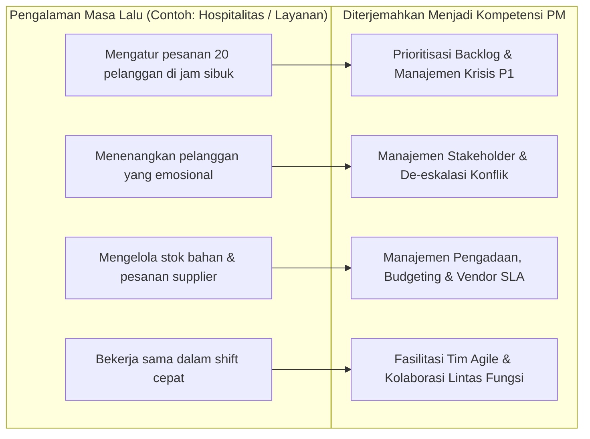

# Modul 08: Transisi Karier dan Transferable Skills (Career Pivot & Transferable Skills)

Salah satu kisah paling menginspirasi dalam seri *Google Project Management Professional Certificate* adalah kisah seorang profesional yang berhasil bertransisi dari seorang **bartender / pekerja industri perhotelan menjadi seorang Technical Project Manager di perusahaan teknologi global**.

Banyak orang ragu untuk terjun ke dunia manajemen proyek karena merasa tidak memiliki latar belakang formal: *"Saya bukan lulusan teknik industri,"* atau *"Saya selama ini hanya staf administrasi biasa."*

Faktanya, manajemen proyek adalah salah satu profesi paling inklusif di dunia. Tanpa Anda sadari, jika Anda pernah mengorganisir acara, mengelola stok inventaris yang berantakan, menenangkan pelanggan yang marah di jam sibuk, atau mengoordinasikan jadwal shift tim, **Anda sebenarnya telah mempraktikkan keterampilan manajemen proyek (*Transferable Skills*)**.

---

## 1. Memetakan Keterampilan Non-Tradisional Menjadi Kompetensi PM

Setiap pengalaman kerja masa lalu menyimpan "keterampilan tersembunyi" yang sangat dihargai di dunia manajemen proyek:



### Kamus Penerjemahan Pengalaman Masa Lalu ke Bahasa PM:

| Pengalaman Kerja Asli | Bahasa Deskripsi Tradisional (Kurang Menjual) | Bahasa Kompetensi Project Manager (Tinggi Nilai Jual) |
| :--- | :--- | :--- |
| **Kasir / Administrasi** | *"Melayani transaksi pembayaran pasien dan membuat laporan harian kas."* | *"Mengelola rekonsiliasi finansial harian bernilai ratusan juta rupiah dengan akurasi 99,9% dan memfasilitasi audit kepatuhan internal."* |
| **Customer Service / Helpdesk**| *"Menjawab telepon komplain dan mencatat tiket keluhan pelanggan."* | *"Memimpin penanganan insiden operasional, menganalisis pola keluhan untuk Root Cause Analysis, dan memangkas waktu resolusi komplain sebesar 40%."* |
| **Staf Rekam Medis** | *"Menyusun berkas rekam medis dan mengecek kelengkapan klaim BPJS."* | *"Menegakkan kepatuhan tata kelola data privasi pasien (UU PDP), memvalidasi kelayakan berkas klaim, dan mengeliminasi risiko penundaan piutang."* |
| **Programmer / IT Support** | *"Memperbaiki bug aplikasi dan menulis koding Java."* | *"Mendiagnosa integritas arsitektur sistem, memitigasi risiko keamanan database, dan mengestimasi kelayakan teknis sprint rilis produk."* |

---

## 2. Mengubah Narasi CV: Formula Google XYZ untuk Career Switcher

Saat beralih karier (*career pivot*), kesalahan terbesar adalah menulis resume yang terlihat seperti daftar tugas harian (*job description*). Rekruter eksekutif mencari **dampak dan hasil nyata (*impact & outcomes*)**.

Gunakan formula baku Google:

$$\text{"Accomplished [X], as measured by [Y], by doing [Z]"}$$

```diff
- CONTOH RESUME SEBELUMNYA (PASIF & BIASA):
- Bekerja sebagai staf IT rumah sakit yang membantu instalasi sistem dan melatih perawat menggunakan komputer.

+ CONTOH RESUME SETELAH TRANSFORMASI (BAHASA PM STRATEGIS):
+ Memimpin inisiatif adopsi sistem rekam medis digital bagi 120 tenaga kesehatan [Z], berhasil memangkas waktu tunggu administrasi rawat inap sebesar 55% dan menaikkan kepatuhan pengisian form hingga 98% [X], menghasilkan percepatan klaim asuransi senilai Rp 850 Juta per kuartal [Y].
```

---

## 3. Menaklukkan Sindrom Impostor (*Impostor Syndrome*)

Ketika Anda baru memasuki ruangan rapat bersama direktur senior, arsitek sistem jenius, atau dokter spesialis, wajar jika muncul bisikan di dalam hati: *"Apakah saya pantas berada di sini? Bagaimana jika mereka tahu saya baru beralih profesi?"*

```mermaid
flowchart TD
    subgraph ImpostorTrap["Perangkap Impostor Syndrome"]
        T1["Mengira PM Harus Menjadi Orang Paling Pintar di Ruangan Secara Teknis"] --> T2["Takut Bertanya Karena Cemas Terlihat Bodoh"]
        T2 --> T3["Membuat Keputusan Berdasarkan Asumsi Sendiri"]
        T3 --> T4["Proyek Mengalami Miskomunikasi & Gagal"]
    end

    subgraph PMTruth["Kebenaran Sejati Peran PM"]
        P1["PM Bukanlah Pemilik Semua Jawaban Teknis"] --> P2["PM Adalah FASILITATOR yang Mengajukan Pertanyaan Terbaik"]
        P2 --> P3["Menghubungkan Titik-Titik Antara Bisnis, Pengguna, dan Insinyur"]
        P3 --> P4["Membimbing Ruangan Mencapai Keputusan Konsensus yang Tepat"]
    end
```



---

## 4. Studi Kasus Riil: Transisi Strategis Dessy Rahmawati Chairullina, S.Kom

### Profil Perjalanan Karier
- **Latar Belakang Awal**: Lulusan Sarjana Komputer (S.Kom) dengan keahlian teknis pemrograman Java, SQL, dan rekayasa perangkat lunak.
- **Tantangan Transisi**: Bagaimana memposisikan diri bukan sekadar sebagai "programmer pelaksana", melainkan sebagai **Lead Business Analyst & Enterprise Project Manager** yang memimpin transformasi digital rumah sakit.

### Strategi Pemosisian Diri yang Berhasil:
1. **Menggabungkan Dua Dunia (The T-Shaped Advantage)**:
   - Tidak membuang latar belakang teknisnya, melainkan menjadikannya sebagai fondasi pembeda: menguasai logika algoritma dan query database, sekaligus fasih berbicara tentang arus kas klaim BPJS, regulasi SatuSehat Kementerian Kesehatan, dan psikologi perawat di bangsal.
2. **Membangun Bukti Kerja Nyata (*Tangible Proof of Work*)**:
   - Alih-alih hanya mencantumkan sertifikat kursus di LinkedIn, Dessy mendokumentasikan 46 modul kurikulum Google PM lengkap dengan 8 studi kasus implementasi riil SIMRS di GitHub yang dapat diaudit langsung oleh calon pemberi kerja.
3. **Hasil**:
   - Diakui sebagai pemimpin proyek yang disegani oleh dokter spesialis dan direksi rumah sakit, membuktikan bahwa kombinasi pemahaman domain klinis, logika rekayasa software, dan tata kelola PM adalah profil yang sangat langka dan bernilai tinggi di industri enterprise.

---

## 5. Actionable Checklist Transisi Karier PM

```
[ ] 1. Audit Transferable Skills: Apakah Anda telah menuliskan minimal 5 keterampilan dari pekerjaan masa lalu Anda yang relevan dengan pilar manajemen proyek?
[ ] 2. Terapkan Formula Google XYZ: Apakah seluruh poin pencapaian di CV Anda telah diformulasikan dalam format Pencapaian [X] diukur dengan [Y] melalui cara [Z]?
[ ] 3. Bersihkan Jargon Internal Lama: Apakah istilah-istilah sempit yang hanya dimengerti kantor lama Anda sudah diubah menjadi bahasa standar manajemen proyek global?
[ ] 4. Bangun Repositori Bukti Nyata: Apakah Anda memiliki tautan portofolio publik (seperti GitHub) yang memamerkan dokumen kerja nyata (Project Charter, WBS, Risk Register)?
[ ] 5. Reframe Peran Fasilitator: Apakah Anda sudah membuang rasa cemas harus tahu segalanya dan mulai fokus menjadi fasilitator pemecahan masalah terbaik bagi tim?
```
