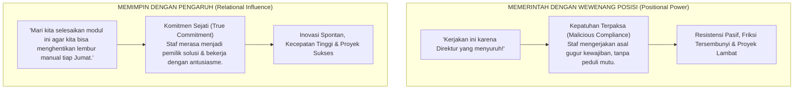
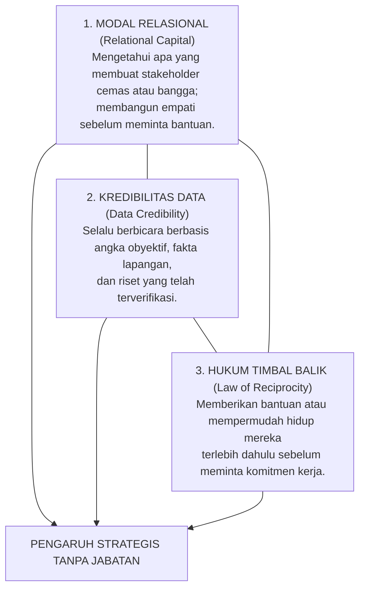

# Modul 09: Mengapa Pengaruh Penting sebagai Manajer Proyek (Why Influence is the PM's Greatest Superpower)

Dalam struktur bagan organisasi korporat tradisional, wewenang mengalir dari atas ke bawah: Direktur memerintah Manajer, Manajer memerintah Supervisor, dan Supervisor memerintah Staf. 

Namun, posisi seorang Project Manager (PM) sangat unik dan penuh paradoks: Anda memegang **tanggung jawab penuh atas keberhasilan proyek**, tetapi Anda **hampir tidak pernah memiliki wewenang struktural langsung (*direct line authority*)** atas anggota tim yang Anda butuhkan. Anda tidak bisa memecat pengembang software yang terlambat, Anda tidak bisa memotong gaji dokter yang enggan mengisi form, dan Anda tidak bisa memerintahkan manajer keuangan untuk segera mencairkan dana.

Oleh karena itu, **Pengaruh (*Influence*)** adalah satu-satunya instrumen kepemimpinan sejati yang Anda miliki. Jika Anda tidak bisa mempengaruhi orang lain tanpa mengandalkan jabatan, Anda tidak akan pernah bisa menjadi Project Manager yang sukses.

---

## 1. Kepatuhan Semu vs Komitmen Sejati

Ketika seorang manajer mengandalkan pemaksaan atau mengadu ke atasan (*escalation threat*), hasil yang didapat adalah kepatuhan yang rapuh:



---

## 2. Segitiga Pengaruh Project Manager

Pengaruh tidak dibangun dalam semalam; pengaruh ditopang oleh 3 fondasi yang harus Anda rawat setiap hari:



---

## 3. Menghadapi 3 Arketipe Stakeholder Paling Menantang

| Tipe Stakeholder | Karakteristik Perilaku | Cara Mempengaruhi Secara Efektif |
| :--- | :--- | :--- |
| **Eksekutif yang Tidak Sabar** | Rentang perhatian pendek, tidak peduli detail teknis, hanya ingin hasil cepat. | Gunakan metode **BLUF (Bottom Line Up Front)**; sajikan dampak bisnis dan pilihan solusi dalam 1 slide; hindari curhat teknis. |
| **Spesialis Klinis Senior (Dokter)**| Sangat cerdas, memiliki ego profesional tinggi, defensif jika merasa digurui oleh orang non-medis. | Gunakan teknik **Nemawashi (Pre-wiring)**; mintai pendapat klinis mereka saat draf baru 70% selesai; tunjukkan respek pada keahlian mereka. |
| **Pengembang Software Skeptis** | Alergi terhadap birokrasi, mencurigai PM hanya sebagai "penambah rapat", sangat membenci *technical debt*. | Tunjukkan pemahaman pada arsitektur kode; lindungi mereka dari rapat tidak penting; selesaikan birokrasi izin server untuk mereka. |

---

## 4. Studi Kasus Riil: Mengesahkan Pembekuan Fitur (Feature Freeze) Tanpa Menyinggung Dewan

### Latar Belakang Kasus
- **Fase Proyek**: H-14 Peluncuran Sistem Pembayaran Kasir & Farmasi RS Indriati.
- **Tantangan**: Direktur Keuangan dan Komite Medis terus-menerus mengirimkan permintaan revisi form dan formula diskon baru setiap hari. Jika dibiarkan, kode program akan mengalami ketidakstabilan (*code regression*) dan tanggal go-live terancam gagal.
- **Batasan**: PM (Dessy Rahmawati Chairullina) tidak memiliki wewenang untuk menolak kehendak Direktur Keuangan.

### Manuver Pengaruh yang Dijalankan oleh PM:
1. **Membangun Koalisi dengan Fakta Kuantitatif**:
   - PM tidak berkata: *"Bapak/Ibu jangan nambah-nambah fitur terus, kami capek."*
   - PM menyiapkan simulasi data sederhana: menunjukkan bahwa setiap 1 perubahan form di H-14 membutuhkan waktu pengujian ulang pada 120 relasi database dan menaikkan risiko *system crash* saat jam buka kasir sebesar 42%.
2. **Menawarkan Pintu Masuk Alternatif yang Terhormat (*The Second Phase Gate*)**:
   - PM membuat lembar dokumen baru: **"Piagam Prioritas Transformasi Fase 2"**.
   - Setiap usulan dari Direktur dan Dokter dicatat dengan sangat rapi dan diberi tajuk terhormat: *"Usulan Strategis Lanjutan"*.
   - PM menyampaikan: *"Bapak/Ibu, usulan diskon khusus karyawan ini sangat brilian. Agar tidak merusak stabilitas transaksi kasir minggu depan yang sedang diaudit akuntan publik, kami telah mengunci fitur ini sebagai fitur nomor satu yang akan langsung kita rilis 14 hari pasca go-live."*
3. **Hasil**:
   - Direktur Keuangan menyetujui penandatanganan SK Pembekuan Fitur (*Feature Freeze Agreement*) dengan senyuman karena merasa idenya sangat dihargai dan memiliki jadwal rilis pasti.
   - Go-live berlangsung dengan stabilitas 100% tanpa ada satu pun insiden error transaksi.

---

## 5. Actionable Checklist Membangun Pengaruh

```
[ ] 1. Diagnosa Motivasi Utama: Apakah Anda tahu apa 1 hal yang paling ditakuti dan 1 hal yang paling diinginkan oleh stakeholder kunci Anda?
[ ] 2. Investasi Relasi Sebelum Butuh: Apakah Anda pernah menyapa atau membantu rekan kerja di luar momen ketika Anda membutuhkan tanda tangan atau bantuan mereka?
[ ] 3. Bahasa Keuntungan Bersama: Ketika mengajukan usulan, apakah Anda membingkainya dalam konteks apa keuntungan bagi mereka (WIIFM - What's In It For Me)?
[ ] 4. Penguasaan Data Tanpa Bantahan: Apakah argumen Anda didukung oleh angka faktual yang telah diverifikasi, bukan sekadar opini subjektif?
[ ] 5. Berikan Rasa Kepemilikan (Co-Creation): Apakah Anda melibatkan pihak yang skeptis dalam merumuskan draf perbaikan agar mereka merasa memiliki ide tersebut?
```
