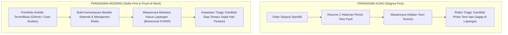
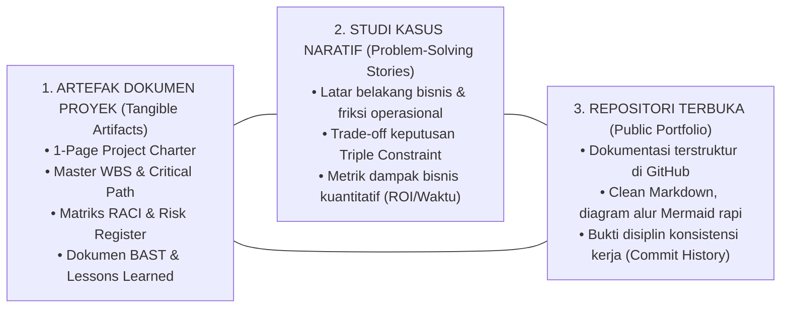

# Modul 10: Menjadi PM Berbasis Keahlian dan Bukti Kerja (Skills-First Hiring & Proof of Work)

Selama beberapa dekade, jalur menuju posisi manajerial sering kali dibatasi oleh sertifikat ijazah formal dari universitas terkemuka. Namun dalam lanskap rekrutmen korporat dan teknologi global saat ini—yang dipelopori oleh perusahaan seperti Google, Apple, dan IBM—terjadi pergeseran paradigma radikal menuju **Skills-First Hiring (Perekrutan Berbasis Keahlian Nyata)**.

Bagi calon Project Manager (PM) atau Business Analyst (BA), pertanyaan terpenting yang diajukan oleh pemberi kerja saat ini bukanlah: *"Dari universitas mana Anda lulus?"*, melainkan:
1. **"Dapatkah Anda membuktikan bahwa Anda mampu merencanakan dan mengeksekusi proyek yang kompleks?"**
2. **"Tunjukkan kepada saya artefak kerja nyata yang pernah Anda buat sendiri."**
3. **"Ceritakan bagaimana cara Anda menyelesaikan krisis nyata ketika proyek keluar dari jalur."**

---

## 1. Pergeseran Paradigma: Ijazah Kertas vs Bukti Kerja (*Proof of Work*)



---

## 2. Tiga Pilar Bukti Kerja (*The Proof-of-Work Triad*)

Seorang kandidat PM yang memikat harus memiliki tiga bukti nyata yang dapat dilihat dan diaudit oleh calon pemberi kerja:



---

## 3. Membangun Portofolio PM Tanpa Menunggu Judul Jabatan Resmi

Banyak orang terjebak dalam dilema klasik: *"Bagaimana saya bisa punya portofolio PM jika belum pernah menjabat sebagai PM?"*

Kuncinya adalah memahami bahwa **setiap pekerjaan mengandung proyek yang belum diberi nama**:

| Inisiatif Nyata yang Dapat Dijadikan Proyek Portofolio | Cara Membingkainya Sebagai Proyek PM Kelas Dunia |
| :--- | :--- |
| Merapikan gudang berkas rekam medis kertas yang berantakan di klinik tempat Anda bekerja. | *"Inisiatif Digitalisasi & Restrukturisasi Sistem Pengarsipan Berkas Pasien: Memangkas Waktu Retrival Berkas dari 20 Menit ke 3 Menit."* |
| Mengoordinasikan acara bakti sosial atau donor darah di komunitas lokal Anda. | *"Manajemen Pengadaan, Budgeting, dan Alokasi Sumber Daya Multi-Vendor untuk Kegiatan Pelayanan Publik 500 Peserta."* |
| Menganalisis alur antrean pendaftaran di puskesmas setempat dan membuat usulan form baru. | *"Analisis Proses Bisnis (As-Is vs To-Be) & Perancangan Spesifikasi Sistem Admisi Satu Pintu (BRD/PRD)."* |

---

## 4. Studi Kasus Riil: Keunggulan Portofolio GitHub Dessy Rahmawati Chairullina

### Skenario Pembuktian Diri
- **Tantangan Rekrutmen**: Bersaing dengan ratusan pelamar dari seluruh Indonesia yang memiliki sertifikasi formal atau gelar master untuk posisi pimpinan proyek teknologi kesehatan.
- **Strategi Diferensiasi yang Diterapkan**:
  - Alih-alih hanya melampirkan file PDF resume standar, Dessy menyertakan tautan langsung ke repositori GitHub publik yang membedah kurikulum **Google Project Management Professional Certificate** (46 Modul Lengkap) dan modul **How to Running the Project**, terintegrasi dengan **8 Studi Kasus Implementasi SIMRS Riil**.
- **Apa yang Dilihat oleh Tim Pewawancara Eksekutif**:
  1. **Disiplin Luar Biasa**: Riwayat commit yang rapi dan konsisten membuktikan etos kerja yang teliti dan pantang menyerah.
  2. **Kedalaman Teknis & Regulasi**: Artefak yang disajikan tidak bersifat abstrak, melainkan membedah spesifikasi nyata seperti enkripsi bridging BPJS VClaim, resource JSON HL7 FHIR SatuSehat, dan perlindungan data pribadi UU PDP.
  3. **Kemampuan Berpikir Bisnis**: Setiap modul selalu dihubungkan dengan metrik efisiensi biaya, pencegahan kerugian piutang, dan keselamatan pasien.
- **Hasil**: Calon pemberi kerja tidak lagi memperdebatkan status gelar atau almamater, karena bukti keahlian nyata terpampang transparan di hadapan mereka.

---

## 5. Actionable Checklist Membangun Bukti Kerja PM

```
[ ] 1. Pilih 1 Proyek Nyata: Pilih satu inisiatif perbaikan proses di tempat kerja atau komunitas Anda saat ini untuk dijadikan proyek studi kasus utama.
[ ] 2. Ciptakan 3 Artefak Inti: Buat 1 dokumen Piagam Proyek (Project Charter), 1 Matriks Risiko (Risk Register), dan 1 Alur Proses Bisnis (Flowchart).
[ ] 3. Publikasikan di Repositori Terbuka: Unggah seluruh dokumen dan catatan pembelajaran Anda ke platform publik seperti GitHub dalam format Markdown yang rapi.
[ ] 4. Sertakan Metrik Kuantitatif: Pastikan studi kasus Anda memiliki angka sebelum dan sesudah (misal: waktu pangkas 40%, kesalahan turun ke 0%).
[ ] 5. Latih Narasi Lisan: Latihlah menceritakan proses penyelesaian masalah dalam studi kasus Anda secara lancar dalam waktu 3 menit.
```
