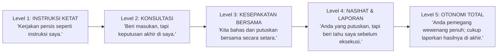
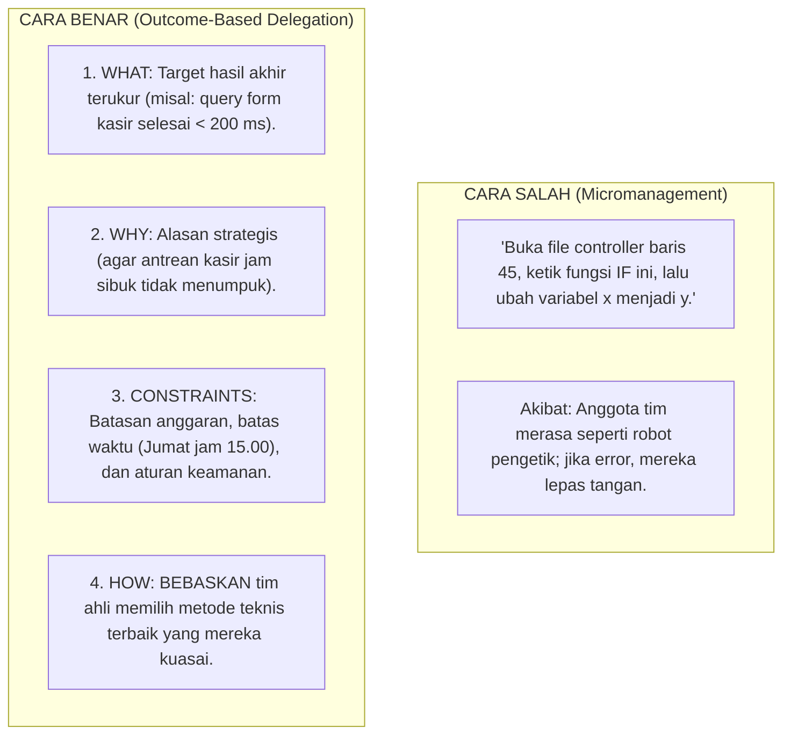
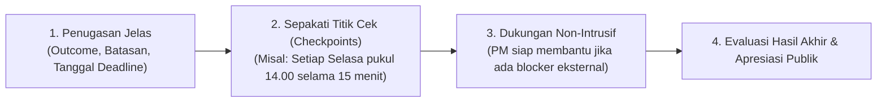

# Modul 11: Cara Mendelegasikan Tugas sebagai Manajer Program (The Art of Delegation for Program Managers)

Salah satu hambatan terbesar yang menghentikan langkah seorang Project Manager (PM) untuk naik kelas menjadi **Program Manager (PgM)** adalah **Ketidakmampuan untuk Mendelegasikan Tugas**.

Banyak manajer berbakat terjebak dalam perangkap pahlawan tunggal (*The Superhero Trap*): mereka meyakini bahwa *"Jika pekerjaan ingin selesai dengan benar dan cepat, saya harus mengerjakannya sendiri."* Akibatnya, manajer tersebut tenggelam dalam ribuan detail mikro teknis, mengalami kelelahan mental akut (*burnout*), menjadi leher botol (*bottleneck*) bagi seluruh tim, dan kehilangan pandangan strategis atas tujuan besar organisasi.

Mendelegasikan tugas bukanlah tindakan melepaskan tanggung jawab atau membuang pekerjaan kotor kepada orang lain (*dumping work*); delegasi adalah **seni memberdayakan manusia, membangun kepercayaan, dan melipatgandakan kapasitas organisasi**.

---

## 1. Spektrum Tingkat Delegasi: 5 Level Otonomi

Delegasi bukanlah saklar biner (semua atau tidak sama sekali). Tingkat delegasi harus disesuaikan dengan tingkat kompetensi dan risiko tugas:



### Panduan Penentuan Level:
- **Tugas Berisiko Kritis (Migrasi Database Live)**: Berada pada Level 2 atau 3.
- **Tugas Eksplorasi Arsitektur (Memilih Library UI atau Riset SDK)**: Berikan ke insinyur senior pada Level 4 atau 5.

---

## 2. Formula Delegasi yang Efektif: Delegasikan "WHAT & WHY", Bukan "HOW"

Kesalahan paling umum dari manajer yang baru belajar mendelegasikan adalah mendikte setiap langkah teknis (*micromanaging the "HOW"*). Hal ini mematikan inisiatif dan membuat tim merasa tidak dipercaya.



---

## 3. Menegakkan Sistem Kendali Tanpa Menjadi Micromanager

Bagaimana memastikan tugas yang didelegasikan tetap berjalan sesuai rencana tanpa harus bertanya setiap jam: *"Sudah sampai mana?"*



- **Prinsip Checkpoint**: Tetapkan jadwal peninjauan di awal. Jika Anda sudah sepakat untuk review setiap Selasa, Anda tidak perlu mengganggu pengembang di hari Senin, dan pengembang merasa memiliki otonomi kerja yang damai.

---

## 4. Studi Kasus Riil: Menyelamatkan Waktu 15 Jam per Minggu Melalui Delegasi Arsitektur

### Latar Belakang Kasus
- **Peran**: Program Manager Transformasi SIMRS (Dessy Rahmawati Chairullina, S.Kom).
- **Kondisi Stres**: Dessy menghabiskan 15 jam per minggu hanya untuk mengaudit setiap baris kode query SQL yang ditulis oleh 4 pengembang junior. Akibatnya, Dessy tidak memiliki waktu untuk menyiapkan proposal anggaran ke Direksi dan sering bekerja hingga larut malam.

### Intervensi Delegasi yang Dijalankan:
1. **Mengangkat Lead Insinyur Lokal (*Engineering Champion*)**:
   - Dessy mendelegasikan wewenang persetujuan tinjauan kode (*Pull Request Review*) kepada 1 pengembang paling senior di tim.
2. **Menyusun Kriteria Mutu Baku (*Definition of Done Checklist*)**:
   - Alih-alih mengandalkan ingatan pribadi, Dessy merumuskan dokumen checklist 1 lembar: (1) PreparedStatement wajib; (2) Index query terpasang; (3) Try-with-resources tertutup rapat.
3. **Pemberian Wewenang Bertingkat (Level 4 Delegation)**:
   - Senior developer memegang wewenang penuh menolak atau menerima kode junior berdasarkan checklist tersebut, dan hanya perlu melaporkan ringkasan tiket lolos uji pada standup pagi.
4. **Hasil Terukur**:
   - Waktu kerja Dessy berhasil dihemat **15 jam per minggu**!
   - Waktu yang dihemat digunakan Dessy untuk menyusun dokumen diplomasi ke Komite Medis dan bernegosiasi dengan BPJS, menghasilkan percepatan pencairan klaim Rp 1,2 Miliar.
   - Lead insinyur senior merasa sangat bangga karena dipercaya memegang peran kepemimpinan teknis (*empowerment*).

---

## 5. Actionable Checklist Delegasi untuk Manajer

```
[ ] 1. Kenali The Superhero Trap: Kapan terakhir kali Anda mengerjakan tugas teknis sendiri yang seharusnya bisa dikerjakan oleh anggota tim?
[ ] 2. Komunikasikan Hasil, Bukan Cara: Apakah saat mendelegasikan tugas Anda sudah menjelaskan 'What' dan 'Why' dengan jelas, sekaligus membebaskan 'How'?
[ ] 3. Tetapkan Batasan Tegas: Apakah anggota tim mengetahui batas anggaran, batas tanggal, dan aturan keamanan yang tidak boleh dilanggar?
[ ] 4. Jadwalkan Checkpoint: Apakah Anda dan penerima tugas telah menyepakati jadwal peninjauan berkala di muka?
[ ] 5. Beri Ruang untuk Belajar: Apakah Anda siap menerima bahwa cara anggota tim menyelesaikan tugas mungkin berbeda dari cara Anda, asalkan hasilnya memenuhi standar mutu?
```
