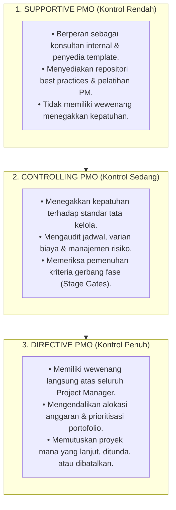
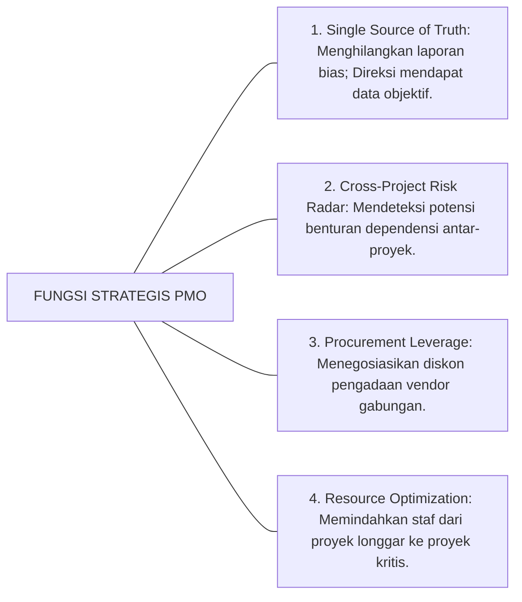

# Modul 12: Bekerja di Kantor Manajemen Proyek - PMO (Working in a Project Management Office)

Ketika sebuah organisasi tumbuh membesar dan menjalankan puluhan proyek secara bersamaan—misalnya rumah sakit yang sedang merombak sistem rekam medis, memperluas gedung rawat inap, membeli alat diagnostik MRI baru, dan mengintegrasikan bridging BPJS secara serentak—manajemen sering kali menghadapi kekacauan: anggaran proyek membengkak tanpa pengawasan, standar pelaporan berbeda-beda di setiap divisi, dan vendor dibayar ganda karena tidak ada koordinasi sentral.

Untuk mengatasi kekacauan ini, dibentuklah **Project Management Office (PMO)** atau Kantor Manajemen Proyek: sebuah divisi sentral yang bertugas menetapkan standar tata kelola, memastikan efisiensi portofolio investasi, dan menjamin bahwa setiap proyek selaras dengan visi strategis perusahaan.

---

## 1. Tiga Model Arsitektur PMO

Tergantung pada tingkat wewenang dan kedewasaan organisasi (*organizational maturity*), PMO dibagi menjadi tiga model:



---

## 2. Nilai Strategis PMO bagi Institusi Enterprise

PMO modern bukan lagi "polisi dokumen" yang hanya memeriksa apakah format font laporan sudah sesuai standar. PMO modern adalah **Pengungkit Nilai Bisnis (*Value Enabler*)**:



---

## 3. Jalur Karier di Lingkungan PMO

Bekerja di dalam PMO adalah salah satu jalur tercepat untuk memahami gambaran besar bisnis (*business big picture*) karena Anda terekspos langsung pada strategi Direksi dan operasional lapangan:

| Posisi di PMO | Fokus Tanggung Jawab Utama | Keterampilan Kunci |
| :--- | :--- | :--- |
| **PMO Coordinator / Specialist** | Mengelola jadwal, notulensi dewan, pengarsipan artefak, dan pemeliharaan alat manajemen proyek (Jira/Asana/Sheets). | Ketelitian administrasi, komunikasi tertulis, penguasaan software PM. |
| **PMO Analyst** | Menganalisis varian biaya (EVM), tren velocity tim, tingkat defect produk, dan menyusun dashboard eksekutif. | Data analytics, visualisasi data, pemodelan keuangan (ROI/NPV). |
| **Project / Program Manager** | Memimpin langsung eksekusi deliverable proyek strategis di bawah arahan PMO. | Kepemimpinan tim, manajemen risiko, negosiasi stakeholder, diplomasi. |
| **Head of PMO / PMO Director** | Bertanggung jawab langsung ke C-Suite atas seluruh portofolio investasi organisasi. | Strategic planning, tata kelola korporat, manajemen perubahan budaya. |

---

## 4. Studi Kasus Riil: Transformasi PMO Menyelamatkan 12 Proyek SIMRS yang Tumpang Tindih

### Skenario Lapangan
- **Masalah RS Indriati**: Sebelum pembentukan PMO, terdapat 12 inisiatif teknologi yang berjalan sendiri-sendiri tanpa koordinasi: instalasi farmasi membeli software barcode mandiri, divisi keuangan merancang sistem penagihan sendiri, dan divisi rawat inap menyewa konsultan luar terpisah.
- **Dampak Buruk**: Terjadi pemborosan anggaran sebesar Rp 380.000.000 untuk lisensi ganda yang fiturnya saling bertabrakan, dan data rekam medis pasien terpecah di 4 database yang tidak bisa saling terhubung.

### Pembentukan PMO Transformasi Digital oleh Lead PM (Dessy Rahmawati Chairullina):
1. **Membangun Peta Portofolio Tunggal (*Unified Project Portfolio Map*)**:
   - Seluruh 12 inisiatif didata ke dalam satu matriks master portofolio.
   - Ditemukan bahwa 5 proyek sebenarnya mengerjakan hal yang sama (modul bridging data pasien).
2. **Konsolidasi & Re-alokasi Anggaran**:
   - Membatalkan 3 kontrak vendor pihak ketiga yang redundan, mengalihkan seluruh pengembangan modul ke dalam arsitektur terpadu in-house SIMRS.
   - Menghemat anggaran pengadaan langsung sebesar **Rp 240.000.000**.
3. **Penerapan Standar Tata Kelola "One-Gate Review"**:
   - Tidak ada divisi yang boleh meluncurkan software atau membeli alat IT baru tanpa persetujuan kelayakan arsitektur (*Architectural Review Gate*) dari PMO.
4. **Hasil**:
   - Seluruh modul berhasil diintegrasikan ke dalam satu basis data tunggal yang aman dan mematuhi regulasi SatuSehat Kementerian Kesehatan.
   - Direksi memiliki dashboard visibilitas kesehatan proyek secara *real-time*.

---

## 5. Actionable Checklist Bekerja di PMO

```
[ ] 1. Identifikasi Model PMO: Apakah PMO di tempat Anda beroperasi sebagai Supportive, Controlling, atau Directive PMO?
[ ] 2. Standarisasi Template: Apakah organisasi Anda memiliki template baku untuk Project Charter, Risk Register, dan Dokumen BAST?
[ ] 3. Dashboard Visibilitas: Apakah status seluruh proyek aktif dapat dilihat dalam satu dasbor terpadu oleh pimpinan puncak?
[ ] 4. Eliminasi Redundansi: Apakah ada dua tim atau departemen berbeda yang sedang membangun fitur serupa tanpa saling koordinasi?
[ ] 5. Fokus pada Nilai Bisnis: Apakah PMO Anda dipandang sebagai mitra strategis yang mempercepat pencapaian laba, bukan sekadar penambah birokrasi formulir?
```
