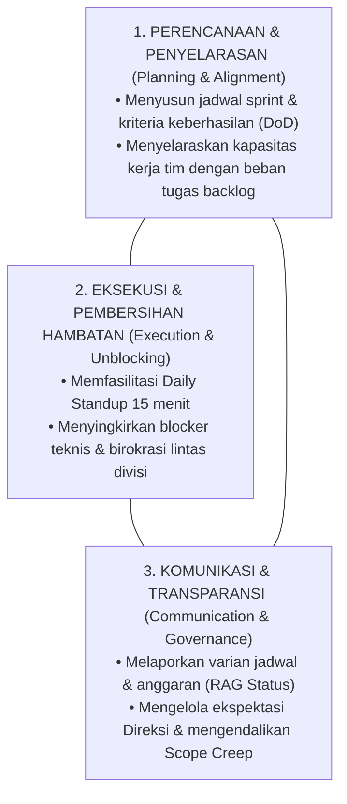
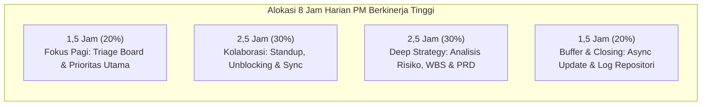

# Modul 13: Tanggung Jawab Harian Manajer Proyek (Daily Responsibilities of a Project Manager)

Bagi orang awam, deskripsi pekerjaan seorang Project Manager (PM) sering kali terasa abstrak. Berbeda dengan seorang dokter yang memeriksa pasien atau seorang programmer yang menulis baris kode Java, seorang PM tidak menghasilkan produk fisik dengan tangannya sendiri.

Lalu, apa sebenarnya yang dikerjakan oleh seorang Project Manager dari pukul 08.00 pagi hingga 17.00 sore?

Seorang PM bertanggung jawab penuh atas **ritme, kelancaran, dan arah hantaran nilai (*value delivery*)** dari seluruh tim. Tanggung jawab harian PM dapat dirangkum ke dalam satu kalimat: **Memastikan tim memiliki segala hal yang mereka butuhkan untuk bekerja tanpa hambatan, memastikan pemangku kepentingan selalu mendapat kepastian status yang jujur, dan memastikan proyek bergerak mendekati tujuannya setiap hari**.

---

## 1. Tiga Pilar Tanggung Jawab Harian PM



---

## 2. Membedakan "Busywork" vs "High-Leverage Work"

Banyak PM pemula merasa sangat lelah di akhir hari kerja, namun proyeknya tidak maju sama sekali. Hal ini terjadi karena mereka menghabiskan energi untuk pekerjaan sibuk (*busywork*) bernilai rendah:

| Kategori Aktivitas | Contoh Pekerjaan Sibuk Rendah Nilai (*Low-Leverage Busywork*) | Contoh Pekerjaan Berdampak Tinggi (*High-Leverage Work*) |
| :--- | :--- | :--- |
| **Pengelolaan Rapat** | Menghadiri 8 rapat yang tidak ada agendanya dan sekadar mendengarkan orang berdebat. | Membatalkan rapat status yang tidak perlu dan menggantinya dengan 1 memo pembaruan asinkron (*Async Status Memo*). |
| **Komunikasi Email/Chat**| Membalas puluhan pesan chat WhatsApp yang menanyakan hal-hal sepele secara instan sepanjang hari. | Mengunci 2 jam waktu fokus untuk membedah dokumen spesifikasi teknis (BRD) agar programmer tidak salah tafsir. |
| **Penanganan Masalah** | Menyelesaikan pekerjaan anggota tim yang malas atau lambat dengan mengerjakannya sendiri. | Melatih dan memberdayakan tim (*coaching*) agar mereka mandiri menyelesaikan masalah di masa depan. |
| **Manajemen Jadwal** | Menggeser-geser tanggal di bagan Gantt setiap kali ada tugas terlambat tanpa mencari tahu penyebabnya. | Melakukan analisis akar masalah (5 Whys) mengapa tugas tersebut terlambat dan memitigasi dependensinya. |

---

## 3. Template Distribusi Waktu Harian Ideal PM (Formula 8 Jam)



- **Prinsip Buffer 20%**: Jangan pernah menjadwalkan kalender Anda 100% penuh dengan rapat. Anda WAJIB menyisakan ruang jeda 90 menit setiap hari untuk menangani insiden tak terduga (*unexpected emergencies*) yang pasti muncul.

---

## 4. Studi Kasus Riil: Mengubah Ritme Harian PM SIMRS dari Reaktif Menjadi Proaktif

### Skenario Lapangan
- **Project Manager**: Dessy Rahmawati Chairullina, S.Kom.
- **Kondisi Awal yang Melelahkan**: Setiap hari Dessy datang ke rumah sakit langsung disambut telepon komplain dari kasir, dokter poli yang menagih perubahan form, dan tim pengembang yang bingung prioritas apa yang harus dikerjakan. Hari kerja habis hanya untuk "memadamkan kebakaran dadakan" (*firefighting mode*).

### Transformasi Rutinitas Harian yang Dijalankan:
1. **Mengunci Waktu "Golden Hour" Pukul 07.45 - 08.30 WIB**:
   - Mematikan notifikasi chat ponsel.
   - Meninjau log performa server semalam dan menetapkan **3 Prioritas Terpenting Hari Ini (*Top 3 Must-Win Priorities*)**.
2. **Disiplin Standup Pukul 08.30 - 08.45 WIB**:
   - Berdiri di depan papan Kanban. Mendeteksi 2 blocker: izin akses API VClaim dan keterlambatan review form resep.
   - PM berjanji menyelesaikan kedua blocker tersebut sebelum jam 11.30 WIB.
3. **Waktu Diplomasi & Unblocking Pukul 09.00 - 11.30 WIB**:
   - PM menemui Kepala Divisi IT dan Ketua Komite Medis secara langsung untuk menyelesaikan kedua izin tersebut.
4. **Waktu Deep Strategy Pukul 13.30 - 15.30 WIB**:
   - Merancang spesifikasi skema rekonsiliasi klaim BPJS tanpa gangguan rapat.
5. **Penutupan Harian Pukul 16.30 WIB**:
   - Mengisi log perubahan resmi di repositori GitHub dan mengirimkan ringkasan status hijau-kuning-merah ke grup pimpinan.
6. **Hasil**:
   - Stres kerja menurun drastis; proyek berjalan dengan predikat *Ahead of Schedule* (SPI = 1,08).

---

## 5. Actionable Checklist Tanggung Jawab Harian PM

```
[ ] 1. Mulai dengan Prioritas: Apakah Anda memulai hari kerja dengan menentukan 3 target paling penting sebelum membuka inbox pesan?
[ ] 2. Standup 15 Menit Tajam: Apakah standup pagi Anda fokus pada penyelesaian pekerjaan sprint dan pengungkapan blocker?
[ ] 3. Lindungi Deep Work: Apakah Anda mengunci minimal 90 menit setiap hari untuk berpikir strategis dan merancang dokumen proyek?
[ ] 4. Selesaikan Blocker Hari Ini: Apakah blocker yang menghambat pengembang telah Anda tangani sebelum akhir jam kerja?
[ ] 5. Penutupan Disiplin: Apakah Anda mencatat hasil kemajuan dan memperbarui papan pelacakan sebelum meninggalkan meja kerja?
```
