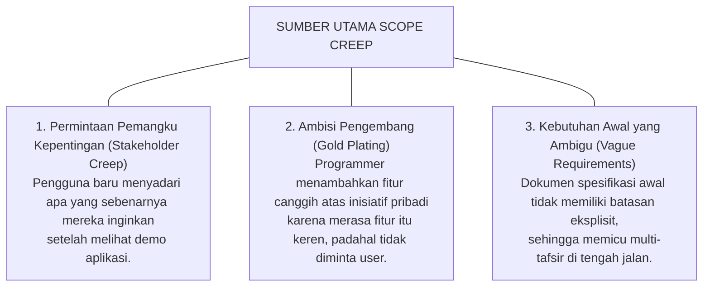
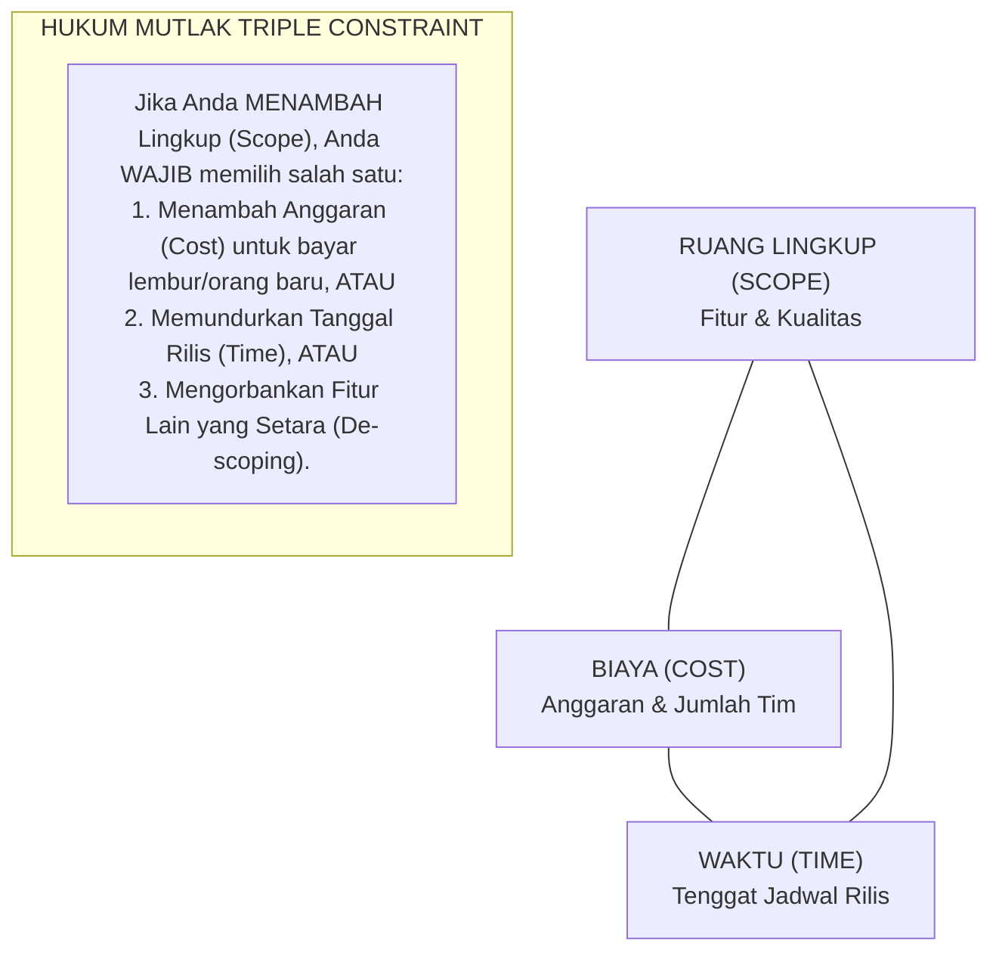
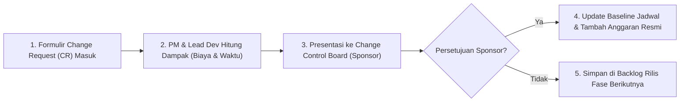

# Modul 14: Cara Mengelola dan Mencegah Scope Creep (Managing & Preventing Scope Creep)

Dalam dunia manajemen proyek, tidak ada monster yang lebih mematikan bagi jadwal dan anggaran selain **Scope Creep**. Scope Creep adalah fenomena di mana ruang lingkup proyek terus bertambah, melebar, dan bermutasi secara perlahan tanpa disertai penambahan anggaran, waktu, atau sumber daya yang sebanding.

Scope Creep jarang sekali datang dalam bentuk permintaan raksasa yang langsung terlihat berbahaya. Ia datang menyamar dalam bentuk kalimat-kalimat manis yang terdengar sepele:
- *"Mbak, cuma tambah 1 kolom tanggal kecil di form ini kok, gampang kan?"*
- *"Mas, bisa sekalian ditambahkan tombol ekspor Excel warna biru di pojok kanan?"*
- *"Dokter minta sekalian ada grafik tren gula darah otomatis di layar rawat jalan."*

Ketika Anda mengiyakan permintaan-permintaan kecil ini tanpa kendali resmi, satu tombol kecil beranak menjadi 10 kolom baru, menuntut modifikasi pada 5 tabel database, merusak logika validasi lama, dan tiba-tiba proyek Anda molor 2 bulan dengan anggaran yang tekor.

---

## 1. Tiga Sumber Utama Pemicu Scope Creep



---

## 2. Segitiga Emas Triple Constraint: Hukum Fisika Proyek

Anda tidak bisa mengubah satu sisi dari segitiga proyek tanpa mempengaruhi sisi lainnya:



---

## 3. Seni Berkata "Ya, Dan..." (*The Diplomatic Trade-Off*)

Seorang PM hebat tidak pernah berkata secara kasar: *"Tidak bisa, itu di luar kontrak!"* Hal tersebut membuat pemangku kepentingan merasa diabaikan dan memicu perselisihan politik.

Gunakan teknik **"Yes, and..." (Penyelarasan Konsekuensi)**:

| Apa yang Dikatakan Pengguna | Respon PM yang Salah (Konfrontatif) | Respon PM Berkelas Dunia ("Yes, and...") |
| :--- | :--- | :--- |
| *"Tolong tambahkan fitur cetak grafik riwayat tensi pasien di form poli ya."* | *"Tidak bisa Dok! Itu di luar kesepakatan awal, kita tidak punya waktu!"* | *"Idenya sangat bagus Dok, ini akan sangat membantu analisis klinis! Kami bisa memasukkan fitur ini, **dan** konsekuensinya adalah kita butuh 4 hari tambahan yang memundurkan rilis poli ke minggu depan, **atau** kita jadwalkan fitur ini sebagai prioritas nomor satu tepat di hari pertama setelah go-live. Menurut Dokter, opsi mana yang paling ideal?"* |

Dengan membingkai percakapan seperti ini, Anda tidak pernah menolak ide mereka; Anda hanya **mengembalikan keputusan trade-off ke tangan mereka**. Sering kali, mereka sendiri yang akan memilih menunda fitur tersebut demi mengejar tanggal rilis.

---

## 4. Alur Formal Pengendalian Perubahan (*Change Control Process*)

Ketika ada permintaan perubahan yang memang benar-benar krusial bagi bisnis, jalankan alur **Change Control Board (CCB)**:



---

## 5. Studi Kasus Riil: Menaklukkan 18 Permintaan Perubahan pada Modul IGD

### Latar Belakang Kasus
- **Proyek**: Digitalisasi Lembar Asesmen Triase Gawat Darurat RS Indriati.
- **Tantangan**: H-7 sebelum pelatihan staf, Komite Medis menyerahkan dokumen berisi **18 formulir asesmen tambahan** (seperti asesmen nyeri komprehensif, skrining jatuh Morse, dan form riwayat alergi khusus).
- **Risiko**: Tim pengembang panik dan menyatakan butuh waktu 1 bulan tambahan jika seluruh form harus dikerjakan.

### Manuver Manajemen oleh Lead PM (Dessy Rahmawati Chairullina):
1. **Triase MoSCoW Bersama Ketua Komite Medis**:
   - Duduk bersama dalam sesi 30 menit membedah 18 permintaan tersebut.
2. **Kategorisasi Objektif**:
   - **Must-Have (3 Form)**: Asesmen Triase Standar, Skrining Alergi Obat, dan Vital Signs Kritis. Ini wajib ada demi keselamatan nyawa pasien (*Patient Safety*).
   - **Should-Have / Could-Have (15 Form)**: Form asesmen spiritual, status ekonomi, dan kuesioner tambahan. Seluruhnya dipindahkan ke jadwal rilis Fase 2.
3. **Hasil**:
   - Tanggal peluncuran IGD tetap terlaksana 100% tepat waktu.
   - Komite Medis puas karena 3 kebutuhan paling vital mereka diakomodasi, dan 15 kebutuhan lainnya telah memiliki jadwal rilis resmi yang terdaftar di roadmap sistem.

---

## 6. Actionable Checklist Pengendalian Scope Creep

```
[ ] 1. Scope Baseline Terkunci: Apakah piagam lingkup awal telah ditandatangani dan dibagikan ke seluruh pimpinan sebelum pengerjaan sprint?
[ ] 2. Larang Gold Plating: Apakah Anda telah mengingatkan tim pengembang untuk tidak menambahkan fitur di luar tiket Jira tanpa persetujuan PM?
[ ] 3. Terapkan Change Request Form: Apakah setiap permintaan fitur baru diwajibkan mengisi dokumen tertulis yang mencantumkan alasan bisnisnya?
[ ] 4. Kuasai Seni Trade-Off: Ketika ada permintaan baru masuk, apakah Anda selalu menyajikan konsekuensi biaya dan waktu dengan elegan?
[ ] 5. Pelihara Backlog Fase 2: Apakah Anda memiliki tempat penampungan resmi untuk ide-ide hebat pengguna agar mereka tahu usulannya tidak dibuang?
```
