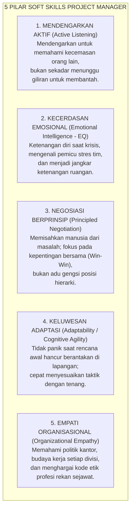
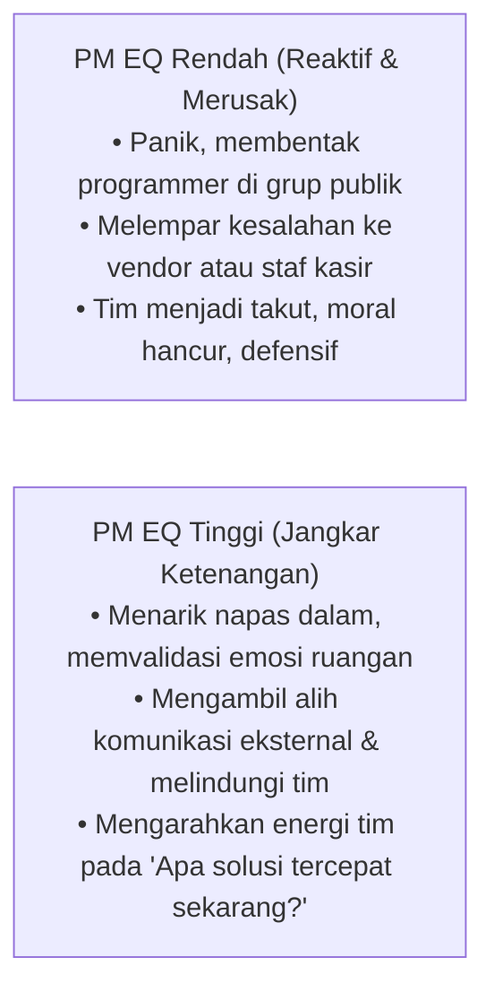

# Modul 15: Pentingnya Soft Skills dalam Proyek (The Power of Soft Skills in Delivery)

Ada sebuah miskonsepsi besar di kalangan profesional teknologi: banyak yang meyakini bahwa Project Manager (PM) terhebat adalah orang yang paling menguasai rumus formula spreadsheet yang rumit, paling mahir mengonfigurasi perangkat lunak Jira, atau paling paham sintaks koding database.

Keahlian teknis (*hard skills*) memang penting sebagai tiket masuk awal. Namun data industri dari *Project Management Institute (PMI)* dan riset Google membuktikan fakta mengejutkan: **Lebih dari 80% kegagalan proyek di dunia disebabkan oleh kegagalan komunikasi, perselisihan kepribadian, pudarnya motivasi tim, dan ketidakmampuan bernegosiasi—semuanya bermuara pada Ketiadaan Soft Skills**.

Seorang PM menghabiskan **90% jam kerjanya untuk berkomunikasi dengan manusia**. Keahlian teknis menentukan *apa* yang kita bangun, namun soft skills menentukan *apakah* proyek tersebut benar-benar berhasil diselesaikan dan dicintai oleh penggunanya.

---

## 1. Lima Soft Skills Inti Project Manager Kelas Dunia



---

## 2. Mendengarkan Aktif: Menangkap Apa yang "Tidak Terucap"

Dalam rapat proyek, hal terpenting sering kali adalah **apa yang tidak diucapkan secara lisan** (*reading between the lines*):

| Apa yang Dikatakan Pengguna / Dokter | Apa yang Sebenarnya Mereka Rasakan (Subteks) | Respon Soft Skill PM yang Tepat |
| :--- | :--- | :--- |
| *"Sistem baru ini membingungkan sekali."* | *"Saya takut terlihat gaptek dan lambat di depan pasien dan rekan kerja saya."* | Tawarkan pelatihan pendampingan privat 1-on-1 dengan suasana santai tanpa dihakimi. |
| *"Kami terlalu sibuk untuk menghadiri testing besok."* | *"Kami merasa waktu kami tidak dihargai karena sesi testing kemarin banyak waktu terbuang sia-sia."* | Rancang sesi testing super ringkas (maksimal 15 menit) dengan skenario yang sudah siap pakai. |
| *"Terserah tim IT saja bagaimana baiknya."* | *"Saya merasa masukan saya selama ini diabaikan, jadi saya menyerah dan lepas tangan."* | Ajak berbicara berdua saat minum kopi: *"Dok, kami sengaja belum menyelesaikan form ini karena perspektif klinis Dokter adalah yang paling kami butuhkan."* |

---

## 3. Kecerdasan Emosional (EQ) di Bawah Tekanan Krisis

Saat server mati (*system outage*) pada jam sibuk, atau ketika Direksi melayangkan teguran keras, seorang PM dengan EQ tinggi menunjukkan karakteristik pembeda:



---

## 4. Studi Kasus Riil: Mendamaikan Sengketa Panas Antara Dokter Bedah dan Kepala Perawat

### Skenario Lapangan
- **Proyek**: Penerapan Formulir Digital *Surgical Safety Checklist* (Keselamatan Pasien Operasi) RS Indriati.
- **Konflik Meledak**:
  - Kepala Perawat Kamar Operasi (OK) menolak menandatangani form jika dokter spesialis bedah belum mencentang verifikasi lokasi sayatan.
  - Dokter Spesialis Bedah Senior marah besar: *"Saya ini operator bedah utama, bukan anak magang yang harus dicentang-centang perawat! Jangan buang waktu saya di depan meja operasi!"*
  - Suasana kamar operasi tegang; proyek digitalisasi checklist keselamatan terancam dibatalkan.

### Intervensi Soft Skills oleh PM (Dessy Rahmawati Chairullina):
1. **Pemisahan Pihak Bertikai & Active Listening Privat**:
   - PM tidak mengonfrontasi dokter di depan perawat.
   - PM menemui dokter bedah di ruang istirahat dokter secara privat, mendengarkan keluh kesahnya tentang betapa tingginya tekanan mental sebelum operasi dimulai.
   - PM memvalidasi keahlian dokter: *"Dokter, kami sangat paham bahwa konsentrasi Dokter sepenuhnya tertuju pada keselamatan nyawa pasien di meja operasi."*
2. **Reframing Tujuan Bersama (*Superordinate Goal*)**:
   - PM menjelaskan bahwa checklist digital ini bukan untuk menguji kompetensi dokter, melainkan sebagai **Perisai Hukum Malpraktik (*Legal Shield*)**:
   - *"Dok, jika di masa depan ada tuntutan hukum dari pihak luar terkait operasi, dokumen checklist digital bertanda tangan elektronik ini adalah bukti hukum tak terbantahkan bahwa Dokter telah menjalankan standar keselamatan internasional 100% sempurna."*
3. **Penyelarasan Ergonomis (Desain Tombol 2 Detik)**:
   - Form disederhanakan: Perawat yang membacakan checklist secara lisan, dokter cukup mengonfirmasi suara dan menempelkan sidik jari (*fingerprint scan*) selama 2 detik sebelum insisi.
4. **Hasil**:
   - Dokter bedah menerima solusi tersebut dengan lapang dada.
   - Hubungan antara perawat kamar bedah dan dokter kembali harmonis.
   - Kepatuhan pengisian *Surgical Safety Checklist* mencapai 100% dan mendapat pujian dalam audit akreditasi rumah sakit.

---

## 5. Actionable Checklist Soft Skills untuk PM

```
[ ] 1. Praktik Jeda 3 Detik: Ketika menerima kritik pedas atau kabar buruk, apakah Anda membiasakan diri mengambil jeda 3 detik sebelum merespons?
[ ] 2. Validasi Emosi Lawan Bicara: Apakah Anda mengakui perasaan orang lain ("Saya paham kekhawatiran Anda...") sebelum memaparkan argumen data Anda?
[ ] 3. Bahasa Inklusif "KITA": Apakah Anda menggunakan kata "Kita" alih-alih "Kalian" saat membahas tantangan yang dihadapi proyek?
[ ] 4. Baca Bahasa Tubuh: Dalam rapat, apakah Anda mengamati kontak mata, nada suara, dan gestur peserta untuk mendeteksi penolakan terselubung?
[ ] 5. Berikan Apresiasi Personal: Apakah Anda meluangkan waktu untuk menyampaikan terima kasih yang tulus atas kerja keras rekan kerja hari ini?
```
