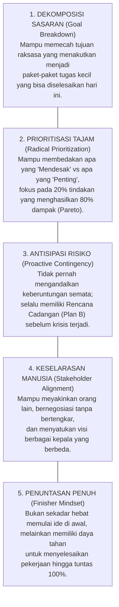
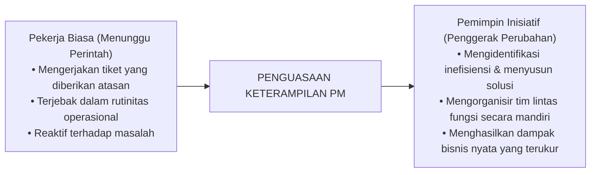

# Modul 16: Mengapa Anda Membutuhkan Keterampilan Manajemen Proyek (Why PM Skills are Universal Life & Career Skills)

Banyak orang mengira bahwa keterampilan manajemen proyek (*Project Management Skills*) hanya dibutuhkan oleh orang-orang yang memiliki kata "Project Manager" di kartu nama mereka. 

Ini adalah kekeliruan besar. Di dunia modern yang bergerak cepat dan penuh ketidakpastian, **manajemen proyek adalah keterampilan hidup universal (*Universal Life Skill*)**. 

Pikirkan tentang kehidupan Anda: merencanakan pernikahan, merenovasi rumah, menyusun skripsi atau tesis, merombak alur pelayanan di klinik, atau meluncurkan kampanye media sosial—semuanya memiliki awal, akhir, sumber daya terbatas, dan tujuan tertentu. **Semuanya adalah PROYEK**.

Orang yang menguasai keterampilan manajemen proyek mampu mengubah ide-ide abstrak yang mengambang di kepala menjadi kenyataan nyata yang terstruktur dan terukur.

---

## 1. Lima Keterampilan PM yang Mengubah Produktivitas Siapa Pun



---

## 2. Mengapa Keterampilan PM Kebal Terhadap Otomatisasi AI?

Di era kecerdasan buatan (*Artificial Intelligence*), pekerjaan teknis yang sifatnya berulang—menulis kode dasar, membuat formula spreadsheet, atau menyusun draf email—dapat dilakukan oleh AI dalam hitungan detik.

Namun, **AI tidak pernah bisa menggantikan keterampilan kepemimpinan proyek**:
- AI tidak bisa menatap mata dokter senior yang sedang marah di IGD dan menenangkannya dengan empati.
- AI tidak bisa merasakan ketakutan tersembunyi seorang perawat yang cemas kehilangan pekerjaannya karena sistem baru.
- AI tidak bisa bernegosiasi di ruang dewan untuk menyatukan dua kepentingan politik direksi yang saling bertolak belakang.

Keterampilan manajemen proyek adalah keterampilan yang berakar pada **Kemanusiaan (*Humanity*), Diplomasi, dan Penghantaran Nilai**.

---

## 3. Dari Pelaksana Menjadi Pemimpin: Efek Pengungkit PM

Bagi profesional di bidang apa pun—akuntan, dokter, desainer grafis, analis data, atau staf administrasi—mempelajari manajemen proyek adalah jalan pintas tercepat untuk bertransisi dari seorang "pelaksana instruksi" menjadi seorang **"pemimpin inisiatif strategis"**:



---

## 4. Studi Kasus Riil: Transformasi Staf Farmasi Menjadi Koordinator Logistik Melalui Prinsip PM

### Skenario Lapangan
- **Profil**: Rina, staf logistik farmasi RS Indriati dengan latar belakang D3 Farmasi.
- **Masalah Lapangan**: Gudang obat sering kehabisan stok obat antibiotik kritis saat akhir pekan karena pemesanan ke distributor dilakukan secara mendadak berdasarkan ingatan visual.
- **Langkah Inisiatif yang Dijalankan Rina (Menerapkan Pola Pikir PM)**:
  1. **Mendefinisikan Masalah & Metrik (Scope & Metrics)**: Menargetkan *Stock-Out Rate* antibiotik turun dari 12% menjadi 0%.
  2. **Membuat WBS Sederhana**: Memecah proyek penataan stok menjadi 3 tahap: (a) Pengelompokan obat metode ABC/Fast-Moving; (b) Penetapan angka stok aman minimum (*Buffer Stock*); (c) Pembuatan jadwal pemesanan otomatis ke vendor setiap hari Selasa.
  3. **Manajemen Stakeholder**: Rina mempresentasikan alur ini kepada Kepala Instalasi Farmasi dan Manajer Keuangan dengan tabel perbandingan biaya pengadaan darurat vs terencana.
- **Hasil**:
  - Kejadian kehabisan obat antibiotik turun menjadi **0%** selama 6 bulan berturut-turut.
  - Rumah sakit menghemat biaya pembelian obat darurat sebesar Rp 65 Juta.
  - Rina dipromosikan menjadi **Koordinator Pengadaan & Logistik Terpadu**, membuktikan bahwa pola pikir manajemen proyek mengangkat nilai karier siapa pun terlepas dari posisinya.

---

## 5. Actionable Checklist Keterampilan Hidup PM

```
[ ] 1. Perlakukan Sasaran sebagai Proyek: Apakah target pribadi atau pekerjaan Anda memiliki tanggal tenggat resmi dan kriteria sukses terukur?
[ ] 2. Dekomposisi Tugas Hari Ini: Apakah Anda telah memecah proyek besar minggu ini menjadi tugas-tugas kecil yang dapat diselesaikan dalam 30 menit?
[ ] 3. Identifikasi Risiko Pribadi: Apakah Anda sudah menyiapkan rencana mitigasi jika hal terburuk terjadi pada pekerjaan Anda besok?
[ ] 4. Komunikasi Proaktif: Apakah Anda selalu memberikan kabar pembaruan status kepada pihak berkepentingan sebelum mereka menanyakannya kepada Anda?
[ ] 5. Berhenti Berasumsi, Validasi dengan Data: Apakah keputusan yang Anda ambil hari ini didasarkan pada fakta obyektif, bukan sekadar perasaan atau kebiasaan lama?
```
