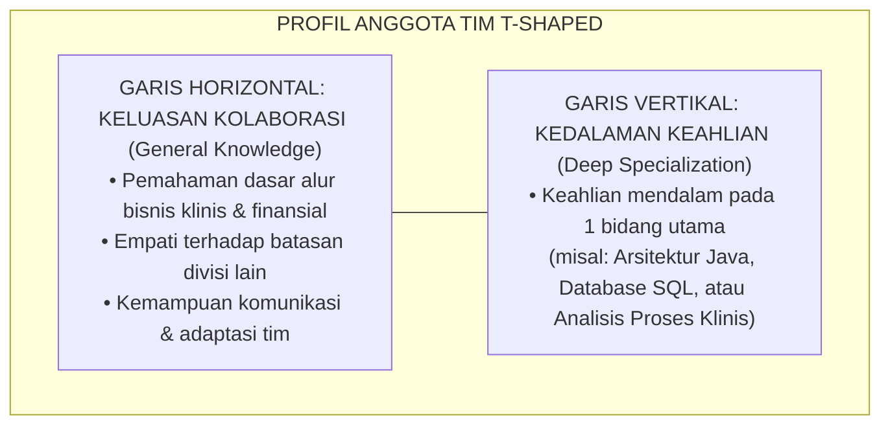
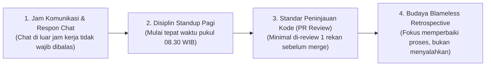

# Modul 17: Cara Memilih Anggota Tim yang Tepat dan Bekerja Sama (Team Selection & Collaboration)

Salah satu keputusan paling krusial yang menentukan takdir sebuah proyek bahkan sebelum hari pertama sprint dimulai adalah **Siapa orang-orang yang Anda pilih untuk masuk ke dalam tim Anda**.

Banyak Project Manager (PM) pemula melakukan kesalahan fatal dengan hanya melihat daftar riwayat hidup teknis (*hard skills checklist*). Mereka merekrut orang-orang yang paling pintar secara individual, namun lupa menilai kemampuan kolaborasi, empati, dan kecocokan budaya (*cultural fit*). 

Kumpulan orang-orang jenius yang tidak bisa bekerja sama bukanlah sebuah tim; mereka adalah bom waktu politik yang siap meledak di tengah krisis proyek.

---

## 1. Konsep Talenta "T-Shaped": Standar Emas Anggota Tim Modern

Dalam tim proyek berkinerja tinggi, kita mencari individu yang memiliki profil keahlian **T-Shaped**:



- **I-Shaped Person (Spesialis Sempit)**: Sangat ahli di satu bidang teknis, namun menolak peduli pada hal lain (*"Tugas saya cuma nulis query, saya tidak peduli formnya lambat di kasir"*).
- **T-Shaped Person (Kolaborator Ideal)**: Sangat ahli di bidangnya, namun memiliki rasa kepemilikan atas keberhasilan seluruh sistem (*"Meskipun saya backend developer, mari saya bantu periksa alur UX form kasir agar staf tidak salah klik"*).

---

## 2. Waspadai "The Brilliant Jerk"

Dalam bukunya *No Rules Rules*, CEO Netflix Reed Hastings menekankan bahaya merekrut individu yang sangat pintar secara teknis namun memiliki kepribadian toksik (*The Brilliant Jerk*):

```
+-----------------------------------------------------------------------------------+
|                  DAMPAK BURUK 'THE BRILLIANT JERK' PADA TIM                       |
+-----------------------------------------------------------------------------------+
| 1. MEMBUNUH KEAMANAN PSIKOLOGIS: Anggota tim lain menjadi takut berpendapat atau   |
|    mengakui kebingungan karena takut diejek atau direndahkan.                    |
| 2. MENCIPTAKAN BOTTLENECK INFORMASI: Mereka sering menimbun pengetahuan teknis    |
|    sendiri (*information hoarding*) agar merasa tidak tergantikan.                |
| 3. MERUSAK RETENSI TALENTA: Anggota tim yang baik dan berpotensi akan memilih     |
|    mengundurkan diri karena lelah menghadapi arogansi rekan kerjanya.             |
|                                                                                   |
| PRINSIP PM: Lebih baik merekrut seseorang dengan keahlian teknis 80% namun       |
| memiliki etos kerja dan empati 100%, daripada merekrut orang dengan teknis 100%   |
| tetapi menjadi racun bagi keharmonisan tim.                                       |
+-----------------------------------------------------------------------------------+
```

---

## 3. Matriks Keterampilan Tim (*Team Skills Matrix*)

Sebelum menugaskan pekerjaan, petakan seluruh keterampilan anggota ke dalam matriks transparan:

| Nama Anggota | Keahlian Utama (Primary) | Keahlian Pendukung (Secondary) | Minat Belajar (Growth Area) | Peran di Skuad |
| :--- | :--- | :--- | :--- | :--- |
| **Dessy** | Manajemen Proyek & Analisis Proses Bisnis | Arsitektur Database SQL & Interoperabilitas | Eksekutif C-Suite Influence | Lead PM / Product Owner |
| **Rian** | Pemrograman Backend Java | REST API & Security Auditing | Optimasi Query Skema Besar | Senior Backend Engineer |
| **Siti** | Penjaminan Mutu (QA Testing) | Dokumentasi Klinis & UAT Manual | Automated Integration Testing | QA & Compliance Lead |
| **dr. Hendra**| Pengalaman Klinis Rawat Inap | Regulasi Akreditasi Medis | Desain Antarmuka Pengguna | Clinical Domain Advisor |

---

## 4. Piagam Kerja Sama Tim (*Team Working Agreement*)

Di awal pembentukan tim (*Forming stage*), buatlah kesepakatan tertulis bersama mengenai aturan main operasional:



---

## 5. Studi Kasus Riil: Menyusun Skuad Khusus Transformasi Rekam Medis Elektronik

### Latar Belakang Kasus
- **Tantangan**: Membangun modul Rekam Medis Elektronik (RME) yang kompleks dalam waktu 10 minggu di RS Indriati.
- **Masalah Seleksi Tim**: Jika hanya mengandalkan programmer murni, aplikasi akan sulit digunakan perawat. Jika hanya mengandalkan perawat, mereka tidak memahami batasan arsitektur database.

### Pembentukan Skuad Silang oleh PM (Dessy Rahmawati Chairullina):
1. **Membentuk "Cross-Functional Triad"**:
   - Setiap sub-modul (misal: Modul Resep Obat) ditangani oleh satu unit kecil beranggotakan 3 orang: **1 Developer Backend + 1 QA Tester + 1 Perwakilan Staf Farmasi Lapangan**.
2. **Keterlibatan Pengguna Sejak Hari Pertama**:
   - Staf farmasi bukan sekadar "penguji di akhir", melainkan dilibatkan saat perancangan wireframe form awal.
3. **Penyelarasan Nilai Bersama**:
   - Tim menandatangani *Working Agreement* untuk tidak saling menunjuk ketika terjadi bug saat uji coba.
4. **Hasil**:
   - Tidak ada revisi besar di akhir proyek (*Zero Major Rework*).
   - Aplikasi selesai 10 hari lebih cepat dari jadwal awal karena seluruh kesalahpahaman alur bisnis sudah terdeteksi dan diselesaikan di awal oleh tim lintas disiplin tersebut.

---

## 6. Actionable Checklist Pemilihan Tim & Kolaborasi

```
[ ] 1. Audit Karakter & Empati: Saat wawancara calon anggota tim, apakah Anda menguji bagaimana cara mereka merespons kesalahan dan kritik rekan kerja?
[ ] 2. Cari Talenta T-Shaped: Apakah tim Anda memiliki anggota yang mau membantu bidang di luar keahlian sempitnya saat rekan lain terhambat?
[ ] 3. Buat Team Working Agreement: Apakah tim Anda sudah memiliki piagam aturan main kerja bersama yang disepakati secara tertulis?
[ ] 4. Pemetaan Keterampilan Transparan: Apakah Anda memiliki Skills Matrix untuk mengidentifikasi area mana yang kekurangan tenaga ahli (*single point of failure*)?
[ ] 5. Rayakan Keberhasilan Bersama: Apakah Anda secara teratur merayakan keberhasilan kecil tim untuk memperkuat ikatan emosional dan rasa saling percaya?
```
