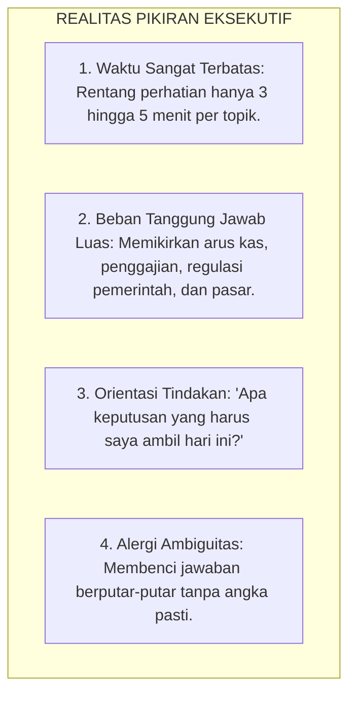
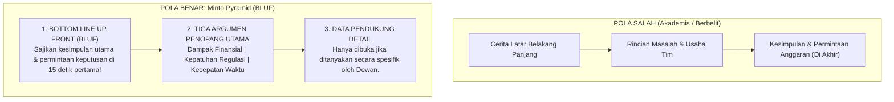

# Modul 18: Cara Terbaik Berkomunikasi dengan Eksekutif (Mastering Executive Communication)

Bagi seorang Project Manager (PM), momen mempresentasikan laporan kemajuan di hadapan pimpinan puncak (*Chief Executive Officer, Chief Financial Officer, Direktur Utama, Dewan Komisaris*) sering kali menjadi momen yang paling menegangkan.

Banyak PM berbakat gagal di ruang dewan bukan karena proyek mereka buruk, melainkan karena **mereka berbicara dengan bahasa yang salah**. PM teknis cenderung memaparkan seluruh proses panjang, detail konfigurasi server, atau tumpukan tiket bug yang telah diselesaikan. Di mata eksekutif yang memikul tanggung jawab kelangsungan hidup seluruh institusi, laporan seperti itu terasa bertele-tele dan tidak bernilai.

Eksekutif tidak membeli proses teknis Anda; mereka membeli **Kepastian Hasil Bisnis (*Business Outcomes*)**, **Perlindungan Terhadap Risiko Hukum & Finansial**, dan **Efisiensi Penggunaan Modal**.

---

## 1. Memahami Dunia & Pola Pikir Eksekutif (C-Suite Mindset)

Sebelum Anda membuka mulut di hadapan dewan direksi, pahami realitas dunia yang mereka hadapi:



---

## 2. Struktur Komunikasi: Piramida Barbara Minto (BLUF)

Metode komunikasi tradisional yang diajarkan di bangku sekolah (Latar belakang $\rightarrow$ Analisis $\rightarrow$ Kesimpulan) adalah racun dalam rapat eksekutif. Gunakan prinsip **Barbara Minto (McKinsey)** yang membalik struktur tersebut:



---

## 3. Kamus Terjemahan: Bahasa Programmer ke Bahasa Direksi

| Apa yang Dipikirkan PM Teknis | Apa yang Seharusnya Dikatakan ke Direksi |
| :--- | :--- |
| *"Database kita sering mengalami deadlock saat jam 8 pagi karena query tidak terindeks."* | *"Sistem pendaftaran pagi mengalami perlambatan yang berisiko menahan antrean 200 pasien; kami butuh persetujuan maintenance 1 jam malam ini untuk mengamankan kelancaran pelayanan besok."* |
| *"Modul bridging SatuSehat sudah selesai lolos testing JSON endpoint."* | *"Rumah sakit kita 100% aman dari ancaman penalti pencabutan izin operasional dari Kementerian Kesehatan."* |
| *"Kami berhasil memangkas 40 story points di sprint ini."* | *"Efisiensi throughput tim naik 35% tanpa ada penambahan biaya pengeluaran gaji baru."* |

---

## 4. Dua Aturan Emas Menjawab Pertanyaan Dewan

1. **Jawab "YA" atau "TIDAK" Terlebih Dahulu**:
   - Jika Direktur bertanya: *"Apakah modul ini siap diluncurkan tanggal 1 Desember?"*
   - Jangan menjawab dengan dongeng: *"Begini Pak, kemarin tim server sempat ada kendala teknis..."*
   - Jawablah: *"**YA**, siap diluncurkan tepat waktu, dengan catatan pengujian keamanan vendor selesai besok sore."*
2. **Kejujuran Intelektual Saat Tidak Tahu**:
   - Jangan pernah mengarang data di depan Direksi! Jika Anda tidak memiliki angkanya, katakan dengan tenang:
   - *"Saya tidak ingin memberikan estimasi yang keliru kepada Dewan. Saya akan memverifikasi angka pastinya dengan tim akuntansi dan mengirimkan memo tertulis ke meja Bapak sebelum pukul 14.00 hari ini."*

---

## 5. Studi Kasus Riil: Presentasi 5 Menit Penyelamatan Anggaran Server RS Indriati

### Skenario Lapangan
- **Tantangan**: Meminta persetujuan mendadak penambahan anggaran belanja modal Rp 45.000.000 untuk pengadaan server failover bridging BPJS di tengah rapat anggaran dewan yang sangat ketat.
- **Presenter**: Dessy Rahmawati Chairullina, S.Kom (Lead BA / PM).

### Naskah Penyampaian 3 Menit oleh Dessy:
> *"Selamat pagi Bapak Direktur Utama dan Ibu Direktur Keuangan.
> 
> Kehadiran saya pagi ini membawa satu tujuan utama: **Mengamankan arus kas piutang klaim BPJS rumah sakit senilai Rp 1,4 Miliar per bulan** agar tidak terhenti akibat insiden server down.
> 
> Saat ini, sistem penerbitan SEP BPJS kita hanya bertumpu pada 1 server tunggal yang telah berusia 5 tahun. Jika server ini mengalami kegagalan teknis pada hari kerja, antrean pendaftaran 600 pasien akan terhenti total dalam 10 menit, memicu penumpukan loket fisik dan risiko penolakan klaim akibat keterlambatan penerbitan surat eligibilitas.
> 
> Kami telah menyiapkan solusi mitigasi berupa pengadaan unit server failover otomatis dengan investasi satu kali sebesar **Rp 45 Juta**. Investasi ini memiliki rasio perlindungan risiko 31 kali lipat dibandingkan potensi kerugian tertahannya klaim bulanan kita. 
> 
> Kami memohon pengesahan Dewan hari ini agar instalasi selesai sebelum audit akreditasi faskes minggu depan."*

### Respon Dewan:
Direktur Utama langsung mengetuk palu menyetujui anggaran dalam waktu 4 menit tanpa keberatan, karena proposal disajikan bukan sebagai beban biaya komputer, melainkan sebagai **asuransi perlindungan pendapatan institusi**.

---

## 6. Actionable Checklist Komunikasi Eksekutif

```
[ ] 1. Terapkan Prinsip BLUF: Apakah pesan utama dan permintaan tindakan Anda sudah disampaikan pada 30 detik pertama presentasi?
[ ] 2. Eliminasi Jargon Teknis: Apakah seluruh singkatan teknis internal (API, SQL, CI/CD, JSON) telah diganti menjadi terminologi bisnis dan finansial?
[ ] 3. Dashboard Satu Lembar: Apakah ringkasan status proyek Anda dapat dibaca dan dipahami dalam 1 halaman tanpa harus scrolling?
[ ] 4. Siapkan Lembar Lampiran (Appendix): Apakah data mentah dan detail metodologi telah dipisahkan ke slide lampiran belakang jika sewaktu-waktu diaudit?
[ ] 5. Latihan Jawaban Langsung: Apakah Anda sudah melatih diri untuk menjawab pertanyaan dewan dengan pola "Jawaban Langsung ➔ Fakta Pendukung"?
```
