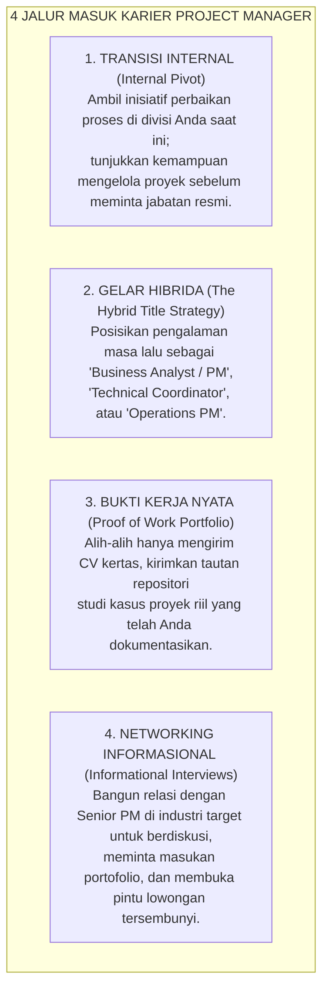
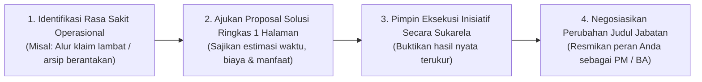
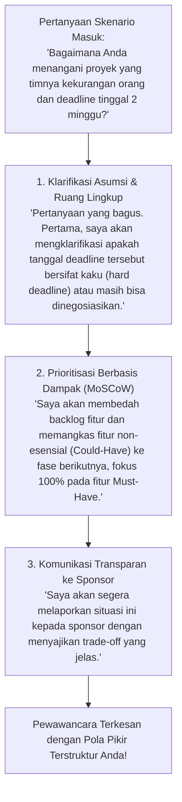

# Modul 19: Tips Mendapatkan Pekerjaan PM Pertama Anda (Landing Your First Project Manager Job)

Bagi calon Project Manager (PM), rintangan terbesar sering kali muncul di awal perjalanan karier dalam bentuk paradoks klasik:
> *"Semua lowongan pekerjaan PM mensyaratkan pengalaman minimal 2-3 tahun, tetapi bagaimana saya bisa punya pengalaman jika tidak ada perusahaan yang mau memberi saya pekerjaan PM pertama?"*

Kenyataannya, ribuan profesional setiap tahun berhasil menembus paradoks ini dan mendapatkan posisi Project Manager atau Associate PM pertama mereka. Mereka tidak berhasil karena keberuntungan semata; mereka berhasil karena menerapkan **Strategi Pemosisian Karier yang Tepat (*Strategic Career Positioning*)**.

---

## 1. Empat Pintu Masuk Menuju Pekerjaan PM Pertama



---

## 2. Strategi Transisi Internal: Jalan Tol Menuju PM

Jalur tercepat dan paling minim risiko untuk menjadi PM adalah **melalui perusahaan tempat Anda bekerja saat ini**:



Pemberi kerja saat ini sudah mengenal integritas dan budaya kerja Anda, sehingga jauh lebih mudah bagi mereka untuk memberi Anda kepercayaan memimpin proyek daripada bagi perusahaan asing yang belum mengenal Anda.

---

## 3. Optimasi Profil LinkedIn & Resume Ramah ATS

Sistem pelacak pelamar (*Applicant Tracking System - ATS*) dan rekruter manusia memindai ratusan resume setiap hari dalam hitungan detik:

```
+-----------------------------------------------------------------------------------+
|               CHECKLIST OPTIMASI CV & LINKEDIN UNTUK CALON PM                     |
+-----------------------------------------------------------------------------------+
| 1. KATA KUNCI ATS WAJIB: Sertakan istilah standar industri: 'Agile/Scrum',        |
|    'Sprint Planning', 'Risk Mitigation', 'Stakeholder Management', 'WBS',         |
|    'User Acceptance Testing (UAT)', dan 'Budget Forecasting'.                     |
| 2. GANTI NADA KALIMAT KE GOOGLE XYZ: Ubah 'Bertanggung jawab atas...' menjadi      |
|    'Meningkatkan efisiensi [X] sebesar [Y]% dengan mengimplementasikan [Z]'.      |
| 3. TAUTKAN BUKTI PORTOFOLIO: Letakkan tautan GitHub / Notion studi kasus proyek    |
|    langsung di bagian atas di bawah nama dan kontak Anda.                         |
| 4. HEADLINE LINKEDIN YANG JELAS: Jangan menulis 'Aspiring PM'. Tuliskan:          |
|    'Project Manager | Business Analyst | Healthcare & Enterprise Systems'.        |
+-----------------------------------------------------------------------------------+
```

---

## 4. Menguasai Sesi Wawancara PM Pertama

Ketika Anda berhasil dipanggil wawancara, pewawancara ingin menguji **Cara Berpikir (*Thinking Process*)** Anda, bukan hafalan teori Anda:



---

## 5. Studi Kasus Riil: Menembus Posisi Lead PM Melalui Portofolio Terbuka

### Latar Belakang Kasus
- **Kandidat**: Dessy Rahmawati Chairullina, S.Kom.
- **Tantangan**: Membuktikan kompetensi di industri teknologi kesehatan tingkat enterprise.
- **Taktik yang Mengantarkan Kemenangan**:
  - Alih-alih hanya mengklaim memiliki sertifikat, Dessy membangun dokumentasi portofolio komprehensif yang membedah kurikulum **Google Project Management Certificate** dan mengaitkannya secara mendalam dengan **8 Studi Kasus Riil SIMRS RS Indriati**.
  - Saat sesi wawancara, ketika ditanya tentang penanganan regulasi kementerian, Dessy langsung membuka arsitektur JSON HL7 FHIR SatuSehat dan formula enkripsi BPJS yang telah didokumentasikan rapi di GitHub.
- **Hasil**: Tim pewawancara terpukau oleh kedalaman teknis dan ketelitian manajemen yang disajikan, mengunci tawaran pekerjaan dengan predikat kandidat unggulan.

---

## 6. Actionable Checklist Mendapatkan Pekerjaan PM Pertama

```
[ ] 1. Audit Headline LinkedIn: Apakah headline Anda sudah memuat kata kunci peran target dan spesialisasi domain Anda?
[ ] 2. Siapkan 3 Cerita Proyek STARR: Apakah Anda sudah menyiapkan 3 studi kasus nyata (Situation, Task, Action, Result, Reflection) untuk wawancara?
[ ] 3. Tautkan Bukti Kerja: Apakah resume Anda memiliki tautan langsung ke portofolio artefak (GitHub/Notion)?
[ ] 4. Lakukan 5 Informational Interview: Apakah Anda sudah menghubungi 5 PM senior di LinkedIn minggu ini untuk meminta masukan atas portofolio Anda?
[ ] 5. Berpikir Seperti Pemilik Solusi: Dalam setiap lamaran, apakah Anda memposisikan diri sebagai orang yang siap datang untuk menyelesaikan masalah bisnis mereka?
```
