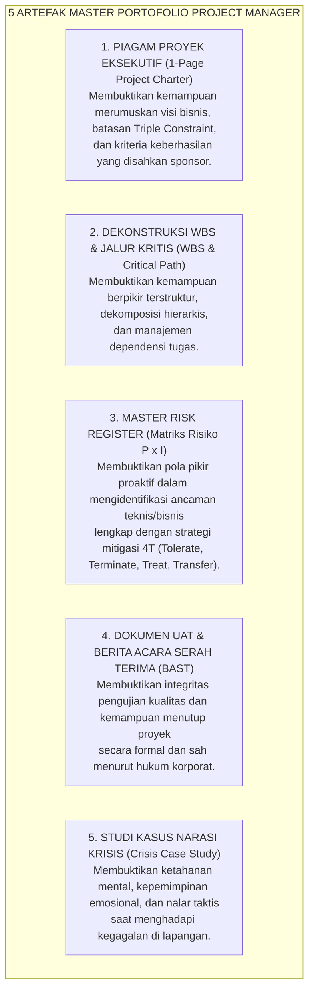
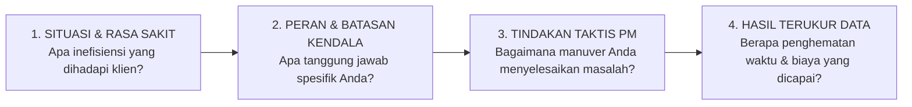

# Modul 20: Pentingnya Contoh Kerja Nyata dan Portofolio (The Power of Tangible Work Samples)

Dalam dunia perekrutan profesional modern, ada satu aturan emas yang membedakan kandidat yang diabaikan dari kandidat yang langsung diperebutkan oleh perusahaan: **"Show, Don't Tell" (Tunjukkan Buktinya, Jangan Hanya Mengklaim)**.

Setiap pelamar kerja bisa menulis kalimat-kalimat klise di resume mereka seperti:
- *"Saya adalah pemimpin tim yang karismatik dan berorientasi hasil."*
- *"Saya sangat ahli dalam manajemen risiko dan negosiasi stakeholder."*
- *"Saya memiliki kemampuan komunikasi yang luar biasa."*

Bagi tim perekrut dan eksekutif yang telah membaca ribuan resume serupa, klaim-klaim verbal di atas bernilai nol. Klaim tersebut tidak memiliki bobot pembuktian. Namun, saat Anda membuka laptop di ruang wawancara dan meletakkan **Contoh Kerja Nyata (*Tangible Work Samples*)**—sebuah dokumen Piagam Proyek yang rapi, Matriks Risiko dengan skor probabilitas dan mitigasi terukur, atau Berita Acara Serah Terima (BAST) berstempel resmi—seluruh dinamika percakapan seketika berubah.

---

## 1. Lima Artefak Kerja Nyata Paling Berdaya Jual Tinggi



---

## 2. Protokol Sanitasi Data: Menjaga Kerahasiaan Perusahaan (NDA Safe)

Banyak calon PM cemas memamerkan dokumen kerja kantor lama karena takut melanggar perjanjian kerahasiaan (*Non-Disclosure Agreement - NDA*) atau privasi data pengguna (UU PDP). 

Kuncinya adalah melakukan **Sanitasi Data (*Data Redaction*)**:

| Elemen Rahasia Asli | Cara Menyamarkan Secara Profesional di Portofolio |
| :--- | :--- |
| **Nama Pasien / NIK Asli** | Ganti dengan data dummy: *"Tn. Pasien A (NIK: 3309xxxxxxxxxxxx)"*. |
| **Angka Anggaran Finansial Riil** | Gunakan persentase varian atau samarkan skala nominalnya (*"Anggaran Disetujui: Rp [X] Ratus Juta; Penghematan Riil: 18%"*). |
| **Kredensial API & Token Rahasia** | Ganti dengan string acak dummy: *"Bearer token_sandbox_mock_test_12345"*. |
| **Nama Vendor Pihak Ketiga Sensitif** | Ganti dengan sebutan fungsional (*"Vendor Penyedia Gateway SMS Nasional"*). |

Dengan melakukan sanitasi data yang benar, Anda membuktikan dua kompetensi sekaligus kepada calon pemberi kerja: **(1) Kualitas keahlian manajemen proyek Anda**, dan **(2) Tingginya etika profesional Anda dalam melindungi kerahasiaan klien**.

---

## 3. Anatomi Portofolio Studi Kasus yang Memikat (Format 4 Babak)

Setiap contoh kerja yang Anda masukkan ke dalam portofolio harus disusun dengan struktur naratif yang jelas:



---

## 4. Studi Kasus Riil: Keberhasilan Portofolio Master Dessy Rahmawati Chairullina

### Skenario Pembuktian
- **Portofolio yang Dibangun**: Repositori GitHub komprehensif yang memuat:
  1. Kurikulum lengkap 46 Modul Google Project Management.
  2. Modul Kursus Eksekusi Proyek (How to Running the Project).
  3. Modul Jalur Karier & Kepemimpinan (Different Paths to be a Project Manager).
  4. Delapan Studi Kasus Implementasi SIMRS Riil (dari alur IGD, resep farmasi, rekonsiliasi klaim BPJS, hingga interoperabilitas SatuSehat).
- **Dampak pada Rekruter & Klien**:
  - Tim penilai tidak lagi meragukan kapasitas kepemimpinan Dessy karena seluruh proses berpikir, standar clean architecture, kepatuhan regulasi, dan mitigasi risiko tersaji lengkap, transparan, dan siap diaudit.
  - Portofolio ini menjadi aset reputasi digital permanen yang bekerja 24 jam sehari untuk membuka peluang karier tingkat tinggi.

---

## 5. Actionable Checklist Contoh Kerja Nyata

```
[ ] 1. Siapkan 3 Dokumen Master: Apakah Anda sudah memiliki minimal 1 Project Charter, 1 Risk Register, dan 1 Dokumen BAST yang telah disanitasi?
[ ] 2. Pastikan 100% Beban Rahasia Bersih: Apakah seluruh data pribadi, NIK, password, dan angka sensitif telah disamarkan?
[ ] 3. Format Presentasi Rapi: Apakah portofolio Anda disajikan dalam format Markdown yang bersih, mudah dibaca di layar laptop maupun ponsel?
[ ] 4. Tautkan Metrik Nyata: Apakah setiap studi kasus memiliki angka hasil yang terukur (persentase waktu, uang, atau kepatuhan)?
[ ] 5. Uji Coba Navigasi: Apakah seluruh tautan link dokumen dan diagram alur di portofolio Anda dapat dibuka tanpa ada pesan error?
```
