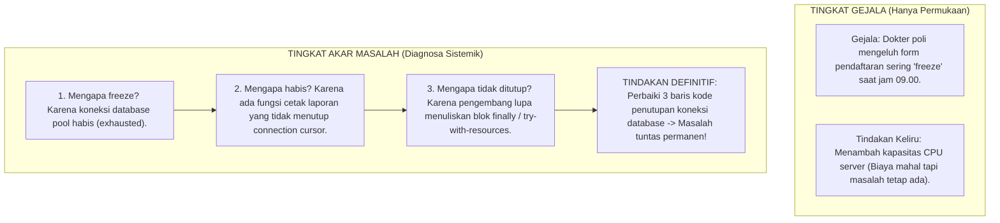
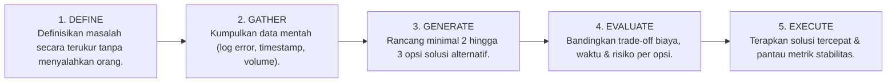

# Modul 21: Pemecahan Masalah sebagai Keterampilan Nomor Satu (Problem-Solving as the #1 Skill for Program Managers)

Jika Anda bertanya kepada para eksekutif senior dan direktur teknologi di perusahaan global: *"Apa satu keahlian terpenting yang membedakan Project Manager biasa dari Program Manager kelas dunia?"*, jawabannya hampir selalu sama: **Kemampuan Memecahkan Masalah Kompleks (*Complex Problem-Solving Under Pressure*)**.

Siapa pun bisa menjadi manajer proyek ketika segala sesuatu berjalan lancar: ketika server bekerja normal, anggaran melimpah, dan pengguna bersikap ramah. Namun, nilai sejati seorang pemimpin proyek baru diuji ketika **krisis meledak**: ketika sistem mengalami *crash* di jam pelayanan paling sibuk, ketika dua departemen saling mengancam mogok kerja, atau ketika regulasi pemerintah tiba-tiba berubah seminggu sebelum peluncuran.

Program Manager bukanlah pencatat masalah (*problem logger*); Program Manager adalah **Mesin Penghancur Masalah (*Problem Buster*)**.

---

## 1. Membedakan "Gejala Permukaan" vs "Akar Masalah Sejati"

Kesalahan paling fatal dari pemecah masalah amatir adalah langsung mengobati gejala (*symptoms*) tanpa pernah menyembuhkan penyakit dasarnya (*root cause*):



---

## 2. Kerangka Kerja 5 Langkah Pemecahan Masalah Sistemik



### Aturan "Minimal 2 Opsi Solusi":
Jangan pernah datang ke hadapan pimpinan atau sponsor hanya dengan satu pilihan kaku (*"Hanya ini satu-satunya cara, Pak!"*). Selalu hadirkan minimal 2 opsi:
- **Opsi A (Taktis Cepat / Workaround Sementara)**: Mengamankan kelancaran operasional dalam 1 jam ke depan.
- **Opsi B (Solusi Definitif / Arsitektural)**: Menyelesaikan kelemahan sistem secara permanen pada sprint pemeliharaan akhir pekan.

---

## 3. Psikologi Pemimpin Krisis: Menjadi "Termostat", Bukan "Termometer"

Di tengah situasi darurat, banyak orang bertindak seperti **Termometer**: mereka sekadar memantulkan suhu kepanikan ruangan. Jika direktur panik, mereka ikut histeris; jika pengguna marah, mereka ikut terpancing emosi.

Seorang pemimpin proyek sejati bertindak seperti **Termostat**: ia menetapkan dan mengatur suhu ruangan. Ketika seluruh ruangan mendidih dalam kepanikan, ia masuk membawa ketenangan yang menyejukkan, mengisolasi kebisingan, dan menuntun tim kembali ke nalar logis pemecahan masalah.

```
+-----------------------------------------------------------------------------------+
|               PROTOKOL 60 DETIK PERTAMA SAAT KRISIS P1 TERJADI                    |
+-----------------------------------------------------------------------------------+
| 1. JEDA BERNAPAS: Ambil napas dalam 3 kali. Jangan mengetik pesan reaktif di chat.|
| 2. ISOLASI AREA KERUSAKAN: Hentikan transaksi error agar data korup tidak meluas. |
| 3. BENTUK WAR ROOM DARURAT: Kumpulkan 3 orang kunci (bukan 20 orang!).             |
| 4. BERIKAN KABAR KE SPONSOR: "Kami menyadari insiden X; tim investigasi sudah     |
|    bergerak; kabar status berikutnya akan kami berikan dalam 20 menit."           |
| 5. FOKUS SOLUSI, BUKAN SALAH: Larang perdebatan siapa pembuat kode hingga sistem  |
|    kembali normal beroperasi.                                                     |
+-----------------------------------------------------------------------------------+
```

---

## 4. Studi Kasus Riil: Menyelamatkan Selisih Kasir Rp 300 Juta Saat Malam Tahun Baru

### Latar Belakang Insiden
- **Waktu**: 31 Desember pukul 21.00 WIB (Tutup Buku Tahunan RS Indriati).
- **Krisis**: Sistem kasir sentral melaporkan selisih anomali transaksi sebesar Rp 300.000.000 antara total penerimaan fisik loket dengan saldo sistem database. Manajer Akuntansi panik dan mengancam membekukan seluruh laporan keuangan tahunan rumah sakit.

### Investigasi Sistemik oleh Lead BA / PM (Dessy Rahmawati Chairullina):
1. **Mengumpulkan Data Log Transaksi (*Log Scraping*)**:
   - Dessy memeriksa log transaksi database antara pukul 18.00 hingga 21.00 WIB.
2. **Menemukan Titik Anomali (*Data Forensic*)**:
   - Ditemukan bahwa selisih Rp 300 Juta tersebut bukan uang hilang atau penggelapan, melainkan adanya **transaksi ganda (*duplicate execution*)** pada modul pembayaran asuransi pihak ketiga akibat petugas loket menekan tombol simpan berulang-ulang (*double-click*) saat internet sempat melambat 3 detik.
3. **Eksekusi Solusi 2 Babak**:
   - **Taktis (Malam Itu Juga)**: Dessy menjalankan query audit rekonsiliasi yang membatalkan transaksi duplikat berdasarkan ID referensi bank yang sama, mengembalikan saldo sistem ke posisi seimbang sempurna 100% tepat pukul 23.15 WIB.
   - **Definitif (Pencegahan Masa Depan)**: Menambahkan pengaman tombol (*Idempotency Key & UI Button Disabling*) sehingga tombol otomatis terkunci segera setelah sentuhan pertama, membuat transaksi ganda mustahil terjadi lagi secara sistemik.
4. **Hasil**:
   - Laporan keuangan tahunan rumah sakit berhasil ditutup sukses sebelum tengah malam.
   - Direksi memberikan penghargaan apresiasi khusus atas ketenangan dan kecepatan pemecahan masalah yang ditunjukkan Dessy.

---

## 5. Actionable Checklist Pemecahan Masalah untuk PM

```
[ ] 1. Tahan Asumsi Pribadi: Apakah Anda sudah memverifikasi masalah menggunakan data log error atau rekaman layar riil, bukan sekadar cerita lisan pihak ketiga?
[ ] 2. Terapkan 5 Whys: Apakah Anda menggali minimal 5 kali pertanyaan 'Mengapa' untuk memastikan Anda menyembuhkan akar masalah sejati?
[ ] 3. Siapkan Opsi Komparatif: Apakah proposal perbaikan Anda ke pimpinan selalu menyertakan minimal 2 pilihan solusi lengkap dengan analisis trade-off?
[ ] 4. Terapkan Prinsip Termostat: Apakah Anda mampu mempertahankan ketenangan emosional dan nada bicara yang terkontrol saat krisis terjadi?
[ ] 5. Pasang Proteksi Permanen: Setelah krisis selesai, apakah Anda memasang pengaman otomatis (Poka-yoke) agar masalah serupa tidak pernah terulang lagi?
```
