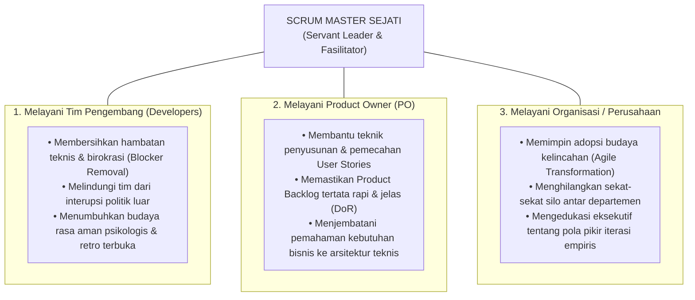

# Modul 22: Apa yang Membuat Scrum Master Efektif (The Traits of an Effective Scrum Master)

Dalam kerangka kerja Scrum (*The Scrum Guide*), posisi **Scrum Master** adalah salah satu peran yang paling sering disalahpahami. Banyak organisasi memperlakukan Scrum Master sekadar sebagai "sekretaris pencatat notulensi rapat", "polisi jadwal yang mengatur tiket Jira", atau "manajer proyek konvensional dengan seragam baru".

Scrum Master sejati bukanlah atasan tim, bukan manajer administratif, dan bukan mandor kerja. Scrum Master adalah **Pemimpin yang Melayani (*Servant Leader*) dan Agen Perubahan Budaya (*Change Agent*)**. 

Tolak ukur keberhasilan seorang Scrum Master bukanlah seberapa sibuk ia memberi instruksi kepada tim, melainkan **seberapa mandiri, berdaya, dan berkinerja tinggi tim tersebut bahkan ketika Scrum Master sedang tidak berada di ruangan**.

---

## 1. Tiga Dimensi Pelayanan Scrum Master

Seorang Scrum Master yang efektif mendedikasikan energinya ke tiga arah yang saling melengkapi:



---

## 2. Scrum Master vs Project Manager Tradisional

| Dimensi Praktis | Project Manager Tradisional | Scrum Master Efektif |
| :--- | :--- | :--- |
| **Gaya Kepemimpinan** | Instruksi satu arah (*Command and Control*). | Kepemimpinan melayani (*Servant Leadership*). |
| **Penetapan Tugas** | Membagi-bagikan tugas kepada masing-masing orang: *"Kamu kerjakan A, kamu kerjakan B."* | Memberdayakan tim untuk menarik tugas secara mandiri dari backlog (*Self-Managing Team*). |
| **Fokus Utama** | Memastikan ketaatan terhadap jadwal rencana awal (*Following the Plan*). | Memaksimalkan aliran nilai dan kemampuan beradaptasi (*Responding to Change*). |
| **Saat Ada Blocker** | Mencari siapa yang terlambat dan menagih komitmen. | Bertanya: *"Apa yang bisa saya bantu singkirkan agar kalian bisa melaju kencang?"* |

---

## 3. Seni Fasilitasi: Bertanya, Bukan Mendikte (*Powerful Questions*)

Scrum Master yang buruk selalu memberikan jawaban atau memaksakan solusinya sendiri. Scrum Master hebat menggunakan **Pertanyaan yang Menggerakkan (*Powerful Coaching Questions*)** untuk melatih nalar mandiri tim:

```
+-----------------------------------------------------------------------------------+
|               KUMPULAN PERTANYAAN EMAS FASILITASI SCRUM MASTER                    |
+-----------------------------------------------------------------------------------+
| 1. SAAT ESTIMASI TUGAS BIAS:                                                      |
|    "Apa yang membuat kita percaya tugas ini bernilai 3 story points, dan risiko    |
|    tersembunyi apa yang belum kita perhitungkan?"                                 |
|                                                                                   |
| 2. SAAT ANGGOTA TIM MENGALAMI KEBUNTUAN:                                          |
|    "Jika kita harus menyelesaikan 50% dari fitur ini besok sore untuk menyelamatkan|
|    pengguna, bagian mana yang paling penting kita prioritaskan?"                  |
|                                                                                   |
| 3. SAAT TERJADI KONFLIK TEKNIS ANTAR-DEVELOPER:                                   |
|    "Data atau eksperimen pengujian apa yang bisa kita jalankan dalam 2 jam ke depan|
|    untuk membuktikan arsitektur mana yang paling stabil secara objektif?"         |
|                                                                                   |
| 4. SAAT SPRINT RETROSPEKTIF:                                                      |
|    "Eksperimen kecil apa yang bisa kita coba selama 1 minggu ke depan untuk       |
|    membuat hidup kerja kita lebih menyenangkan?"                                  |
+-----------------------------------------------------------------------------------+
```

---

## 4. Studi Kasus Riil: Mentransformasi Tim SIMRS yang Terhambat Menjadi Skuad Mandiri

### Skenario Lapangan
- **Kondisi Tim**: Skuad pengembang modul Rawat Jalan & Farmasi RS Indriati mengalami kegagalan memenuhi komitmen Sprint Goal selama 4 sprint berturut-turut.
- **Gejala Masalah**:
  - Tim pengembang sangat bergantung pada instruksi PM; mereka tidak mau mengambil keputusan sebelum ditugaskan secara eksplisit.
  - Setiap hari tim dihujani interupsi langsung via WhatsApp dari para dokter dan staf kasir yang meminta perbaikan form dadakan, memecah konsentrasi koding hingga berantakan.

### Intervensi Fasilitasi oleh Scrum Master (Dessy Rahmawati Chairullina):
1. **Menegakkan Perisai Pelindung Tim (*The Team Shield*)**:
   - Dessy menyepakati aturan dengan manajemen rumah sakit: **Semua permintaan baru WAJIB masuk melalui Product Owner, bukan langsung ke meja pengembang**.
   - Menghubungkan seluruh komplain pengguna ke dalam sistem tiket terpadu, memulihkan 4 jam waktu fokus koding per hari bagi insinyur.
2. **Mendefinisikan "Definition of Ready (DoR)"**:
   - Menghentikan kebiasaan developer mengerjakan tiket yang spesifikasinya masih kabur. Tiket hanya boleh ditarik ke dalam sprint jika kriteria pengujian UAT-nya sudah jelas 100%.
3. **Mendorong Otonomi Harian**:
   - Pada Daily Standup, Dessy mundur selangkah dan membiarkan para pengembang saling memimpin jalannya standup secara bergiliran.
4. **Hasil**:
   - Velocity tim melonjak **2,4 kali lipat** dalam 3 sprint berikutnya.
   - Angka penyelesaian Sprint Goal mencapai **100%** secara konsisten.
   - Tim bertransformasi menjadi unit yang percaya diri, mandiri, dan bangga atas perangkat lunak yang mereka hasilkan.

---

## 5. Actionable Checklist Scrum Master Berdampak Tinggi

```
[ ] 1. Evaluasi Otonomi Tim: Apakah tim pengembang Anda mampu merencanakan dan mengeksekusi sprint harian tanpa harus menunggu instruksi dari Anda?
[ ] 2. Berfungsi sebagai Perisai: Apakah Anda berhasil menangkis interupsi liar dari pihak eksternal agar tidak mengganggu fokus sprint tim?
[ ] 3. Pelihara Definition of Done: Apakah tim mematuhi standar kualitas (DoD) secara konsisten dan menolak meloloskan kode yang belum lolos testing?
[ ] 4. Latih Pertanyaan Kuat: Dalam rapat, apakah Anda lebih banyak memicu ide tim melalui pertanyaan reflektif dibanding memberi tahu jawaban langsung?
[ ] 5. Rawat Keberlanjutan Kerja (Sustainable Pace): Apakah tim Anda bekerja dalam ritme kerja yang sehat tanpa lembur darurat kronis setiap akhir sprint?
```
