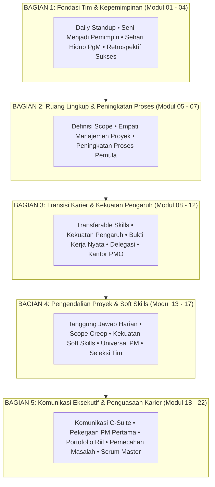

# Specialization: Different Paths to be a Project Manager
## Google Project Management Professional Certificate

> **Catatan Belajar & Dokumentasi Kepemimpinan, Transisi Karier & Dinamika Peran PM**  
> Disusun oleh: **Dessy Rahmawati Chairullina, S.Kom**  
> Sumber Materi: *Google Career Certificates — Different Paths to be a Project Manager*  
> Playlist Referensi: [Different Paths to be a Project Manager](https://www.youtube.com/playlist?list=PLTZYG7bZ1u6qgnZYyPwTE-caskhauisWI)

---

## 🎯 Fokus Pembelajaran Kursus
Seri ini membedah spektrum luas perjalanan karier, keterampilan kepemimpinan emosional, navigasi politik organisasi, seni delegasi, dan pemecahan masalah yang dibutuhkan untuk menjadi pemimpin proyek dan manajer program tingkat enterprise.

---

## 🗺️ Peta Jalur Pembelajaran (22 Modul Lengkap)

---

## 📋 Indeks Lengkap 22 Modul Dokumentasi

| No | Modul Pembelajaran | Topik Bahasan Kunci | Video ID | Dokumen Lengkap |
| :---: | :--- | :--- | :---: | :--- |
| **01** | **Manfaat Daily Standup dan Ritme Tim** | Format 15 menit, 3 pertanyaan penyelaras, Walk the board, penanganan blocker cepat. | [VZNrkYYiwDk](https://www.youtube.com/watch?v=VZNrkYYiwDk) | [01-manfaat-daily-standup-dan-ritme-tim.md](./01-manfaat-daily-standup-dan-ritme-tim.md) |
| **02** | **Pelajari Cara Menjadi Pemimpin Proyek** | Persamaan Kepercayaan (Trust Equation), transisi IC ke Leader, ketenangan saat krisis. | [OpHuuv15VV8](https://youtu.be/OpHuuv15VV8) | [02-pelajari-cara-menjadi-pemimpin-proyek.md](./02-pelajari-cara-menjadi-pemimpin-proyek.md) |
| **03** | **Sehari dalam Kehidupan Manajer Program** | Program vs Project vs Portfolio, Dynamic Resource Balancing, orkestrasi 4 proyek simultan. | [Dhc1bd2StTM](https://youtu.be/Dhc1bd2StTM) | [03-sehari-dalam-kehidupan-program-manager.md](./03-sehari-dalam-kehidupan-program-manager.md) |
| **04** | **Tips untuk Retrospektif yang Sukses** | 5 tahap Esther Derby, format Sailboat & 4Ls, batasan maksimal 2 action items SMART. | [W4yemTNjYTU](https://youtu.be/W4yemTNjYTU) | [04-tips-retrospektif-yang-sukses.md](./04-tips-retrospektif-yang-sukses.md) |
| **05** | **Pentingnya Lingkup Kerja Terdefinisi** | Anatomi Scope Statement, kekuatan daftar Out-of-Scope, aturan WBS 100% dan batas 8/80. | [3uUwDCTR_ms](https://youtu.be/3uUwDCTR_ms) | [05-pentingnya-lingkup-kerja-terdefinisi.md](./05-pentingnya-lingkup-kerja-terdefinisi.md) |
| **06** | **Empati dalam Manajemen Proyek** | 3 tingkatan empati, praktik Job Shadowing (Gemba Walk), mengatasi penolakan form klinis. | [8PsljU8Pqac](https://youtu.be/8PsljU8Pqac) | [06-empati-dalam-manajemen-proyek.md](./06-empati-dalam-manajemen-proyek.md) |
| **07** | **Peningkatan Proses untuk Pemula** | Waktu bernilai tambah (VAT) vs NVAT, 8 pemborosan DOWNTIME, diagram swimlane As-Is/To-Be. | [1Kc0P8PH8i0](https://youtu.be/1Kc0P8PH8i0) | [07-peningkatan-proses-untuk-pemula.md](./07-peningkatan-proses-untuk-pemula.md) |
| **08** | **Transisi Karier & Transferable Skills** | Dari bartender/staf teknis ke PM, menerjemahkan pengalaman ke bahasa PM, formula Google XYZ. | [QySO1pr59os](https://youtu.be/QySO1pr59os) | [08-transisi-karier-dan-transferable-skills.md](./08-transisi-karier-dan-transferable-skills.md) |
| **09** | **Mengapa Pengaruh Penting sebagai PM** | Kepatuhan semu vs komitmen sejati, segitiga pengaruh, lobi pre-wiring pembekuan fitur. | [39BufAwyKhc](https://youtu.be/39BufAwyKhc) | [09-mengapa-pengaruh-penting-sebagai-pm.md](./09-mengapa-pengaruh-penting-sebagai-pm.md) |
| **10** | **Menjadi PM Berbasis Bukti Kerja** | Pergeseran Skills-First Hiring, triad Proof of Work, membangun portofolio tanpa judul jabatan. | [DgPYRU50V7E](https://youtu.be/DgPYRU50V7E) | [10-menjadi-pm-berbasis-keahlian-dan-bukti-kerja.md](./10-menjadi-pm-berbasis-keahlian-dan-bukti-kerja.md) |
| **11** | **Cara Mendelegasikan Tugas bagi PgM** | Menghindari The Superhero Trap, 5 level otonomi delegasi, delegasikan What & Why bukan How. | [36uBt118CLg](https://youtu.be/36uBt118CLg) | [11-cara-mendelegasikan-tugas-sebagai-program-manager.md](./11-cara-mendelegasikan-tugas-sebagai-program-manager.md) |
| **12** | **Bekerja di Kantor Manajemen Proyek (PMO)**| 3 model PMO (Supportive, Controlling, Directive), nilai strategis PMO, konsolidasi proyek SIMRS. | [0r0BmCBBR7Y](https://youtu.be/0r0BmCBBR7Y) | [12-bekerja-di-kantor-manajemen-proyek-pmo.md](./12-bekerja-di-kantor-manajemen-proyek-pmo.md) |
| **13** | **Tanggung Jawab Harian Manajer Proyek** | Membedakan Busywork vs High-Leverage Work, distribusi formula 8 jam harian, proteksi buffer. | [hZEp1XIniek](https://youtu.be/hZEp1XIniek) | [13-tanggung-jawab-harian-manajer-proyek.md](./13-tanggung-jawab-harian-manajer-proyek.md) |
| **14** | **Cara Mengelola & Mencegah Scope Creep** | Sumber pemicu scope creep, hukum fisika Triple Constraint, teknik diplomasi 'Yes, and...'. | [tkrE25qP8G8](https://youtu.be/tkrE25qP8G8) | [14-cara-mengelola-dan-mencegah-scope-creep.md](./14-cara-mengelola-dan-mencegah-scope-creep.md) |
| **15** | **Pentingnya Soft Skills dalam Proyek** | 5 pilar soft skills PM, Active listening menangkap subteks, mendamaikan sengketa dokter bedah. | [ySQtmeZ77_Y](https://youtu.be/ySQtmeZ77_Y) | [15-pentingnya-soft-skills-dalam-proyek.md](./15-pentingnya-soft-skills-dalam-proyek.md) |
| **16** | **Mengapa Semua Orang Butuh Keterampilan PM**| 5 keterampilan PM universal, mengapa PM kebal otomatisasi AI, transformasi staf farmasi. | [o2NwYj5v4Uo](https://youtu.be/o2NwYj5v4Uo) | [16-mengapa-setiap-orang-butuh-keterampilan-pm.md](./16-mengapa-setiap-orang-butuh-keterampilan-pm.md) |
| **17** | **Memilih Anggota Tim & Kolaborasi Efektif** | Profil talenta T-Shaped, bahaya The Brilliant Jerk, Skills Matrix, Team Working Agreement. | [vjI-gTHpV6M](https://youtu.be/vjI-gTHpV6M) | [17-memilih-anggota-tim-dan-kolaborasi-efektif.md](./17-memilih-anggota-tim-dan-kolaborasi-efektif.md) |
| **18** | **Cara Terbaik Berkomunikasi dengan Eksekutif**| Memahami dunia C-Suite, Minto Pyramid (BLUF), kamus bahasa teknis ke direksi, elevator pitch. | [wgwiVb_XQCM](https://youtu.be/wgwiVb_XQCM) | [18-cara-terbaik-berkomunikasi-dengan-eksekutif.md](./18-cara-terbaik-berkomunikasi-dengan-eksekutif.md) |
| **19** | **Tips Mendapatkan Pekerjaan PM Pertama** | Mengatasi paradoks Catch-22, 4 jalur masuk PM, optimasi resume ramah ATS, navigasi wawancara. | [TC3L_Dua9BA](https://youtu.be/TC3L_Dua9BA) | [19-tips-mendapatkan-pekerjaan-pm-pertama.md](./19-tips-mendapatkan-pekerjaan-pm-pertama.md) |
| **20** | **Pentingnya Contoh Kerja Nyata & Portofolio**| Show Don't Tell, 5 artefak bernilai tinggi, protokol sanitasi data (NDA safe), studi kasus 4 babak. | [oJbpLL8x-bo](https://youtu.be/oJbpLL8x-bo) | [20-pentingnya-contoh-kerja-nyata-dan-portofolio.md](./20-pentingnya-contoh-kerja-nyata-dan-portofolio.md) |
| **21** | **Pemecahan Masalah sebagai Keterampilan #1**| Gejala vs akar masalah, siklus 5 langkah pemecahan masalah, menjadi termostat bukan termometer. | [STXAUTfUln0](https://youtu.be/STXAUTfUln0) | [21-pemecahan-masalah-sebagai-keterampilan-nomor-satu.md](./21-pemecahan-masalah-sebagai-keterampilan-nomor-satu.md) |
| **22** | **Apa yang Membuat Scrum Master Efektif** | 3 dimensi pelayanan Scrum Master, SM vs PM tradisional, seni mengajukan powerful questions. | [HSw-y3EhA9U](https://youtu.be/HSw-y3EhA9U) | [22-apa-yang-membuat-scrum-master-efektif.md](./22-apa-yang-membuat-scrum-master-efektif.md) |

---
*© 2026 Dessy Rahmawati Chairullina, S.Kom • Google Project Management Professional Curriculum*
