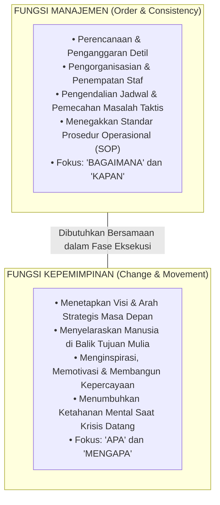
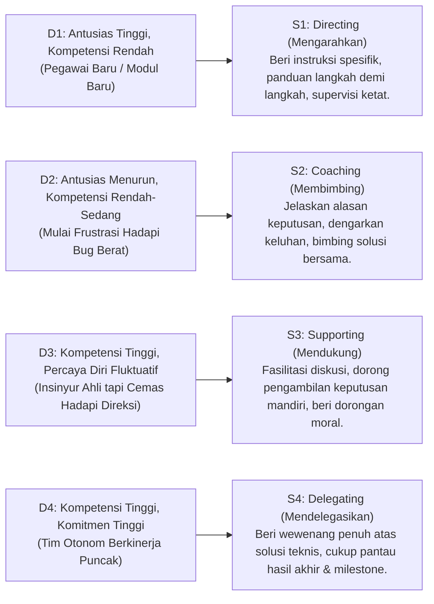
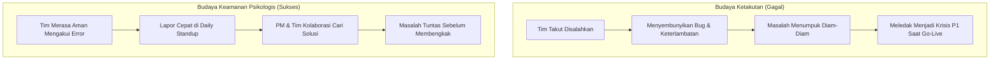
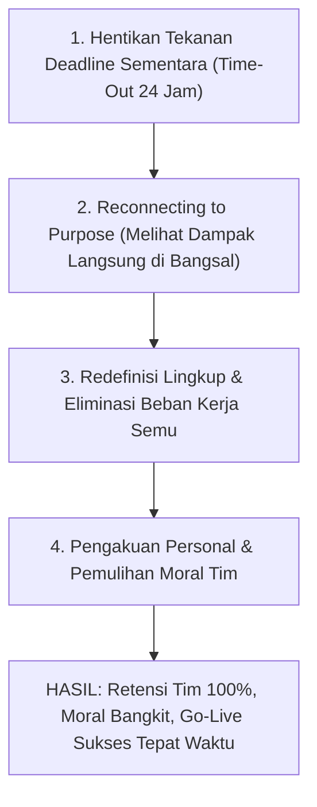

# Modul 01: Kepemimpinan vs Manajemen dalam Tim yang Sukses (Leadership vs Management in Running Projects)

Ketika sebuah proyek memasuki fase eksekusi (*running the project*), dinamika pekerjaan berubah secara drastis. Rencana di atas kertas, bagan Gantt yang rapi, dan piagam proyek yang telah disahkan harus berhadapan langsung dengan realitas operasional: tenggat waktu yang ketat, bug perangkat lunak yang tak terduga, pergeseran prioritas pemangku kepentingan, dan kelelahan mental tim (*team burnout*).

Di fase inilah terlihat perbedaan mencolok antara manajer yang sekadar "mengatur tugas" (*managing tasks*) dengan pemimpin yang "menggerakkan manusia" (*leading people*). 

Seorang Project Manager (PM) yang sukses harus mampu menjalankan kedua peran ini secara seimbang: memiliki ketelitian sistematis seorang manajer dan karisma empatik seorang pemimpin.

---

## 1. Dikotomi Fundamental: Manajemen vs Kepemimpinan

Meskipun sering digunakan secara bergantian, manajemen dan kepemimpinan memiliki fungsi psikologis dan operasional yang sangat berbeda:



### Tabel Komparasi Praktis di Lapangan:

| Dimensi Proyek | Pendekatan Manajer Murni | Pendekatan Pemimpin Proyek |
| :--- | :--- | :--- |
| **Menghadapi Rintangan (*Blockers*)** | Menelusuri siapa yang terlambat dan menagih komitmen berdasarkan jadwal Jira. | Duduk bersama anggota tim, mendengarkan akar kesulitan, dan menyingkirkan hambatan lintas divisi. |
| **Penyampaian Target** | *"Kalian harus menyelesaikan modul kasir ini sebelum Jumat sesuai sprint backlog."* | *"Modul kasir ini akan memangkas antrean pasien lansia dari 45 menit menjadi 10 menit. Mari kita wujudkan bersama."* |
| **Terjadi Kesalahan / Bug Kritis** | Mencari siapa yang salah melakukan *commit* kode dan meminta pertanggungjawaban. | Menjalankan *blameless post-mortem*: *"Proses validasi apa yang perlu kita perbaiki agar bug serupa tidak lolos lagi?"* |
| **Hubungan dengan Anggota Tim** | Berdasarkan wewenang hierarkis dan instruksi satu arah (*top-down*). | Berdasarkan pengaruh timbal balik (*reciprocity*), empati, dan *servant leadership*. |

---

## 2. Model Kepemimpinan Situasional Hersey-Blanchard

Tidak ada satu gaya kepemimpinan tunggal yang cocok untuk semua situasi dan semua orang. Gaya kepemimpinan Anda harus beradaptasi dengan **Tingkat Kematangan & Kompetensi Tim (*Development Level*)**:



### Panduan Aksi PM:
- **Jangan lakukan Micromanagement pada tim D4**: Mengatur detail penamaan variabel programmer senior akan membunuh motivasi dan memicu kebencian kerja.
- **Jangan lakukan Delegating berlebihan pada tim D1**: Membiarkan staf analis pemula merancang skema database kritis tanpa supervisi akan berujung pada malapetaka teknis.

---

## 3. Fondasi Eksekusi: Keamanan Psikologis (*Psychological Safety*)

Berdasarkan studi komprehensif Google (*Project Aristotle*), faktor pembeda utama antara tim yang sukses dan tim yang gagal bukanlah kecerdasan individu atau alat manajemen tercanggih, melainkan **Rasa Aman Psikologis**.



### Indikator Tim yang Memiliki Keamanan Psikologis Tinggi:
1. Anggota tim tidak ragu bertanya: *"Saya belum paham maksud spesifikasi ini, bisakah dijelaskan kembali?"*
2. Pengembang berani mengoreksi PM jika estimasi jadwal tidak realistis.
3. Anggota tim berani mengakui kesalahan tanpa takut dihina atau diancam sanksi karir.

---

## 4. Servant Leadership: Melayani untuk Memimpin

Filosofi *Servant Leadership* (Robert K. Greenleaf) membalik piramida organisasi tradisional. Di mata seorang Servant Leader, **tugas Project Manager adalah melayani kebutuhan tim**, bukan menyuruh tim melayani kemauan PM.

```
PIRAMIDA TRADISIONAL (KUNO):             PIRAMIDA SERVANT LEADERSHIP (MODERN):
        [ PM / Boss ]                                [ PENGGUNA / PASIEN ]
             ▲                                                 ▲
       [ Supervisor ]                                   [ TIM PENGEMBANG ]
             ▲                                                 ▲
   [ Tim Pelaksana Kerja ]                              [ PROJECT MANAGER ]
(Tim melayani instruksi bos)                 (PM menjadi bantalan & pelayan tim)
```

### 3 Tugas Pokok Servant Leader dalam Menjalankan Proyek:
1. **Shielding the Team (Bantalan Politik)**: Melindungi tim pengembang dari interupsi eksternal, perubahan kehendak sepihak dari pejabat manajemen, atau komplain liar yang belum diverifikasi.
2. **Removing Friction (Pembersih Hambatan)**: Mengurus birokrasi izin akses server, memfasilitasi lisensi alat pengembangan, dan memastikan lingkungan kerja tim bebas stres non-teknis.
3. **Amplifying Others (Membesarkan Orang Lain)**: Memberikan panggung penghargaan kepada insinyur dan staf lapangan ketika proyek berhasil, serta mengambil tanggung jawab utama ketika proyek menghadapi kritik dewan.

---

## 5. Studi Kasus Riil: Mengatasi "Project Fatigue" pada Proyek SIMRS

### Konteks Skenario
- **Inisiatif Proyek**: Peluncuran Modul Rekam Medis Elektronik (RME) Rawat Inap & Bridging BPJS Kesehatan.
- **Tantangan Lapangan**:
  - Proyek telah berjalan selama 4 bulan. Tim pengembang dan tim rekam medis mulai mengalami kelelahan mental akut (*project fatigue*).
  - Hubungan kerja memburuk: Pengembang software merasa staf rumah sakit terlalu banyak menuntut revisi kecil, sementara perawat bangsal merasa sistem baru membingungkan dan menambah beban kerja shift malam.
  - Dua insinyur kunci mengajukan cuti panjang karena merasa tidak dihargai dan sering dimarahi saat demo sistem.

### Intervensi Kepemimpinan oleh PM (Dessy Rahmawati Chairullina):



1. **Jeda Kemanusiaan (*Human Time-Out*)**:
   - PM menghentikan sprint selama 1 hari penuh. Seluruh pembicaraan mengenai tiket Jira dan burndown chart dibekukan.
   - Mengadakan sesi makan siang santai di luar area rumah sakit tanpa laptop untuk mendengarkan keluh kesah secara personal.
2. **Menghubungkan Kembali dengan Tujuan Mulia (*Reconnecting to Purpose*)**:
   - PM mengajak dua insinyur perangkat lunak mendampingi perawat jaga malam di ruang rawat intensif (ICU).
   - Insinyur menyaksikan sendiri bagaimana lembaran rekam medis kertas yang tebal dan tercecer membuat perawat kesulitan mencari riwayat alergi obat pasien yang sedang kritis.
   - Momen ini mengubah paradigma insinyur secara radikal: mereka menyadari bahwa kode program yang mereka tulis bukan sekadar baris sintaks Java, melainkan alat penyelamat nyawa manusia.
3. **Penyederhanaan Ruang Lingkup (*De-scoping Non-Essentials*)**:
   - PM bernegosiasi dengan Komite Medis untuk menunda 12 permintaan fitur kosmetik yang tidak mendesak ke rilis fase kedua.
   - Beban kerja tim pengembang berkurang 30%, memungkinkan mereka fokus membereskan stabilitas koneksi data bridging BPJS.
4. **Hasil**:
   - Moral tim pulih total; kedua insinyur membatalkan rencana pengunduran diri.
   - Siklus rilis kembali stabil, dan implementasi modul rawat inap diluncurkan dengan tingkat adopsi perawat mencapai 98% dalam 14 hari pertama.

---

## 6. Actionable Checklist Kepemimpinan Tim Eksekusi

```
[ ] 1. Diagnosa Tingkat Kematangan: Apakah Anda menerapkan gaya kepemimpinan yang sesuai (Directing / Coaching / Supporting / Delegating) untuk setiap anggota tim?
[ ] 2. Cek Keamanan Psikologis: Kapan terakhir kali seorang anggota tim berani mengakui kesalahan atau ketidaktahuannya di depan Anda tanpa takut dihakimi?
[ ] 3. Audit Perisai Tim: Apakah Anda telah menyaring interupsi liar dari pemangku kepentingan luar sebelum mencapai meja kerja tim pengembang?
[ ] 4. Pembersihan Hambatan Harian: Apakah seluruh 'blocker' yang dilaporkan pada daily standup pagi ini sudah memiliki rencana aksi sebelum jam kerja berakhir?
[ ] 5. Apresiasi Spesifik: Apakah Anda telah memuji kontribusi konkret salah satu anggota tim hari ini secara tulus dan spesifik?
```
