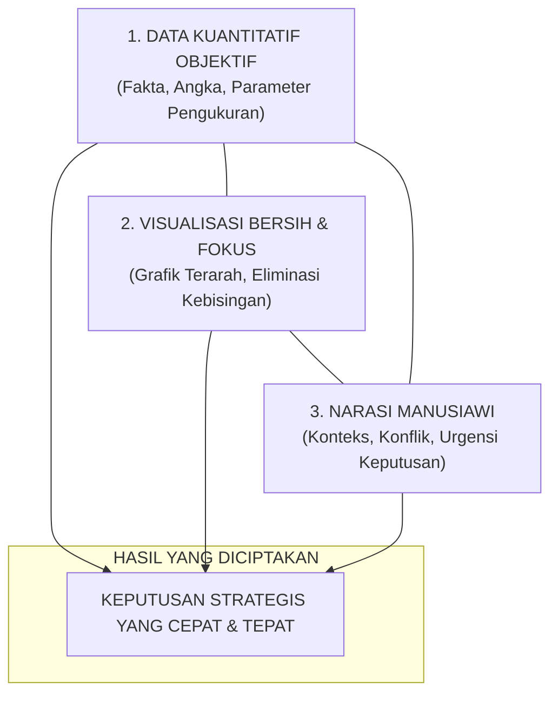
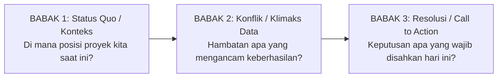
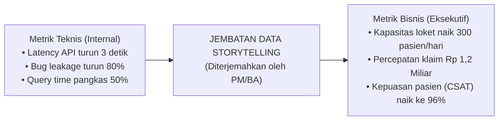

# Modul 02: Bercerita dengan Data untuk Mengambil Keputusan (Data Storytelling for Project Decisions)

Dalam fase menjalankan proyek (*running the project*), seorang Project Manager (PM) dibanjiri oleh ratusan metrik data setiap minggu: grafik *velocity* sprint, jumlah baris kode, tiket bug yang terbuka, varian biaya anggaran (*cost variance*), hingga persentase penyelesaian tugas.

Namun, menyajikan tumpukan tabel angka mentah atau grafik spreadsheet yang rumit kepada para pengambil keputusan (*Project Sponsor, Direksi, Klien*) hampir selalu berujung pada kebingungan, perdebatan yang salah arah, atau penolakan persetujuan.

**Bercerita dengan Data (*Data Storytelling*)** adalah seni dan sains mengubah data mentah yang dingin menjadi narasi manusiawi yang memikat, mudah dipahami, dan menggerakkan orang untuk segera mengambil keputusan strategis.

---

## 1. Segitiga Emas Data Storytelling (*The Power of Three*)

Data storytelling bukanlah sekadar membuat grafik visual yang indah; ini adalah pertemuan harmonis antara tiga pilar fundamental:



### Jebakan Umum yang Sering Terjadi:
- **Data + Visual tanpa Narasi**: Hanya menghasilkan dashboard pajangan yang membingungkan audiens (*"Terus maksud angka 42% ini apa untuk saya?"*).
- **Data + Narasi tanpa Visual**: Sangat melelahkan untuk dicerna oleh eksekutif yang hanya memiliki waktu 5 menit.
- **Visual + Narasi tanpa Data Kuat**: Menjadi sekadar opini kosong atau retorika yang mudah dibantah (*unsubstantiated claims*).

---

## 2. Eksploratori vs Eksplanatori: Memilih Sudut Pandang yang Tepat

Kesalahan paling sering yang dilakukan analis atau PM teknis adalah mempresentasikan seluruh proses investigasi mereka, bukan kesimpulan utamanya.

| Dimensi | Analisis Eksploratori (*Exploratory Analysis*) | Analisis Eksplanatori (*Explanatory Storytelling*) |
| :--- | :--- | :--- |
| **Definisi** | Proses mencari mutiara di dasar lautan (membedah 1.000 kemungkinan, anomali, korelasi). | Menunjukkan mutiara yang sudah ditemukan langsung ke tangan pengambil keputusan. |
| **Kapan Digunakan?** | Saat PM dan analis data sedang menyelidiki akar masalah secara internal. | Saat PM mempresentasikan temuan kepada Direksi, Sponsor, atau Komite Medis. |
| **Bentuk Output** | Spreadsheet mentah, puluhan grafik korelasi, notebook data, query SQL panjang. | 1 slide visual bersih dengan 1 pesan kunci dan rekomendasi tindakan jelas. |
| **Tujuan** | Menemukan wawasan (*finding insights*). | Menggerakkan tindakan nyata (*driving action*). |

---

## 3. Struktur Narasi 3 Babak untuk Rapat Eksekutif (*The 3-Act Arc*)

Meminjam struktur dramatis dari dunia sinema, narasi data proyek yang berhasil selalu mengikuti alur 3 babak yang runtut:



### Formula Praktis Penyusunan Naskah Presentasi:

#### Babak 1: Konteks & Harapan Awal (*The Setup*)
> *"Bapak dan Ibu Dewan Direksi, dalam 3 bulan terakhir, proyek bridging antrean online BPJS kita berjalan sesuai target dan telah sukses melayani 12.000 pendaftaran pasien mandiri."*

#### Babak 2: Titik Konflik & Anomali Data (*The Conflict*)
> *"Namun, perhatikan grafik ini: sejak lonjakan volume minggu lalu, terjadi peningkatan drastis waktu respons server dari 0,8 detik menjadi 6,4 detik pada jam sibuk (07.30 - 09.00 WIB). Keterlambatan ini menyebabkan 18% pasien gagal mencetak nomor antrean dan menumpuk kembali di loket fisik, memicu kembali antrean panjang yang kita hindari."*

#### Babak 3: Resolusi & Rekomendasi Terarah (*The Call to Action*)
> *"Akar masalahnya adalah keterbatasan memori server gateway lokal. Kami merekomendasikan Dewan menyetujui pengalihan anggaran lisensi cadangan sebesar Rp 35 Juta untuk upgrade RAM dan failover gateway hari ini, sehingga pada hari Senin depan waktu tunggu kembali normal di bawah 1 detik."*

---

## 4. Prinsip Pembersihan Grafik (*Decluttering Charts & Cognitive Load*)

Grafik yang buruk memaksa otak audiens bekerja keras memecahkan teka-teki visual (*high cognitive load*), alih-alih memahami pesannya.

```
+-----------------------------------------------------------------------------------+
|               PRINSIP EMAS VISUALISASI DATA PROYEK (LESS IS MORE)                 |
+-----------------------------------------------------------------------------------+
| 1. DILARANG MENGGUNAKAN PIE CHART 3D: Mata manusia sangat buruk dalam membedakan   |
|    sudut dan volume 3 dimensi. Gunakan Bar Chart horizontal sederhana.            |
| 2. HAPUS KEBISINGAN VISUAL (CHART JUNK): Hilangkan gridlines yang tebal, border    |
|    kotak berlebihan, dan bayangan efek 3D yang tidak menambah informasi.          |
| 3. PRINSIP WARNA TERARAH (PREATTENTIVE ATTRIBUTES): Gunakan warna abu-abu netral  |
|    untuk data pembanding umum, dan gunakan 1 WARNA TEGAS (misal: Oranye/Merah)    |
|    hanya pada titik data anomali yang ingin Anda sorot.                            |
| 4. INTEGRASIKAN LABEL LANGSUNG (DIRECT LABELING): Hindari meletakkan kotak legenda |
|    terpisah jauh di pojok yang memaksa mata bolak-balik mencocokkan warna.        |
+-----------------------------------------------------------------------------------+
```

---

## 5. Menghubungkan Metrik Teknis ke Metrik Bisnis & Finansial

Eksekutif puncak tidak mengukur proyek dengan unit teknis programmer; mereka mengukurnya dengan unit **Rupiah, Waktu, Reputasi, dan Kepatuhan**.



---

## 6. Studi Kasus Riil: Presentasi Penyelamatan Server Bridging BPJS di Depan Direksi

### Latar Belakang Kasus
- **Presenter**: Dessy Rahmawati Chairullina, S.Kom (Lead PM / BA SIMRS).
- **Masalah Lapangan**: Terjadi insiden sering terputusnya koneksi bridging VClaim BPJS pada jam puncak pelayanan pagi hari, mengakibatkan antrean admisi membludak dan pasien mengeluh di media sosial.
- **Tantangan PM**: Meminta penambahan anggaran darurat Rp 45.000.000 untuk pengadaan jalur fiber optik sekunder dan server load balancer di tengah kebijakan pengetatan anggaran rumah sakit.

### Slide Visual yang Disajikan PM:

```
+-------------------------------------------------------------------------------------------------------+
| TINJAUAN INSIDEN: ANOMALI LATENCY BRIDGING VCLAIM PADA JAM PEAK PELAYANAN                             |
| Dampak Finansial: Potensi Pending Klaim Rp 420 Juta/Bulan | Rekomendasi: Dual-Link Failover Gateway   |
+-------------------------------------------------------------------------------------------------------+
| Waktu (WIB)    | Volume Request | Latency (Detik) | Status Pasien                                     |
| 06.00 - 07.00  |      150       |      0,6 s      | 🟢 Lancar (Waktu cetak SEP: 15 detik)             |
| 07.00 - 08.00  |      850       |      1,8 s      | 🟡 Mulai Melambat (Waktu cetak SEP: 45 detik)     |
| 08.00 - 09.30  |    2.400       |      9,4 s [!]  | 🔴 TIMEOUT PARAH (Antrean menumpuk 180 orang)     |
| 10.00 - 12.00  |      900       |      1,2 s      | 🟢 Kembali Normal                                 |
+-------------------------------------------------------------------------------------------------------+
| KORELASI KERUGIAN OPERASIONAL:                                                                        |
| Setiap kenaikan latency di atas 5 detik memicu 'Connection Reset' dari server BPJS pusat, memaksa     |
| petugas mengulang input manual 3 kali dan menambah waktu antrean per orang dari 2 menit menjadi 12 mnt.|
+-------------------------------------------------------------------------------------------------------+
| 3 OPSI STRATEGIS KEPUTUSAN UNTUK DIREKSI:                                                             |
| [ ] OPSI 1: Tidak Melakukan Apa-pun (Biaya Rp 0) -> Risiko komplain viral & penumpukan loket berlanjut.|
| [ ] OPSI 2: Menambah 3 Loket Manual Baru -> Menambah biaya gaji staf Rp 180 Juta/tahun (Kurang Efektif)|
| [X] OPSI 3 (REKOMENDASI): Pasang Dual-Link Gateway & Failover Otomatis (Investasi 1x: Rp 45 Juta)     |
|     * Target Hasil: Latency stabil < 1 detik pada jam sibuk; kapasitas tampung naik hingga 5.000 req/jam.|
+-------------------------------------------------------------------------------------------------------+
```

### Hasil Akhir:
Direktur Utama dan Direktur Keuangan menyetujui rekomendasi Opsi 3 dalam waktu kurang dari 10 menit tanpa perdebatan berkepanjangan, karena data disajikan bukan sebagai keluhan teknis, melainkan sebagai **solusi bisnis yang melindungi reputasi institusi dan menghemat biaya operasional tahunan**.

---

## 7. Actionable Checklist Data Storytelling untuk PM

```
[ ] 1. Identifikasi Audiens: Siapa pengambil keputusan utama Anda dan metrik apa yang paling mereka pedulikan (Biaya, Waktu, Mutu, Risiko)?
[ ] 2. Terapkan Formula 3 Babak: Apakah presentasi Anda memiliki alur yang jelas: Status Quo ➔ Konflik Data ➔ Usulan Resolusi?
[ ] 3. Decluttering Visual: Apakah seluruh elemen dekoratif yang tidak perlu (grid tebal, warna pelangi, efek 3D) sudah dihapus dari grafik Anda?
[ ] 4. Sorot Poin Kunci: Apakah titik data anomali atau pencapaian terbesar sudah diberi warna tegas yang membedakannya secara instan?
[ ] 5. Satu Slide Satu Pesan: Apakah setiap slide atau dashboard memiliki satu tajuk utama (*action title*) yang merangkum kesimpulan bisnisnya?
```
