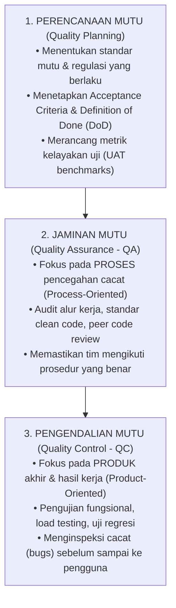
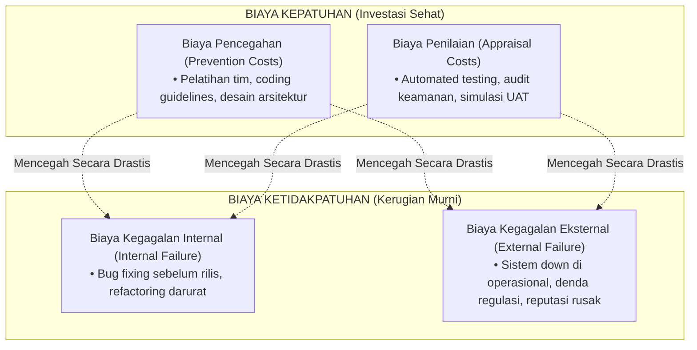
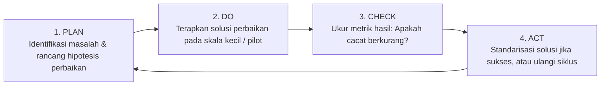
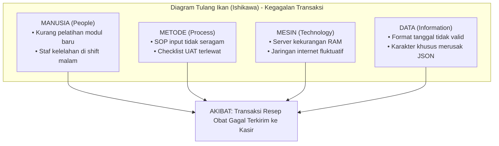
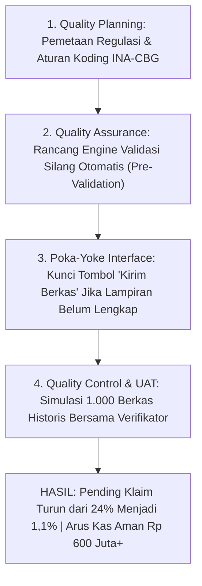

# Modul 03: Manajemen Mutu dan Peningkatan Berkelanjutan (Quality Management & Continuous Improvement)

Banyak tim proyek mengira bahwa menyelesaikan proyek tepat waktu (*on schedule*) dan sesuai anggaran (*on budget*) sudah cukup untuk disebut sukses. Namun, jika sistem yang diluncurkan penuh dengan *bug*, sering mengalami kelambatan (*lagging*), menghasilkan data yang tidak akurat, atau membingungkan pengguna operasional, proyek tersebut pada hakikatnya telah gagal.

Dalam fase eksekusi (*running the project*), **Manajemen Mutu (*Quality Management*)** bukanlah tahapan inspeksi di akhir proyek sebelum rilis; mutu adalah **budaya rekayasa berkelanjutan yang dibangun di setiap baris kode, setiap alur form, dan setiap interaksi tim**.

---

## 1. Tiga Pilar Manajemen Mutu Proyek

Menurut standar manajemen mutu modern (ISO 9001 & PMBOK), manajemen mutu proyek dibagi ke dalam 3 proses terpadu:



### Perbedaan Kunci: QA vs QC

| Kriteria | Quality Assurance (QA) | Quality Control (QC) |
| :--- | :--- | :--- |
| **Fokus Utama** | Mencegah terjadinya cacat (*Prevention*). | Mendeteksi cacat yang sudah terjadi (*Detection*). |
| **Objek Pemeriksaan**| Proses pengembangan, kepatuhan arsitektur, standar coding. | Hasil deliverable perangkat lunak, tampilan UI, respon database. |
| **Kapan Dilakukan?** | Sepanjang siklus hidup proyek (proaktif). | Di akhir iterasi / sprint sebelum rilis (reaktif). |
| **Pertanyaan Inti** | *"Apakah kita membangun sistem dengan cara yang benar?"* | *"Apakah sistem yang kita bangun bekerja sesuai spesifikasi?"* |

---

## 2. Kalkulasi Biaya Mutu (*Cost of Quality - CoQ*)

Banyak manajemen enggan mengalokasikan waktu dan anggaran untuk pengujian menyeluruh karena dianggap memperlambat rilis. Konsep **Cost of Quality (CoQ)** membuktikan secara matematis bahwa **mencegah kesalahan jauh lebih murah daripada memperbaiki kesalahan di masa depan**.



### Aturan 1-10-100 Biaya Mutu:
- **Biaya Rp 1**: Biaya memperbaiki kesalahan saat fase perancangan kebutuhan (BRD/PRD).
- **Biaya Rp 10**: Biaya memperbaiki kesalahan yang sama saat fase pengujian internal (QA/QC).
- **Biaya Rp 100**: Biaya memperbaiki kesalahan tersebut jika sudah sampai ke tangan pengguna hidup di lingkungan produksi (*live production incident*).

---

## 3. Siklus Peningkatan Berkelanjutan: PDCA & Kaizen

Peningkatan mutu bukanlah program sekali jadi, melainkan siklus berulang tanpa henti (*Continuous Improvement*) yang dipelopori oleh W. Edwards Deming:



### Prinsip Kaizen (改善) dalam Tim Proyek:
Kaizen mengajarkan bahwa perbaikan besar tidak lahir dari revolusi mendadak, melainkan dari **akumulasi perbaikan kecil 1% setiap hari** yang dilakukan secara konsisten oleh seluruh anggota tim:
- Mengurangi 1 klik mouse yang tidak perlu pada form kasir.
- Menambahkan validasi batas karakter agar teks tidak terpotong pada cetakan bukti pembayaran.
- Menuliskan komentar dokumentasi yang jelas pada fungsi query yang rumit.

---

## 4. Analisis Akar Masalah: 5 Whys & Diagram Tulang Ikan (Ishikawa)

Ketika sebuah masalah mutu atau insiden kritis terjadi di lapangan, pantangan terbesar PM adalah berhenti pada gejala permukaan (*symptom*). Anda harus menggali hingga menemukan **Akar Masalah (*Root Cause*)**.

### Metode 5 Whys (5 Mengapa):
- **Kasus**: Cetak Surat Eligibilitas Peserta (SEP) BPJS gagal di loket admisi rawat inap.
  1. *Mengapa gagal?* Karena server lokal menerima respon HTTP 504 Gateway Timeout.
  2. *Mengapa timeout?* Karena request bridging menumpuk di antrean memori gateway internal.
  3. *Mengapa request menumpuk?* Karena ada query pencarian riwayat pasien yang memindai seluruh 2 juta baris data tanpa filter indeks.
  4. *Mengapa query tidak menggunakan indeks?* Karena pengembang membuat kolom pencarian baru secara terburu-buru minggu lalu tanpa membuat foreign key index.
  5. *Mengapa bisa lolos tanpa indeks?* **(AKAR MASALAH)** Karena checklist tinjauan kode (*Code Review Guidelines*) tim belum mewajibkan audit performa query database sebelum merge ke branch produksi.
- **Solusi Definitif**: Bukan sekadar me-restart server, melainkan **menambahkan indeks pada kolom database dan mewajibkan checklist audit indeks dalam Definition of Done (DoD)**.



---

## 5. Poka-Yoke: Desain Anti-Keliru pada Antarmuka & Sistem

Berasal dari metodologi manufaktur Toyota, **Poka-Yoke (ポカヨケ)** adalah teknik merancang sistem sedemikian rupa sehingga **kesalahan manusia secara fisik atau logis mustahil terjadi**.

```
+-----------------------------------------------------------------------------------+
|                     PENERAPAN POKA-YOKE DALAM REKAYASA PERANGKAT LUNAK            |
+-----------------------------------------------------------------------------------+
| 1. PEMBATASAN INPUT LOGIS: Kolom tanggal lahir pasien tidak boleh memilih tanggal |
|    di masa depan (otomatis disable kalender H+1 ke atas).                         |
| 2. SANITASI KARAKTER OTOMATIS: Kolom nomor NIK (KTP) otomatis menolak huruf dan  |
|    hanya mengizinkan tepat 16 digit angka; tombol simpan disable jika < 16 digit. |
| 3. PERINGATAN KONTRAINDIKASI KLINIS: Ketika dokter meresepkan antibiotik penisilin,|
|    sistem otomatis memunculkan dialog merah jika pasien memiliki riwayat alergi   |
|    dan mengunci tombol simpan sebelum ada konfirmasi override DPJP.               |
| 4. DATABASE INTEGRITY GUARD: Menggunakan constraint NOT NULL dan Foreign Key ketat |
|    agar tidak ada data yatim piatu (*orphaned records*) yang merusak laporan.     |
+-----------------------------------------------------------------------------------+
```

---

## 6. Studi Kasus Riil: Mengeliminasi Pending Klaim Melalui Pengendalian Mutu Terintegrasi

### Konteks Skenario
- **Inisiatif Proyek**: Modernisasi Sistem Rekonsiliasi Klaim BPJS Kesehatan RS Indriati.
- **Masalah Lapangan**:
  - Tingkat pending klaim BPJS mencapai 24% dari total berkas yang diajukan setiap bulan, menahan piutang rumah sakit senilai Rp 650.000.000.
  - Alasan pending terbanyak: Ketidakcocokan antara diagnosis ICD-10 dengan prosedur tindakan ICD-9-CM, serta berkas penunjang laboratorium yang belum terunggah.

### Rencana Tindakan Mutu oleh PM (Dessy Rahmawati Chairullina):



1. **Penerapan Pre-Validation Rules (QA di Tingkat Input)**:
   - Membuat modul pemeriksa logika koding (*logical validation engine*) yang otomatis mengecek keselarasan diagnosis utama vs prosedur medis sebelum berkas ditutup.
2. **Desain Poka-Yoke Berkas**:
   - Jika berkas pasien rawat inap berstatus "Operasi Bedah", sistem otomatis mewajibkan unggahan PDF Laporan Operasi dan Laporan Anestesi. Tombol *Finalisasi Klaim* berwarna abu-abu mati (*disabled*) hingga berkas diverifikasi lengkap.
3. **Hasil Pengukuran Mutu (Quality Metrics)**:
   - Dalam 60 hari implementasi, tingkat penolakan/pending berkas turun drastis dari **24% menjadi hanya 1,1%**.
   - Waktu verifikasi berkas klaim per pasien terpangkas dari **35 menit menjadi 8 menit**.
   - Rumah sakit berhasil mencairkan piutang klaim Rp 1,3 Miliar tepat waktu tanpa sanksi penundaan dari BPJS.

---

## 7. Actionable Checklist Manajemen Mutu untuk PM

```
[ ] 1. Definition of Done (DoD) Jelas: Apakah setiap tiket fitur memiliki kriteria penerimaan (Acceptance Criteria) yang dapat diuji secara objektif?
[ ] 2. Alokasi Biaya Pencegahan (CoQ): Apakah Anda telah mengalokasikan minimal 20% waktu sprint untuk penulisan automated test dan peer code review?
[ ] 3. Poka-Yoke Terpasang: Apakah antarmuka pengguna telah dilengkapi validasi otomatis yang mencegah staf salah menginput format data?
[ ] 4. Budaya 5 Whys: Saat terjadi kegagalan sistem, apakah Anda menggali hingga menemukan kelemahan proses mendasar, bukan sekadar menyalahkan individu?
[ ] 5. UAT Sign-Off Independen: Apakah pengujian penerimaan pengguna dilakukan langsung oleh perwakilan staf operasional, bukan oleh developer yang menulis kodenya?
```
