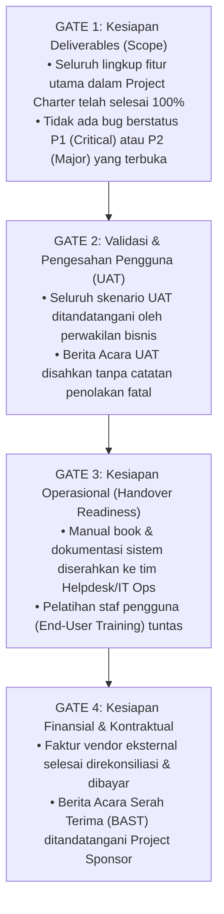
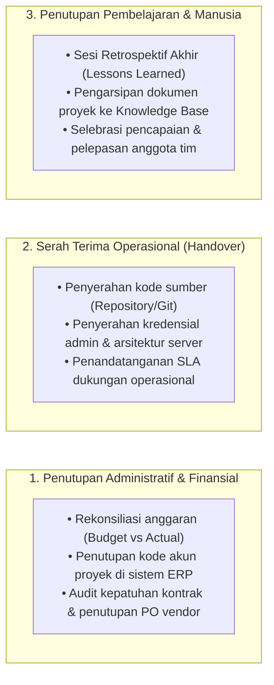
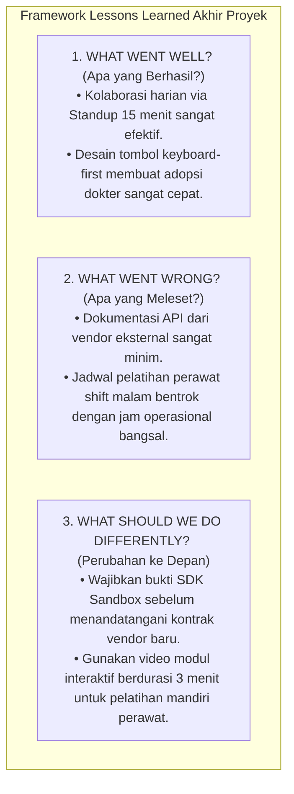
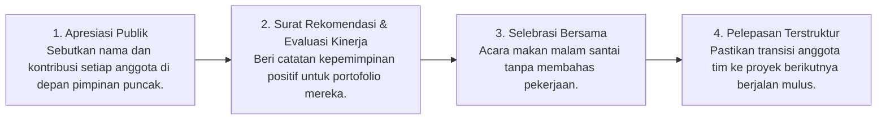

# Modul 04: Cara dan Waktu yang Tepat untuk Menutup Proyek (How and When to Close a Project)

Salah satu kelemahan paling kronis dalam manajemen proyek di banyak organisasi adalah **"Proyek yang Tidak Pernah Berakhir (*The Never-Ending Project Syndrome*)"**. Proyek yang seharusnya selesai dalam waktu 6 bulan terus berlarut-larut hingga 1 tahun lebih, di mana tim pengembang terus-menerus melayani komplain kecil operasional, pengguna menuntut revisi fitur tanpa henti, dan anggaran membengkak tanpa garis akhir yang jelas.

Menutup proyek (*closing the project*) bukanlah sekadar mematikan laptop dan membubarkan tim begitu saja. Penutupan proyek adalah **fase penentu di mana nilai bisnis (*business value*) disahkan secara hukum, kepemilikan dialihkan ke tim operasional, dan modal reputasi Anda sebagai Project Manager (PM) dikunci secara permanen**.

---

## 1. Kapan Waktu yang Tepat Menutup Proyek? (*Closing Criteria*)

Sebuah proyek siap ditutup secara formal apabila telah memenuhi **4 Kriteria Kesiapan Penutupan (*Closing Gates*)**:



### Jebakan "Never-Ending Project" & Cara Mengatasinya:

| Gejala Proyek Tidak Berujung | Penyebab Mendasar | Solusi Tegas PM |
| :--- | :--- | :--- |
| Pengguna terus meminta modifikasi form minor: *"Tolong tambahkan 2 kolom lagi ya..."* | Tidak ada garis pemisah antara proyek (*development*) dengan pemeliharaan (*maintenance*). | Tegakkan batas **Warranty Period (Masa Garansi)**: *"Perubahan baru setelah tanggal BAST akan diproses melalui alur tiket Change Request tim pemeliharaan reguler."* |
| Tim IT operasional menolak menerima serah terima sistem: *"Kami belum siap pegang sistem ini."* | Tim IT operasional tidak dilibatkan sejak awal dan tidak diberikan dokumentasi teknis. | Jalankan **Job Shadowing 2 Minggu**: Tim proyek mendampingi tim operasional hingga mereka mandiri melakukan penanganan tiket L1 & L2. |
| Tagihan vendor pihak ketiga menggantung selama berbulan-bulan. | Dokumen berita acara penyelesaian pekerjaan terlambat diproses. | Jalankan audit rekonsiliasi finansial serentak bersama Manajer Keuangan pada H-7 penutupan. |

---

## 2. Tiga Pilar Eksekusi Penutupan Proyek

Proses penutupan proyek mencakup tiga pilar yang harus dijalankan secara paralel:



---

## 3. Format Dokumen Baku: Berita Acara Serah Terima (BAST)

BAST adalah dokumen hukum tertinggi yang menyatakan bahwa tanggung jawab proyek telah resmi berpindah dari Tim Proyek kepada Pemilik Bisnis (*Business Owner / Operational Management*):

```
===================================================================================
                        BERITA ACARA SERAH TERIMA (BAST)
                          PEKERJAAN TRANSFORMASI SISTEM
Nomor Dokumen : BAST/SIMRS-RME/2026/XI-08
Tanggal       : 20 November 2026
Lokasi        : Rumah Sakit Indriati Boyolali
===================================================================================

Pada hari ini, Jumat tanggal Dua Puluh bulan November tahun Dua Ribu Dua Puluh Enam, 
kami yang bertanda tangan di bawah ini:

1. PIHAK PERTAMA (Yang Menyerahkan):
   Nama      : Dessy Rahmawati Chairullina, S.Kom
   Jabatan   : Lead Project Manager / Business Analyst Transformasi Digital
   Instansi  : Tim Proyek Modernisasi SIMRS RS Indriati

2. PIHAK KEDUA (Yang Menerima):
   Nama      : dr. H. Bambang Soedjatmiko, Sp.B
   Jabatan   : Direktur Pelayanan Medis & Keperawatan (Business Owner)
   Instansi  : Rumah Sakit Indriati Boyolali

MENYATAKAN SEBAGAI BERIKUT:
1. PIHAK PERTAMA telah menyelesaikan 100% ruang lingkup pekerjaan pengembangan dan 
   implementasi "Modul Rekam Medis Elektronik (RME) Rawat Inap & Bridging SatuSehat" 
   sesuai dengan Piagam Proyek (Project Charter) tertanggal 15 Juli 2026.
2. Seluruh hasil pengujian User Acceptance Testing (UAT) telah disetujui dan ditanda-
   tangani tanpa catatan cacat kritis (Zero P1/P2 Defects).
3. Seluruh dokumentasi teknis, kode sumber (GitHub Repository), kamus data, dan 
   manual book operasional telah diserahkan secara lengkap kepada Kepala Divisi IT.
4. PIHAK PERTAMA memberikan masa garansi pemeliharaan (Warranty Period) selama 30 
   (tiga puluh) hari kalender terhitung sejak tanggal penandatanganan dokumen ini.
5. Terhitung sejak ditandatanganinya BAST ini, pengoperasian dan dukungan tingkat 
   pertama (L1 Helpdesk) resmi menjadi tanggung jawab Divisi IT Operasional Rumah Sakit.

Demikian Berita Acara Serah Terima ini dibuat dalam rangkap 2 (dua) bermaterai cukup 
dan memiliki kekuatan hukum yang sama bagi kedua belah pihak.

PIHAK PERTAMA (Tim Proyek),                      PIHAK KEDUA (Business Owner),


( Dessy Rahmawati Chairullina, S.Kom )            ( dr. H. Bambang Soedjatmiko, Sp.B )

Mengetahui & Menyetujui:
Project Sponsor / Direktur Utama RS Indriati


( Dr. dr. R. Hendro Kusumo, MARS )
===================================================================================
```

---

## 4. Memfasilitasi Sesi "Lessons Learned" yang Berdaya Guna

Sesi peninjauan pasca-implementasi (*Post-Implementation Review / Retrospective*) sering kali gagal jika berubah menjadi formalitas membosankan atau ajang saling menyalahkan. 

Gunakan format **Start - Stop - Continue** untuk menyaring pembelajaran nyata bagi organisasi:



### Aturan Emas Retrospektif Norm Kerth (*Prime Directive*):
> *"Terlepas dari apa yang kita temukan hari ini, kita harus benar-benar memahami dan percaya bahwa setiap orang telah melakukan pekerjaan terbaik yang mereka bisa, dengan apa yang mereka ketahui saat itu, keterampilan dan sumber daya yang tersedia, serta situasi yang dihadapi."*

---

## 5. Merayakan Kemenangan & Pelepasan Tim (*Release & Celebration*)

Menutup proyek bukan hanya urusan birokrasi berkas; ini adalah tentang **manusia**. Setelah berbulan-bulan bekerja keras di bawah tekanan tenggat waktu, anggota tim berhak mendapatkan penutupan emosional:



---

## 6. Studi Kasus Riil: Penutupan Sukses Proyek Modernisasi SIMRS Indriati

### Latar Belakang Kasus
- **Lead Project Manager**: Dessy Rahmawati Chairullina, S.Kom.
- **Nama Inisiatif**: Peluncuran Terpadu RME Rawat Inap & Bridging SatuSehat Kemenkes RI.
- **Durasi Proyek**: 5 Bulan (Selesai Tepat Waktu).
- **Tantangan Akhir**: Beberapa kepala ruangan bangsal mencoba menahan proses penutupan karena menginginkan penambahan 15 fitur kustom di luar piagam awal.

### Strategi Eksekusi Penutupan oleh PM:
1. **Penegasan Ruang Lingkup vs Backlog Fase 2**:
   - PM menunjukkan dokumen Piagam Proyek awal yang telah disetujui direksi 5 bulan lalu.
   - PM mendokumentasikan 15 usulan baru tersebut ke dalam dokumen resmi **"Backlog Prioritas Fase 2"** yang akan diajukan pada tahun anggaran berikutnya. Hal ini membuat kepala ruangan merasa dihargai tanpa menyandera penutupan proyek fase 1.
2. **Eksekusi Handover Bertingkat (3-Tier Support)**:
   - Membuat matriks alur eskalasi: Komplain login atau printer macet ditangani langsung oleh Helpdesk IT L1; isu formula kalkulasi farmasi diteruskan ke L2; bug arsitektur ditangani oleh L3.
3. **Penandatanganan BAST & Selebrasi**:
   - BAST resmi ditandatangani oleh Direktur Pelayanan Medis dan disahkan oleh Direktur Utama.
   - Menggelar acara pemotongan tumpeng bersama seluruh perwakilan perawat, staf kasir, dokter spesialis, dan tim pengembang software.
   - Sisa anggaran efisiensi sebesar Rp 28.000.000 dikembalikan ke kas umum rumah sakit dengan predikat *Under-Budget Delivery*.

---

## 7. Actionable Checklist Penutupan Proyek untuk PM

```
[ ] 1. Verifikasi UAT 100%: Apakah seluruh kriteria keberhasilan pada piagam proyek telah diverifikasi dan disetujui oleh pengguna bisnis?
[ ] 2. Zero P1/P2 Bugs: Apakah tidak ada lagi bug berisiko tinggi yang menggantung di papan pelacakan isu?
[ ] 3. BAST Ditandatangani: Apakah Berita Acara Serah Terima telah disahkan bermaterai oleh Project Sponsor dan Business Owner?
[ ] 4. Serah Terima Kredensial & Repositori: Apakah akses master, konfigurasi server, dan dokumentasi arsitektur telah diserahkan ke tim IT operasional?
[ ] 5. Penutupan Finansial: Apakah seluruh tagihan vendor telah lunas dan kode akun proyek telah dinonaktifkan di sistem keuangan?
[ ] 6. Lessons Learned Terarsip: Apakah retrospektif akhir telah didokumentasikan ke dalam Knowledge Base organisasi untuk referensi proyek masa depan?
[ ] 7. Apresiasi Tim: Apakah seluruh anggota tim telah menerima ucapan terima kasih personal dan pengakuan kinerja di hadapan manajemen?
```
