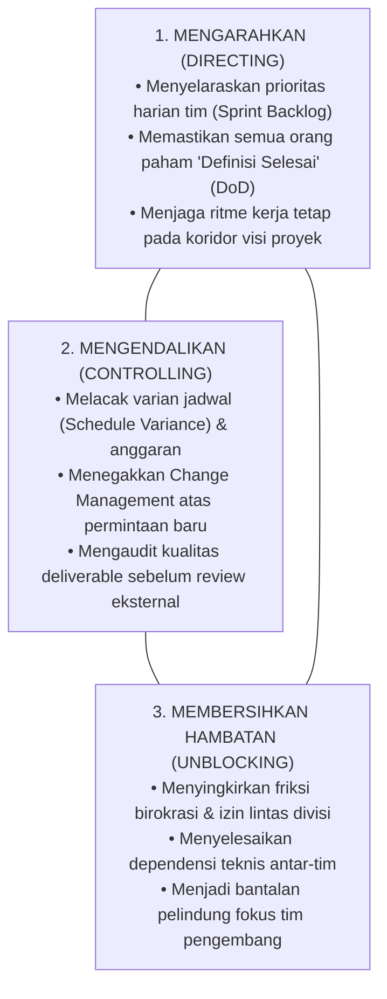
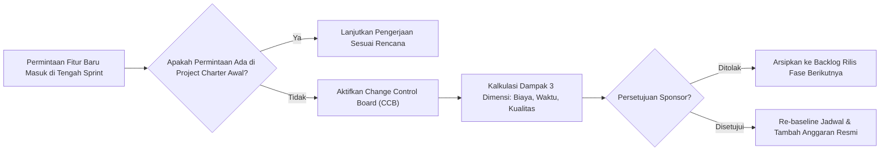
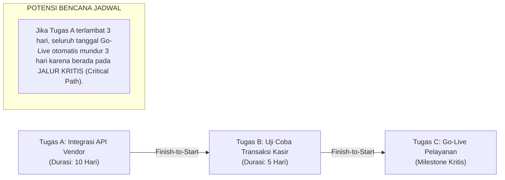
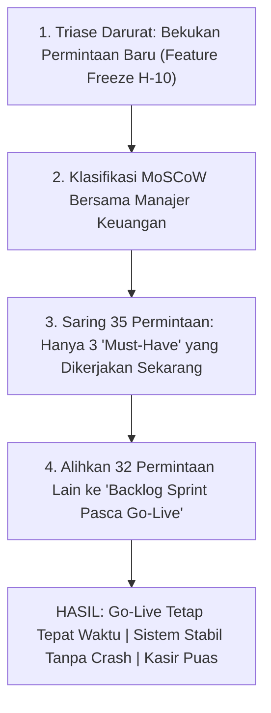

# Modul 05: Manajemen Proyek yang Efektif (Effective Project Management & Execution Governance)

Menjalankan proyek (*running the project*) secara efektif bukan berarti memastikan bahwa segala sesuatu berjalan 100% mulus tanpa ada masalah sama sekali. Di dunia nyata, masalah, kejutan, dan perubahan adalah hal yang pasti terjadi. 

Efektivitas manajemen proyek diukur dari **seberapa cepat dan tepat Anda merespons penyimpangan (*variances*)**, **seberapa tangguh sistem kendali (*control systems*) yang Anda bangun untuk melindungi tim dari gangguan**, dan **seberapa konsisten Anda menghantarkan nilai bisnis di tengah ketidakpastian**.

Seorang Project Manager (PM) yang efektif tidak bertindak seperti pemadam kebakaran yang panik berlarian ke sana kemari, melainkan seperti **arsitek sistem kendali**: tenang, terukur, dan selalu selangkah lebih maju dari potensi krisis.

---

## 1. Triad Eksekusi Proyek: Directing, Controlling, and Unblocking

Dalam ritme kerja harian di fase eksekusi, perhatian PM terbagi ke dalam tiga pilar operasional:



---

## 2. Pengendalian Perubahan Ruang Lingkup (*Disciplined Scope Control*)

Penyebab nomor 1 proyek gagal menghantarkan hasil tepat waktu adalah **Scope Creep**: bertambahnya fitur-fitur baru secara perlahan tanpa penyesuaian jadwal atau anggaran.



### 3 Pertanyaan Filter Sebelum Menerima Perubahan:
1. **Apakah ketiadaan fitur ini membuat sistem tidak bisa digunakan (*showstopper*)?**  
   *Jika sistem masih bisa berjalan normal tanpanya, fitur tersebut bukan prioritas rilis fase 1.*
2. **Fitur apa yang rela dikorbankan untuk digeser ke rilis fase 2?**  
   *Jika pemangku kepentingan menginginkan fitur baru A masuk, mereka harus memilih fitur B yang keluar dari jadwal berjalan.*
3. **Apakah sponsor proyek bersedia menandatangani penambahan anggaran atau pemunduran tanggal rilis?**  
   *Pertanyaan ini seketika menyaring 80% permintaan perubahan yang sifatnya hanya "keinginan sesaat" bukan kebutuhan vital.*

---

## 3. Manajemen Dependensi Kritis & Waktu Jeda (*Critical Path & Lead/Lag*)

Sebuah proyek sering kali mandek bukan karena tim tidak bekerja, melainkan karena mereka terhambat oleh pekerjaan pihak lain yang belum tuntas (*unmanaged dependencies*).



### Taktik Proaktif PM Mengelola Dependensi:
- **Terapkan "Lead Time" (Mulai Lebih Awal)**: Jangan menunggu modul pendaftaran selesai 100% baru mulai merancang form resep obat. Mulai perancangan database resep secara paralel saat modul pendaftaran memasuki fase uji coba.
- **Audit Dependensi Eksternal Setiap Senin Pagi**: Hubungi pihak luar (vendor hardware, tim jaringan, verifikator regulasi) untuk memastikan bahwa deliverable mereka tetap sesuai jadwal sebelum tim internal Anda memerlukannya.

---

## 4. Kebersihan Komunikasi (*Communication Hygiene*): Mengeliminasi Rapat Sia-Sia

Salah satu pemborosan waktu terbesar dalam manajemen proyek modern adalah fenomena *"Rapat tentang Rapat"* yang menguras energi produktif tim.

```
+-----------------------------------------------------------------------------------+
|                     THE COMMUNICATION HYGIENE PROTOCOL                            |
+-----------------------------------------------------------------------------------+
| 1. THE 15-MINUTE STANDUP RULE: Daily standup wajib berdiri, maksimal 15 menit, dan|
|    hanya membahas 3 hal: Selesai kemarin, target hari ini, dan blocker.           |
| 2. NO STATUS-ONLY MEETINGS: Dilarang mengadakan rapat 1 jam hanya untuk mendengarkan|
|    orang membaca status. Ganti dengan Memo Pembaruan Asinkron (Async Digest).     |
| 3. AGENDA OR NO MEETING: Jika penyelenggara rapat tidak mengirimkan agenda dan     |
|    dokumen bahan bacaan minimal 3 jam sebelum rapat, rapat berhak dibatalkan.     |
| 4. TWO-PIZZA RULE (JEFF BEZOS): Jika sebuah pertemuan membutuhkan lebih dari 2 loyang|
|    pizza untuk memberi makan pesertanya, rapat tersebut terlalu gemuk dan tidak    |
|    akan efektif dalam pengambilan keputusan.                                      |
+-----------------------------------------------------------------------------------+
```

---

## 5. Protokol Eskalasi BLUF (Bottom Line Up Front)

Ketika terjadi krisis di lapangan yang membutuhkan intervensi manajemen senior, sampaikan eskalasi menggunakan struktur **BLUF**:

```markdown
### 🚨 ESKALASI KEPUTUSAN: Keterlambatan Pengiriman Scanner Barcode Farmasi
**Kepada**: Direktur Operasional / Project Sponsor  
**Dari**: Dessy Rahmawati Chairullina (Lead PM)  
**Status**: Membutuhkan Keputusan Sebelum Pukul 15.00 WIB Hari Ini

**1. BOTTOM LINE (Inti Keputusan yang Diminta)**:  
Mohon persetujuan penggunaan stok scanner cadangan IGD untuk depo farmasi agar simulasi go-live besok pagi tidak tertunda.

**2. KONTEKS SINGKAT**:  
Vendor pengadaan hardware mengabarkan pengiriman 10 scanner barcode terlambat 4 hari karena kendala ekspedisi logistik. 

**3. OPSI & DAMPAK BISNIS**:  
- Opsi A (Rekomendasi): Pinjam 4 scanner cadangan IGD yang saat ini menganggur. Simulasi UAT tetap jalan 100% tepat waktu; scanner dikembalikan saat paket vendor tiba.
- Opsi B: Tunda simulasi UAT farmasi 4 hari. Mengakibatkan jadwal go-live rumah sakit bergeser 1 minggu dan memicu komplain dokter poli.
```

---

## 6. Studi Kasus Riil: Mengendalikan 35 Permintaan Perubahan Dadakan Menjelang Go-Live

### Konteks Skenario
- **Inisiatif Proyek**: Peluncuran Sistem Pembayaran Terpadu Kasir Rawat Jalan RS Indriati.
- **Situasi Menegangkan**:
  - H-10 sebelum peluncuran sistem baru ke seluruh loket pembayaran.
  - Setelah melihat demo sistem, para kasir, supervisor akuntansi, dan dokter poli mengajukan total **35 permintaan modifikasi fitur baru** (mulai dari font nota, tombol cetak rangkap 3, hingga alur diskon khusus karyawan).
  - Tim pengembang merasa kewalahan dan menyatakan butuh tambahan waktu 1,5 bulan jika semua permintaan itu harus diakomodasi.

### Tindakan Manajemen Efektif oleh PM (Dessy Rahmawati Chairullina):



1. **Penerapan Kebijakan Pembekuan Fitur (*Feature Freeze*)**:
   - PM mengumumkan bahwa per H-10, branch kode produksi resmi dibekukan dari penambahan fitur baru. Hanya perbaikan bug kritis yang diizinkan masuk.
2. **Sesi Triase Cepat Bersama Pemilik Bisnis (*MoSCoW Triage*)**:
   - PM mengumpulkan Kepala Bagian Kasir dan Manajer Keuangan dalam 1 sesi meja bundar berdurasi 45 menit.
   - Dari 35 usulan yang masuk, dievaluasi secara objektif:
     - **3 Permintaan Masuk Kategori MUST-HAVE**: Terkait dengan validasi nominal selisih kas fisik dan cetak nomor transaksi unik BPJS (kepatuhan audit mutlak). Ketiga fitur ini selesai dikerjakan dalam 48 jam.
     - **32 Permintaan Masuk Kategori SHOULD/COULD-HAVE**: Terkait warna latar form, penataan posisi logo rumah sakit, dan pintasan tombol tambahan. Seluruhnya dicatat resmi ke dalam jadwal rilis pemeliharaan minggu kedua pasca go-live.
3. **Hasil Akhir**:
   - Peluncuran sistem kasir baru terlaksana tepat pada tanggal yang dijanjikan tanpa penundaan satu hari pun.
   - Sistem berjalan sangat stabil karena tidak dijejali kode-kode dadakan yang belum teruji.
   - Seluruh pemangku kepentingan mengapresiasi ketegasan PM karena 32 usulan mereka tidak diabaikan, melainkan dijadwalkan secara rapi dan profesional.

---

## 7. Actionable Checklist Manajemen Proyek Efektif

```
[ ] 1. Filter Permintaan Baru: Apakah setiap usulan fitur baru di tengah sprint telah melalui saringan Change Control Board (CCB)?
[ ] 2. Pantau Jalur Kritis (Critical Path): Apakah Anda tahu 3 tugas teratas minggu ini yang jika terlambat 1 hari akan memundurkan seluruh tanggal rilis proyek?
[ ] 3. Audit Rapat Mingguan: Apakah seluruh rapat proyek minggu ini memiliki agenda tertulis dan menghasilkan daftar tindakan (Action Items + PIC) yang jelas?
[ ] 4. Terapkan Format BLUF: Apakah eskalasi Anda ke pimpinan selalu menyajikan rekomendasi solusi konkret di kalimat pertama, bukan cerita kronologis panjang?
[ ] 5. Lindungi Fokus Tim: Apakah tim pengembang Anda memiliki minimal 3 jam blok waktu fokus tanpa gangguan setiap hari untuk menulis kode dan menguji sistem?
```
