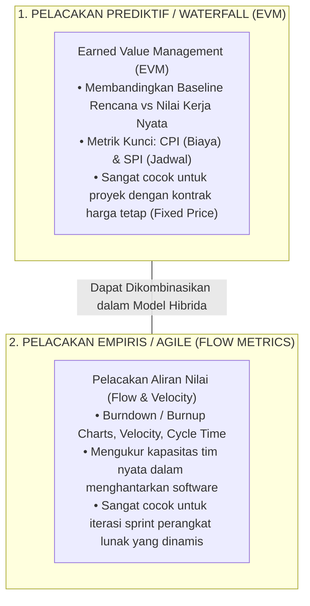
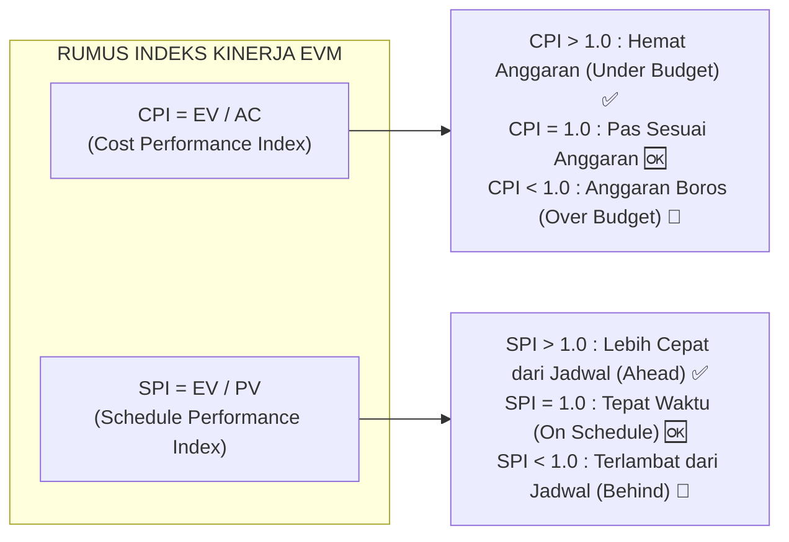
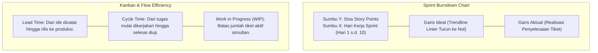

# Modul 06: Metode dan Contoh Pelacakan Proyek (Project Tracking Methods and Examples)

Banyak proyek mengalami kegagalan bukan karena timnya kekurangan orang pintar atau kehabisan anggaran, melainkan karena **mereka tidak menyadari bahwa proyek sedang meleset hingga semuanya sudah terlambat**. Keterlambatan proyek tidak pernah terjadi dalam satu hari; keterlambatan terjadi hari demi hari, sedikit demi sedikit, melalui penundaan-penundaan kecil yang diabaikan.

*"You cannot manage what you do not measure"* (Anda tidak bisa mengelola apa yang tidak Anda ukur). Dalam fase menjalankan proyek (*running the project*), **Pelacakan Proyek (*Project Tracking*)** adalah instrumen navigasi Anda. Tanpa sistem pelacakan yang akurat dan transparan, seorang Project Manager (PM) bagaikan seorang pilot yang menerbangkan pesawat di tengah kabut tebal tanpa panel instrumen kokpit.

---

## 1. Spektrum Pelacakan: Tradisional (EVM) vs Agile (Empiris)

Metode pelacakan proyek harus diselaraskan dengan karakteristik metodologi yang digunakan organisasi:



---

## 2. Earned Value Management (EVM): Matematika Kinerja Proyek

EVM adalah standar internasional paling obyektif untuk mengukur apakah proyek Anda benar-benar berjalan sesuai rencana atau hanya ilusi:

### 3 Variabel Dasar EVM:
1. **Planned Value (PV)**: Nilai anggaran yang *seharusnya* telah diselesaikan menurut jadwal pada tanggal audit.
2. **Actual Cost (AC)**: Jumlah uang riil yang *telah dihabiskan* untuk menyelesaikan pekerjaan hingga hari ini.
3. **Earned Value (EV)**: Nilai anggaran dari pekerjaan yang *benar-benar telah selesai secara fisik/fungsional*.



### Contoh Kasus Kalkulasi EVM:
- Pagu total proyek: Rp 100.000.000 (Durasi: 10 Minggu).
- Di Minggu ke-5, rencana awal harusnya selesai 50% pekerjaan $\rightarrow \mathbf{PV = \text{Rp } 50.000.000}$.
- Di lapangan, tim baru menyelesaikan 40% pekerjaan $\rightarrow \mathbf{EV = \text{Rp } 40.000.000}$.
- Bagian keuangan melaporkan uang yang sudah terpakai adalah $\rightarrow \mathbf{AC = \text{Rp } 48.000.000}$.
- **Analisis Kinerja**:
  - $\text{SPI} = \frac{40.000.000}{50.000.000} = \mathbf{0,80}$ *(Proyek berjalan 20% lebih lambat dari jadwal awal!)*
  - $\text{CPI} = \frac{40.000.000}{48.000.000} = \mathbf{0,83}$ *(Setiap pengeluaran Rp 1.000 hanya menghasilkan nilai kerja sebesar Rp 830!)*

---

## 3. Metrik Pelacakan Agile: Burndown, Velocity, dan Flow

Dalam pengembangan perangkat lunak berbasis Agile, pelacakan berfokus pada kecepatan hantaran fitur yang berfungsi (*working software*):



### Cara Membaca Pola Burndown Chart:
1. **Garis Aktual Berada di Atas Garis Ideal**: Tim terlambat; kemungkinan ada tugas tersembunyi yang belum terestimasi atau terjadi hambatan teknis berat (*blockers*).
2. **Garis Datar Panjang Lalu Turun Tajam di Hari Terakhir**: Pola "Air Terjun Mini" (*Mini-Waterfall*) yang berbahaya. Artinya pengujian (testing) baru dilakukan di hari terakhir dan berisiko memunculkan bug massal saat rilis.
3. **Garis Turun Stabil Secara Bertahap**: Pola tim berkinerja tinggi. Tugas dipecah kecil-kecil dan diselesaikan secara kontinu setiap hari.

---

## 4. Status Reporting yang Jujur: Protokol RAG (Red - Amber - Green)

Pelaporan status proyek sering kali ternoda oleh sindrom *"Semangka"* (*Watermelon Project*): terlihat hijau mulus di luar, namun ketika dibelah di dalamnya sudah merah merona.

Seorang PM profesional menegakkan standar kriteria objektif untuk status **RAG**:

| Status | Kriteria Objektif Proyek | Tindakan yang Wajib Diambil |
| :---: | :--- | :--- |
| **🟢 GREEN (On Track)** | • Varians jadwal & anggaran $< 5\%$.<br>• Tidak ada bug kritis P1.<br>• Semua milestone utama sesuai target. | Lanjutkan eksekusi normal; bagikan pembaruan asinkron rutin mingguan. |
| **🟡 AMBER (At Risk)** | • Varians jadwal atau anggaran antara $5\% - 15\%$.<br>• Ada potensi blocker dari pihak ketiga.<br>• Respon vendor mulai melambat. | Ambil tindakan mitigasi internal; siapkan rencana kontinjensi; laporkan peringatan dini ke sponsor. |
| **🔴 RED (Off Track)** | • Varians jadwal atau biaya $> 15\%$.<br>• Muncul blocker kritis P1 yang menghentikan progres tim.<br>• Tanggal go-live terancam mundur. | **Eskalasi darurat ke Steering Committee**; bentuk *War Room*; tinjau ulang ruang lingkup (descope) atau tambah sumber daya. |

---

## 5. Dashboard Pelacakan Proyek Terpadu (*The Project Cockpit*)

Format ringkas dashboard pelacakan eksekutif yang memadukan data finansial, jadwal, dan operasional:

```
+-------------------------------------------------------------------------------------------------------+
| DASBOR PELACAKAN PROYEK: TRANSFORMASI REKAM MEDIS & BRIDGING SATUSEHAT                                |
| Periode Audit: Minggu ke-8 dari 12 | Tanggal Rilis: 15 Des 2026 | Status Keseluruhan: 🟡 AMBER       |
+-------------------------------------------------------------------------------------------------------+
| [1] METRIK FINANSIAL & JADWAL (EVM):                                                                  |
| • Pagu Anggaran : Rp 250.000.000         • Schedule Performance Index (SPI) : 0,92 (Terlambat 8%)     |
| • Realisasi Kas : Rp 165.000.000         • Cost Performance Index (CPI)     : 1,04 (Hemat Biaya 4%)   |
+-------------------------------------------------------------------------------------------------------+
| [2] METRIK THROUGHPUT SPRINT (AGILE):                                                                 |
| • Sprint Aktif  : Sprint 04 dari 06      • Rata-rata Velocity Tim           : 34 Story Points/Sprint  |
| • Total Backlog : 240 Story Points       • Story Points Selesai (Burnup)    : 162 Points (67,5%)      |
| • Rata-rata Cycle Time: 2,8 Hari/Tiket   • Defect Leakage Rate (Production) : 0,4% (Target < 1,0%)    |
+-------------------------------------------------------------------------------------------------------+
| [3] TOP 2 RISIKO KRITIS & HAMBATAN UTAMA (BLOCKERS):                                                  |
| 1. (🟡 AMBER) Keterlambatan Verifikasi Sertifikat Kemenkes: Proses review sandbox molor 5 hari kerja.  |
|    *Rencana Aksi*: Lead PM menghubungi PIC Tim DTO Kemenkes via jalur komunikasi langsung besok pagi. |
| 2. (🟢 GREEN) Kesiapan Pelatihan Perawat Bangsal: Modul e-learning simulasi telah diakses oleh 84% staf.|
+-------------------------------------------------------------------------------------------------------+
```

---

## 6. Studi Kasus Riil: Menyelamatkan Proyek SIMRS dari Keterlambatan Melalui Deteksi Dini

### Latar Belakang Kasus
- **Nama Proyek**: Implementasi Modul Rekam Medis Elektronik (RME) Gawat Darurat & Farmasi RS Indriati.
- **Durasi Rencana**: 12 Minggu.
- **Lead Project Manager**: Dessy Rahmawati Chairullina, S.Kom.

### Kronologi Penyelamatan Melalui Pelacakan:
1. **Deteksi Dini di Minggu ke-4 (*Early Warning Signal*)**:
   - Berdasarkan Burndown Chart, tim tertinggal 18 story points. Indeks SPI menunjukkan angka **0,84 (🔴 RED ALERT)**.
   - PM menolak menutup-nutupi status ini menjadi hijau. Dalam laporan mingguan ke Direktur, PM menandai modul farmasi berstatus **KUNING/AMBER**.
2. **Diagnosa Akar Masalah (*Root Cause Diagnosis*)**:
   - Melalui analisis Cumulative Flow Diagram (CFD), ditemukan penumpukan kartu tiket di kolom *"Waiting for QA Testing"*.
   - Ternyata 1 analis QA harus menguji 14 form sekaligus seorang diri, menciptakan leher botol (*bottleneck*) yang parah.
3. **Manuver Taktis Penyesuaian (*Corrective Action*)**:
   - PM memindahkan 1 pengembang senior untuk membantu melakukan *automated integration testing* selama 1 minggu.
   - Menerapkan batasan *Work in Progress (WIP Limit)* maksimal 4 tiket aktif di kolom testing.
4. **Hasil Akhir**:
   - Pada Minggu ke-7, kurva Burndown kembali menyentuh garis ideal. Nilai SPI membaik menjadi **1,02 (🟢 ON TRACK)**.
   - Seluruh modul berhasil diluncurkan tepat waktu pada Minggu ke-12 tanpa perlu ada sesi lembur darurat di akhir proyek.

---

## 7. Actionable Checklist Pelacakan Proyek untuk PM

```
[ ] 1. Kalibrasi Baseline: Apakah Anda memiliki rencana baseline resmi (WBS/Sprint Plan) yang telah disahkan sebelum membandingkan data kemajuan?
[ ] 2. Update Burndown Harian: Apakah papan kanban/Jira diperbarui setiap hari kerja setelah Daily Standup, bukan hanya di akhir minggu?
[ ] 3. Audit Indeks EVM: Jika menggunakan kontrak harga tetap, apakah Anda menghitung nilai CPI dan SPI secara berkala setiap 2 minggu?
[ ] 4. Budaya Pelaporan Jujur: Apakah tim Anda merasa aman untuk menandai status proyek menjadi KUNING atau MERAH tanpa takut dimarahi?
[ ] 5. Tindakan Korektif Konkret: Setiap kali status proyek turun menjadi KUNING/MERAH, apakah laporan selalu disertai dengan minimal 2 rencana aksi perbaikan?
```
