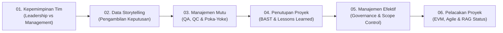

# Course 4: Project Execution — Running the Project
## Google Project Management Professional Certificate

> **Catatan Belajar & Dokumentasi Khusus Fase Eksekusi Proyek**  
> Disusun oleh: **Dessy Rahmawati Chairullina, S.Kom**  
> Sumber Materi: *Google Career Certificates — Project Execution: Running the Project*  
> Playlist Referensi: [Running the Project | Google Project Management Certificate](https://www.youtube.com/playlist?list=PLTZYG7bZ1u6pHAmqR_WefTq1Wps0QgslA)

---

## 🎯 Fokus Pembelajaran Kursus
Fase eksekusi (*running the project*) adalah tahapan paling dinamis dan krusial dalam siklus hidup proyek. Kursus ini membedah bagaimana seorang Project Manager (PM) memimpin tim lintas fungsi, mengendalikan penyimpangan jadwal dan biaya, menerapkan manajemen mutu berkelanjutan, menyajikan data proyek yang memikat untuk keputusan eksekutif, dan menutup proyek secara profesional.

---

## 🗺️ Peta Modul Pembelajaran

---

## 📋 Daftar Modul & Tautan Dokumentasi

| No | Modul Pembelajaran | Topik Bahasan Kunci | Video Referensi | Dokumen Lengkap |
| :---: | :--- | :--- | :---: | :--- |
| **01** | **Kepemimpinan vs Manajemen dalam Tim yang Sukses** | Hersey-Blanchard situational leadership, Psychological safety, Servant leadership, Menangani *project fatigue*. | [ypLw8he1Xh0](https://www.youtube.com/watch?v=ypLw8he1Xh0) | [01-kepemimpinan-vs-manajemen-tim-sukses.md](./01-kepemimpinan-vs-manajemen-tim-sukses.md) |
| **02** | **Bercerita dengan Data untuk Mengambil Keputusan** | Segitiga Data Storytelling, Analisis Eksplanatori vs Eksploratori, Struktur Narasi 3 Babak, Decluttering charts. | [4VDRNQ_f4IE](https://youtu.be/4VDRNQ_f4IE) | [02-bercerita-dengan-data-untuk-keputusan.md](./02-bercerita-dengan-data-untuk-keputusan.md) |
| **03** | **Manajemen Mutu dan Peningkatan Berkelanjutan** | QA vs QC, Cost of Quality (CoQ) 1-10-100, Siklus PDCA Deming, Kaizen, 5 Whys, Ishikawa fishbone, Poka-yoke. | [QOy2gYuWxSc](https://youtu.be/QOy2gYuWxSc) | [03-manajemen-mutu-dan-peningkatan-berkelanjutan.md](./03-manajemen-mutu-dan-peningkatan-berkelanjutan.md) |
| **04** | **Cara dan Waktu yang Tepat untuk Menutup Proyek** | 4 Kriteria Penutupan (*Closing Gates*), Mencegah *Never-Ending Project*, Dokumen BAST, Retrospektif Norm Kerth, Selebrasi tim. | [wJ5f7TxcPR0](https://youtu.be/wJ5f7TxcPR0) | [04-cara-dan-waktu-menutup-proyek.md](./04-cara-dan-waktu-menutup-proyek.md) |
| **05** | **Manajemen Proyek yang Efektif** | Triad Directing-Controlling-Unblocking, Disiplin Change Control Board (CCB), Critical Path & Lead/Lag, Protokol BLUF. | [umnB8LJImbI](https://youtu.be/umnB8LJImbI) | [05-manajemen-proyek-yang-efektif.md](./05-manajemen-proyek-yang-efektif.md) |
| **06** | **Metode dan Contoh Pelacakan Proyek** | Earned Value Management (EVM - CPI/SPI), Agile Burndown/Burnup, Velocity, Cycle Time, RAG Status reporting, Cockpit Dashboard. | [oLh8akA7F3I](https://youtu.be/oLh8akA7F3I) | [06-metode-dan-contoh-pelacakan-proyek.md](./06-metode-dan-contoh-pelacakan-proyek.md) |

---
*© 2026 Dessy Rahmawati Chairullina, S.Kom • Google Project Management Professional Program*
