# Google Project Management Professional Certificate
## Comprehensive Learning Notes, Frameworks & Real-World Case Studies

> **Catatan Belajar & Dokumentasi Profesional Project Management**  
> Disusun oleh: **Dessy Rahmawati Chairullina, S.Kom**  
> Sumber Materi: *Google Career Certificates — Project Management Professional Program*  
> Playlist Referensi: [Google Project Management Certificate (Grow with Google)](https://www.youtube.com/playlist?list=PLTZYG7bZ1u6puLWxUtqAjZkIB4dB_JFzk)

---

## 🎯 Tujuan Repositori
Repositori ini berisi dokumentasi terstruktur, intisari materi, bedah metodologi, dan **studi kasus aplikatif** dari kurikulum lengkap 46 modul **Google Project Management Certificate**. Repositori ini dirancang sebagai standar acuan profesional dan portofolio implementasi manajemen proyek di industri teknologi, kesehatan (*healthcare*), dan sistem *enterprise*.

---

## 🗺️ Roadmap Kurikulum Project Management (46 Modul Lengkap)

```mermaid
flowchart LR
    C1["01. Foundations of PM<br>(Modul 01-05)"] --> C2["02. Project Initiation<br>(Modul 06-10)"]
    C2 --> C3["03. Project Planning<br>(Modul 11-13)"]
    C3 --> C4["04. Execution & Quality<br>(Modul 14-17)"]
    C4 --> C5["05. Agile & Scrum<br>(Modul 18-22)"]
    C5 --> C6["06. Real-World Delivery<br>(Modul 23-27)"]
    C6 --> C7["07. Lean & Modern PM<br>(Modul 28-32)"]
    C7 --> C8["08. Enterprise & Healthcare<br>(Modul 33-37)"]
    C8 --> C9["09. Advanced Governance<br>(Modul 38-40)"]
    C9 --> C10["10. Leadership & Capstone<br>(Modul 41-46)"]
```



| Bagian | Topik Kursus | Status | Dokumentasi |
| :--- | :--- | :---: | :--- |
| **Course 1** | **Foundations of Project Management** | 🟢 Selesai | [`COURSE-PROJECT-MANAGEMENT/`](./COURSE-PROJECT-MANAGEMENT/) |
| • Module 01 | Intro to Project Management (Role, Value, & Life Cycle) | ✅ Selesai | [01-intro-to-project-management.md](./COURSE-PROJECT-MANAGEMENT/01-intro-to-project-management.md) |
| • Module 02 | Finding Project Manager Jobs & Career Pathways | ✅ Selesai | [02-finding-project-manager-jobs.md](./COURSE-PROJECT-MANAGEMENT/02-finding-project-manager-jobs.md) |
| • Module 03 | How Company Culture & Structure Affects Projects | ✅ Selesai | [03-company-culture-and-project-management.md](./COURSE-PROJECT-MANAGEMENT/03-company-culture-and-project-management.md) |
| • Module 04 | Running Effective Meetings (Pre, During, Post Framework) | ✅ Selesai | [04-running-effective-meetings.md](./COURSE-PROJECT-MANAGEMENT/04-running-effective-meetings.md) |
| • Module 05 | Effective Communication for Project Managers | ✅ Selesai | [05-effective-communication-for-pms.md](./COURSE-PROJECT-MANAGEMENT/05-effective-communication-for-pms.md) |
| **Course 2** | **Project Initiation: Starting a Successful Project** | 🟢 Selesai | [`COURSE-PROJECT-MANAGEMENT/`](./COURSE-PROJECT-MANAGEMENT/) |
| • Module 06 | Key Components of Project Initiation & Project Charter | ✅ Selesai | [06-project-initiation-components.md](./COURSE-PROJECT-MANAGEMENT/06-project-initiation-components.md) |
| • Module 07 | Stakeholder Engagement & Communication (Power-Interest & RACI) | ✅ Selesai | [07-stakeholder-engagement-and-communication.md](./COURSE-PROJECT-MANAGEMENT/07-stakeholder-engagement-and-communication.md) |
| • Module 08 | Setting SMART Goals & OKRs for Measurable Impact | ✅ Selesai | [08-setting-smart-goals-and-okrs.md](./COURSE-PROJECT-MANAGEMENT/08-setting-smart-goals-and-okrs.md) |
| • Module 09 | Project Management Tools & Software Architecture | ✅ Selesai | [09-project-management-tools-and-software.md](./COURSE-PROJECT-MANAGEMENT/09-project-management-tools-and-software.md) |
| • Module 10 | Risk Management Fundamentals & Master Risk Register | ✅ Selesai | [10-risk-management-fundamentals.md](./COURSE-PROJECT-MANAGEMENT/10-risk-management-fundamentals.md) |
| **Course 3** | **Project Planning: Putting It All Together** | 🟢 Selesai | [`COURSE-PROJECT-MANAGEMENT/`](./COURSE-PROJECT-MANAGEMENT/) |
| • Module 11 | The Power & Benefits of Comprehensive Project Planning | ✅ Selesai | [11-power-of-project-planning.md](./COURSE-PROJECT-MANAGEMENT/11-power-of-project-planning.md) |
| • Module 12 | Creating a Master Project Communication Plan | ✅ Selesai | [12-project-communication-plan.md](./COURSE-PROJECT-MANAGEMENT/12-project-communication-plan.md) |
| • Module 13 | Project Budgeting, Cost Estimation & Procurement | ✅ Selesai | [13-project-budgeting-and-procurement.md](./COURSE-PROJECT-MANAGEMENT/13-project-budgeting-and-procurement.md) |
| **Course 4** | **Project Execution & Quality Assurance** | 🟢 Selesai | [`COURSE-PROJECT-MANAGEMENT/`](./COURSE-PROJECT-MANAGEMENT/) |
| • Module 14 | Leadership vs Management in High-Performing Teams | ✅ Selesai | [14-leadership-vs-management-in-teams.md](./COURSE-PROJECT-MANAGEMENT/14-leadership-vs-management-in-teams.md) |
| • Module 15 | Data Storytelling for Decision Making | ✅ Selesai | [15-data-storytelling-for-decision-making.md](./COURSE-PROJECT-MANAGEMENT/15-data-storytelling-for-decision-making.md) |
| • Module 16 | Quality Management & Continuous Improvement (QA vs QC) | ✅ Selesai | [16-quality-management-and-continuous-improvement.md](./COURSE-PROJECT-MANAGEMENT/16-quality-management-and-continuous-improvement.md) |
| • Module 17 | How & When to Close a Project (BAST & Lessons Learned) | ✅ Selesai | [17-project-closing-and-retrospective.md](./COURSE-PROJECT-MANAGEMENT/17-project-closing-and-retrospective.md) |
| **Course 5** | **Agile & Scrum Project Management** | 🟢 Selesai | [`COURSE-PROJECT-MANAGEMENT/`](./COURSE-PROJECT-MANAGEMENT/) |
| • Module 18 | Project Tracking Methods & Performance Metrics | ✅ Selesai | [18-project-tracking-methods-and-metrics.md](./COURSE-PROJECT-MANAGEMENT/18-project-tracking-methods-and-metrics.md) |
| • Module 19 | What is Scrum? Roles, Events, & Artifacts | ✅ Selesai | [19-what-is-scrum-framework.md](./COURSE-PROJECT-MANAGEMENT/19-what-is-scrum-framework.md) |
| • Module 20 | Agile & Scrum in the Real World: User Stories & Estimation | ✅ Selesai | [20-agile-and-scrum-in-the-real-world.md](./COURSE-PROJECT-MANAGEMENT/20-agile-and-scrum-in-the-real-world.md) |
| • Module 21 | The Scrum Master Playbook: Facilitation & Blocker Removal | ✅ Selesai | [21-scrum-master-guide-and-facilitation.md](./COURSE-PROJECT-MANAGEMENT/21-scrum-master-guide-and-facilitation.md) |
| • Module 22 | Agile Management & High-Impact Retrospectives | ✅ Selesai | [22-agile-management-and-retrospectives.md](./COURSE-PROJECT-MANAGEMENT/22-agile-management-and-retrospectives.md) |
| **Course 6** | **Capstone: Applying PM in the Real World** | 🟢 Selesai | [`COURSE-PROJECT-MANAGEMENT/`](./COURSE-PROJECT-MANAGEMENT/) |
| • Module 23 | Writing Executive Project Closure Reports | ✅ Selesai | [23-writing-project-closure-reports.md](./COURSE-PROJECT-MANAGEMENT/23-writing-project-closure-reports.md) |
| • Module 24 | Advanced Planning & Stakeholder Negotiation | ✅ Selesai | [24-advanced-planning-and-stakeholder-negotiation.md](./COURSE-PROJECT-MANAGEMENT/24-advanced-planning-and-stakeholder-negotiation.md) |
| • Module 25 | Master Project Planning with Google Sheets | ✅ Selesai | [25-master-project-planning-with-spreadsheets.md](./COURSE-PROJECT-MANAGEMENT/25-master-project-planning-with-spreadsheets.md) |
| • Module 26 | Defining & Measuring True Project Success | ✅ Selesai | [26-defining-and-measuring-project-success.md](./COURSE-PROJECT-MANAGEMENT/26-defining-and-measuring-project-success.md) |
| • Module 27 | Navigating VUCA in Modern Project Management | ✅ Selesai | [27-navigating-vuca-in-project-management.md](./COURSE-PROJECT-MANAGEMENT/27-navigating-vuca-in-project-management.md) |
| **Specialization** | **Advanced PM Practices & Lean Methodologies** | 🟢 Selesai | [`COURSE-PROJECT-MANAGEMENT/`](./COURSE-PROJECT-MANAGEMENT/) |
| • Module 28 | 5 Principles of Lean Methodology & Waste Elimination | ✅ Selesai | [28-lean-methodology-and-waste-elimination.md](./COURSE-PROJECT-MANAGEMENT/28-lean-methodology-and-waste-elimination.md) |
| • Module 29 | Hybrid Project Management: Blending Agile & Waterfall | ✅ Selesai | [29-hybrid-project-management-methodology.md](./COURSE-PROJECT-MANAGEMENT/29-hybrid-project-management-methodology.md) |
| • Module 30 | The Agile Manifesto & The 12 Guiding Principles | ✅ Selesai | [30-the-agile-manifesto-and-12-principles.md](./COURSE-PROJECT-MANAGEMENT/30-the-agile-manifesto-and-12-principles.md) |
| • Module 31 | Customer Centricity & The Strategic Value of a PM | ✅ Selesai | [31-customer-centricity-and-pm-strategic-value.md](./COURSE-PROJECT-MANAGEMENT/31-customer-centricity-and-pm-strategic-value.md) |
| • Module 32 | AI in Project Management & The Modern PM Toolkit | ✅ Selesai | [32-ai-in-project-management-and-modern-toolkit.md](./COURSE-PROJECT-MANAGEMENT/32-ai-in-project-management-and-modern-toolkit.md) |
| **Industry Tracks**| **Healthcare & Enterprise Systems Deep-Dive** | 🟢 Selesai | [`COURSE-PROJECT-MANAGEMENT/`](./COURSE-PROJECT-MANAGEMENT/) |
| • Module 33 | Clinical Workflow Mapping & EMR Change Adoption | ✅ Selesai | [33-clinical-workflow-mapping-and-emr-adoption.md](./COURSE-PROJECT-MANAGEMENT/33-clinical-workflow-mapping-and-emr-adoption.md) |
| • Module 34 | Healthcare Financial Reconciliation & Claims Management | ✅ Selesai | [34-financial-reconciliation-and-claims-management.md](./COURSE-PROJECT-MANAGEMENT/34-financial-reconciliation-and-claims-management.md) |
| • Module 35 | Enterprise System Architecture & FHIR Interoperability | ✅ Selesai | [35-enterprise-interoperability-and-fhir-standards.md](./COURSE-PROJECT-MANAGEMENT/35-enterprise-interoperability-and-fhir-standards.md) |
| • Module 36 | Data Governance, Patient Privacy & Security Audits | ✅ Selesai | [36-data-governance-patient-privacy-and-security.md](./COURSE-PROJECT-MANAGEMENT/36-data-governance-patient-privacy-and-security.md) |
| • Module 37 | Multi-Vendor Integration & Third-Party SLA Governance | ✅ Selesai | [37-managing-vendor-integrations-and-sla-governance.md](./COURSE-PROJECT-MANAGEMENT/37-managing-vendor-integrations-and-sla-governance.md) |
| **Strategy & Ops** | **Process Optimization & Financial Value** | 🟢 Selesai | [`COURSE-PROJECT-MANAGEMENT/`](./COURSE-PROJECT-MANAGEMENT/) |
| • Module 38 | When to Use Agile & When to Avoid It | ✅ Selesai | [38-when-to-use-agile-and-when-to-avoid-it.md](./COURSE-PROJECT-MANAGEMENT/38-when-to-use-agile-and-when-to-avoid-it.md) |
| • Module 39 | Lean Six Sigma Principles & DMAIC Process Optimization | ✅ Selesai | [39-lean-six-sigma-principles-and-dmaic.md](./COURSE-PROJECT-MANAGEMENT/39-lean-six-sigma-principles-and-dmaic.md) |
| • Module 40 | Calculating Project Business Value, ROI & Financial Feasibility | ✅ Selesai | [40-calculating-project-business-value-and-roi.md](./COURSE-PROJECT-MANAGEMENT/40-calculating-project-business-value-and-roi.md) |
| **Leadership & Capstone**| **Executive Influence, Governance & Career Mastery** | 🟢 Selesai | [`COURSE-PROJECT-MANAGEMENT/`](./COURSE-PROJECT-MANAGEMENT/) |
| • Module 41 | Influencing Stakeholders Without Authority (Cohen-Bradford) | ✅ Selesai | [41-influencing-stakeholders-without-authority.md](./COURSE-PROJECT-MANAGEMENT/41-influencing-stakeholders-without-authority.md) |
| • Module 42 | A Day in the Life of a Project Manager (Time-Blocking & Triage) | ✅ Selesai | [42-day-in-the-life-of-a-project-manager.md](./COURSE-PROJECT-MANAGEMENT/42-day-in-the-life-of-a-project-manager.md) |
| • Module 43 | Demonstrating PM Value to C-Suite (Minto Pyramid & Dashboards) | ✅ Selesai | [43-demonstrating-pm-value-to-c-suite.md](./COURSE-PROJECT-MANAGEMENT/43-demonstrating-pm-value-to-c-suite.md) |
| • Module 44 | Steering Committees & Board Governance (Governance vs Mgmt) | ✅ Selesai | [44-steering-committees-and-board-governance.md](./COURSE-PROJECT-MANAGEMENT/44-steering-committees-and-board-governance.md) |
| • Module 45 | Building High-Performing Teams & Peer Effectiveness (Tuckman) | ✅ Selesai | [45-building-high-performing-teams-and-peer-effectiveness.md](./COURSE-PROJECT-MANAGEMENT/45-building-high-performing-teams-and-peer-effectiveness.md) |
| • Module 46 | BA/PM Career Portfolio & STAR Behavioral Interview Mastery | ✅ Selesai | [46-ba-pm-career-portfolio-and-star-interview-mastery.md](./COURSE-PROJECT-MANAGEMENT/46-ba-pm-career-portfolio-and-star-interview-mastery.md) |

---

## 📂 Struktur Repositori

```
project-management/
├── README.md                                         # Peta kurikulum & progress belajar lengkap 100%
├── COURSE-PROJECT-MANAGEMENT/                        # 46 Modul pembelajaran Google PM lengkap
│   ├── 01-intro-to-project-management.md             # Modul 01: Pengenalan PM, Value, & Siklus Hidup
│   ├── 02-finding-project-manager-jobs.md            # Modul 02: Lanskap Karier PM & Formula XYZ
│   ├── 03-company-culture-and-project-management.md  # Modul 03: Budaya Organisasi & Change Management
│   ├── 04-running-effective-meetings.md              # Modul 04: Cara Menyelenggarakan Rapat Efektif
│   ├── 05-effective-communication-for-pms.md         # Modul 05: Komunikasi Efektif Manajer Proyek
│   ├── 06-project-initiation-components.md           # Modul 06: Bagian Penting Inisiasi Proyek & Charter
│   ├── 07-stakeholder-engagement-and-communication.md # Modul 07: Analisis Stakeholder & Matriks RACI
│   ├── 08-setting-smart-goals-and-okrs.md            # Modul 08: Penetapan Sasaran SMART & OKRs
│   ├── 09-project-management-tools-and-software.md   # Modul 09: Alat Manajemen Proyek & Spreadsheet
│   ├── 10-risk-management-fundamentals.md            # Modul 10: Manajemen Risiko & Risk Register
│   ├── 11-power-of-project-planning.md               # Modul 11: Manfaat Perencanaan Proyek Terstruktur
│   ├── 12-project-communication-plan.md              # Modul 12: Rencana Komunikasi Master Proyek
│   ├── 13-project-budgeting-and-procurement.md       # Modul 13: Anggaran Proyek & Manajemen Pengadaan
│   ├── 14-leadership-vs-management-in-teams.md       # Modul 14: Kepemimpinan Tim & Keamanan Psikologis
│   ├── 15-data-storytelling-for-decision-making.md   # Modul 15: Bercerita dengan Data untuk Keputusan
│   ├── 16-quality-management-and-continuous-improvement.md # Modul 16: Manajemen Mutu (QA vs QC)
│   ├── 17-project-closing-and-retrospective.md       # Modul 17: Penutupan Proyek & Dokumen BAST
│   ├── 18-project-tracking-methods-and-metrics.md    # Modul 18: Pelacakan Proyek & Burndown Charts
│   ├── 19-what-is-scrum-framework.md                 # Modul 19: Framework Scrum (Peran, Acara, Artefak)
│   ├── 20-agile-and-scrum-in-the-real-world.md       # Modul 20: User Stories & Planning Poker
│   ├── 21-scrum-master-guide-and-facilitation.md     # Modul 21: Panduan Praktis Scrum Master
│   ├── 22-agile-management-and-retrospectives.md     # Modul 22: Manajemen Agile & Retrospektif
│   ├── 23-writing-project-closure-reports.md         # Modul 23: Laporan Penutupan Proyek Eksekutif
│   ├── 24-advanced-planning-and-stakeholder-negotiation.md # Modul 24: Negosiasi Stakeholder & BATNA
│   ├── 25-master-project-planning-with-spreadsheets.md # Modul 25: Perencanaan Master dengan Google Sheets
│   ├── 26-defining-and-measuring-project-success.md  # Modul 26: Mengukur Sukses Proyek & Audit PIR
│   ├── 27-navigating-vuca-in-project-management.md   # Modul 27: Menavigasi Dinamika VUCA & Agility
│   ├── 28-lean-methodology-and-waste-elimination.md  # Modul 28: 5 Prinsip Lean & Eliminasi Pemborosan
│   ├── 29-hybrid-project-management-methodology.md   # Modul 29: Metodologi Hibrida (Water-Scrum-Fall)
│   ├── 30-the-agile-manifesto-and-12-principles.md   # Modul 30: Nilai & 12 Prinsip Agile Manifesto
│   ├── 31-customer-centricity-and-pm-strategic-value.md # Modul 31: Customer Centricity & Nilai PM
│   ├── 32-ai-in-project-management-and-modern-toolkit.md # Modul 32: AI dalam Manajemen Proyek Modern
│   ├── 33-clinical-workflow-mapping-and-emr-adoption.md # Modul 33: Pemetaan Alur Klinis & Adopsi RME
│   ├── 34-financial-reconciliation-and-claims-management.md # Modul 34: Rekonsiliasi Finansial & Klaim BPJS
│   ├── 35-enterprise-interoperability-and-fhir-standards.md # Modul 35: Interoperabilitas FHIR & SATUSEHAT
│   ├── 36-data-governance-patient-privacy-and-security.md # Modul 36: Tata Kelola Data & Keamanan UU PDP
│   ├── 37-managing-vendor-integrations-and-sla-governance.md # Modul 37: Manajemen Vendor & Kontrak SLA
│   ├── 38-when-to-use-agile-and-when-to-avoid-it.md  # Modul 38: Filter Kesesuaian Metodologi Agile
│   ├── 39-lean-six-sigma-principles-and-dmaic.md     # Modul 39: Lean Six Sigma & Optimasi DMAIC
│   ├── 40-calculating-project-business-value-and-roi.md # Modul 40: Perhitungan Nilai Bisnis & Finansial ROI
│   ├── 41-influencing-stakeholders-without-authority.md # Modul 41: Mempengaruhi Tanpa Otoritas Struktural
│   ├── 42-day-in-the-life-of-a-project-manager.md    # Modul 42: Ritme Harian & Disiplin Waktu PM
│   ├── 43-demonstrating-pm-value-to-c-suite.md       # Modul 43: Membuktikan Nilai PM di Depan Eksekutif
│   ├── 44-steering-committees-and-board-governance.md # Modul 44: Tata Kelola Komite Pengarah (SteerCo)
│   ├── 45-building-high-performing-teams-and-peer-effectiveness.md # Modul 45: Membangun Tim Berkinerja Tinggi
│   └── 46-ba-pm-career-portfolio-and-star-interview-mastery.md # Modul 46: Portofolio Karier & Wawancara STAR
├── templates/                                        # Template dokumen kerja PM (Charter, WBS, RACI)
└── case-studies/                                     # Studi kasus mendalam lintas industri
```

---

## 💡 Standar Format Setiap Catatan Belajar
Setiap modul di repositori ini disusun dengan standar baku:
1. **Executive Summary**: Intisari materi video dalam 3–5 poin kunci.
2. **Konsep & Framework Teori**: Pembahasan mendalam konsep PMBOK/Google PM.
3. **Studi Kasus Nyata (*Real-World Case Study*)**: Penerapan langsung pada skenario proyek IT/Enterprise riil (*Problem Statement ➔ PM Action ➔ Result & Metrics*).
4. **Actionable Checklist**: Panduan praktis yang siap diaplikasikan pada proyek kerja sehari-hari.

---
*© 2026 Dessy Rahmawati Chairullina, S.Kom • Google Project Management Professional Curriculum*
