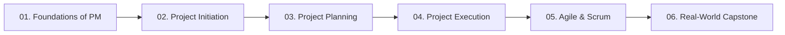

# Google Project Management Professional Certificate
## Comprehensive Learning Notes, Frameworks & Real-World Case Studies

> **Catatan Belajar & Dokumentasi Profesional Project Management**  
> Disusun oleh: **Dessy Rahmawati Chairullina, S.Kom**  
> Sumber Materi: *Google Career Certificates — Project Management Professional Program*  
> Playlist Referensi: [Google Project Management Certificate](https://www.youtube.com/watch?v=rck3MnC7OXA&list=PLcUrHMJVaGzA&index=1)

---

## 🎯 Tujuan Repositori
Repositori ini berisi dokumentasi terstruktur, intisari materi, bedah metodologi, dan **studi kasus aplikatif** dari kurikulum **Google Project Management Certificate**. Repositori ini dirancang sebagai standar acuan profesional dan portofolio implementasi manajemen proyek di industri teknologi, kesehatan (*healthcare*), dan sistem *enterprise*.

---

## 🗺️ Roadmap Kurikulum Project Management



| Bagian | Topik Kursus | Status | Dokumentasi |
| :--- | :--- | :---: | :--- |
| **Course 1** | **Foundations of Project Management** | 🟡 In Progress | [`COURSE-PROJECT-MANAGEMENT/`](./COURSE-PROJECT-MANAGEMENT/) |
| • Module 1 | Intro to Project Management (Role, Value, & Life Cycle) | ✅ Selesai | [01-intro-to-project-management.md](./COURSE-PROJECT-MANAGEMENT/01-intro-to-project-management.md) |
| • Module 2 | Finding Project Manager Jobs & Career Pathways | ✅ Selesai | [02-finding-project-manager-jobs.md](./COURSE-PROJECT-MANAGEMENT/02-finding-project-manager-jobs.md) |
| • Module 3 | How Company Culture & Structure Affects Projects | ✅ Selesai | [03-company-culture-and-project-management.md](./COURSE-PROJECT-MANAGEMENT/03-company-culture-and-project-management.md) |
| • Module 4 | Project Management Methodologies (Agile vs Waterfall) | ⏳ Antrean | - |
| • Module 5 | Organizational Change Management & Governance | ⏳ Antrean | - |
| **Course 2** | **Project Initiation: Starting a Successful Project** | ⏳ Rencana | `02-project-initiation/` |
| **Course 3** | **Project Planning: Putting It All Together** | ⏳ Rencana | `03-project-planning/` |
| **Course 4** | **Project Execution: Running the Project** | ⏳ Rencana | `04-project-execution/` |
| **Course 5** | **Agile Project Management (Scrum Framework)** | ⏳ Rencana | `05-agile-project-management/` |
| **Course 6** | **Capstone: Applying PM in the Real World** | ⏳ Rencana | `06-capstone-project/` |

---

## 📂 Struktur Repositori

```
project-management/
├── README.md                                         # Peta kurikulum & progress belajar
├── COURSE-PROJECT-MANAGEMENT/                        # Kursus 1: Dasar-dasar Manajemen Proyek
│   ├── 01-intro-to-project-management.md             # Modul 1: Pengenalan PM, Value, & Siklus Hidup
│   ├── 02-finding-project-manager-jobs.md            # Modul 2: Lanskap Karier PM & Formula XYZ
│   └── 03-company-culture-and-project-management.md  # Modul 3: Budaya Organisasi & Change Management
├── templates/                                        # Template dokumen kerja PM (Charter, WBS, RACI)
└── case-studies/                                     # Studi kasus mendalam lintas industri
```

---

## 💡 Standar Format Setiap Catatan Belajar
Setiap modul di repositori ini disusun dengan standar baku:
1. **Executive Summary**: Intisari materi video dalam 3–5 poin kunci.
2. **Konsep & Framework Teori**: Pembahasan mendalam konsep PMBOK/Google PM.
3. **Studi Kasus Nyata (*Real-World Case Study*)**: Penerapan langsung pada skenario proyek IT/Enterprise riil (*Problem Statement ➔ PM Action ➔ Result & Metrics*).
4. **Actionable Checklist**: Panduan praktis yang siap diaplikasikan pada proyek kerja sehari-hari.

---
*© 2026 Dessy Rahmawati Chairullina • Learning in Public*
