# Google Project Management Professional Certificate
## Comprehensive Learning Notes, Frameworks & Real-World Case Studies

> **Catatan Belajar & Dokumentasi Profesional Project Management**  
> Disusun oleh: **Dessy Rahmawati Chairullina, S.Kom**  
> Sumber Materi: *Google Career Certificates — Project Management Professional Program*  
> Playlist Referensi Utama: [Google Project Management Certificate (Grow with Google)](https://www.youtube.com/playlist?list=PLTZYG7bZ1u6puLWxUtqAjZkIB4dB_JFzk)  
> Playlist Eksekusi Proyek: [Running the Project | Google Project Management Certificate](https://www.youtube.com/playlist?list=PLTZYG7bZ1u6pHAmqR_WefTq1Wps0QgslA)

---

## 🎯 Tujuan Repositori
Repositori ini berisi dokumentasi terstruktur, intisari materi, bedah metodologi, dan **studi kasus aplikatif** dari kurikulum lengkap **Google Project Management Certificate**. Repositori ini dirancang sebagai standar acuan profesional dan portofolio implementasi manajemen proyek di industri teknologi, kesehatan (*healthcare*), dan sistem *enterprise*.

Repositori ini terbagi menjadi dua koleksi modul utama:
1. 📂 **[`COURSE-PROJECT-MANAGEMENT/`](./COURSE-PROJECT-MANAGEMENT/)**: Kurikulum lengkap 46 modul (Foundations, Initiation, Planning, Execution, Agile/Scrum, Capstone & Portfolio).
2. 📂 **[`HOW TO RUNNING THE PROJECT/`](./HOW TO RUNNING THE PROJECT/)**: Modul fokus eksekusi proyek (Leadership vs Management, Data Storytelling, Quality Management, Project Closure, Effective Execution, & Project Tracking).

---

## 🗺️ Roadmap Kurikulum Project Management (46 Modul Lengkap)

```mermaid
flowchart LR
    C1["01. Foundations of PM<br>(Modul 01-05)"] --> C2["02. Project Initiation<br>(Modul 06-10)"]
    C2 --> C3["03. Project Planning<br>(Modul 11-13)"]
    C3 --> C4["04. Execution & Quality<br>(Modul 14-17)"]
    C4 --> C5["05. Agile & Scrum<br>(Modul 18-22)"]
    C5 --> C6["06. Real-World Delivery<br>(Modul 23-27)"]
    C6 --> C7["07. Lean & Modern PM<br>(Modul 28-32)"]
    C7 --> C8["08. Enterprise & Healthcare<br>(Modul 33-37)"]
    C8 --> C9["09. Advanced Governance<br>(Modul 38-40)"]
    C9 --> C10["10. Leadership & Capstone<br>(Modul 41-46)"]
```



| Bagian | Topik Kursus | Status | Dokumentasi |
| :--- | :--- | :---: | :--- |
| **Course 1** | **Foundations of Project Management** | 🟢 Selesai | [`COURSE-PROJECT-MANAGEMENT/`](./COURSE-PROJECT-MANAGEMENT/) |
| • Module 01 | Intro to Project Management (Role, Value, & Life Cycle) | ✅ Selesai | [01-intro-to-project-management.md](./COURSE-PROJECT-MANAGEMENT/01-intro-to-project-management.md) |
| • Module 02 | Finding Project Manager Jobs & Career Pathways | ✅ Selesai | [02-finding-project-manager-jobs.md](./COURSE-PROJECT-MANAGEMENT/02-finding-project-manager-jobs.md) |
| • Module 03 | How Company Culture & Structure Affects Projects | ✅ Selesai | [03-company-culture-and-project-management.md](./COURSE-PROJECT-MANAGEMENT/03-company-culture-and-project-management.md) |
| • Module 04 | Running Effective Meetings (Pre, During, Post Framework) | ✅ Selesai | [04-running-effective-meetings.md](./COURSE-PROJECT-MANAGEMENT/04-running-effective-meetings.md) |
| • Module 05 | Effective Communication for Project Managers | ✅ Selesai | [05-effective-communication-for-pms.md](./COURSE-PROJECT-MANAGEMENT/05-effective-communication-for-pms.md) |
| **Course 2** | **Project Initiation: Starting a Successful Project** | 🟢 Selesai | [`COURSE-PROJECT-MANAGEMENT/`](./COURSE-PROJECT-MANAGEMENT/) |
| • Module 06 | Key Components of Project Initiation & Project Charter | ✅ Selesai | [06-project-initiation-components.md](./COURSE-PROJECT-MANAGEMENT/06-project-initiation-components.md) |
| • Module 07 | Stakeholder Engagement & Communication (Power-Interest & RACI) | ✅ Selesai | [07-stakeholder-engagement-and-communication.md](./COURSE-PROJECT-MANAGEMENT/07-stakeholder-engagement-and-communication.md) |
| • Module 08 | Setting SMART Goals & OKRs for Measurable Impact | ✅ Selesai | [08-setting-smart-goals-and-okrs.md](./COURSE-PROJECT-MANAGEMENT/08-setting-smart-goals-and-okrs.md) |
| • Module 09 | Project Management Tools & Software Architecture | ✅ Selesai | [09-project-management-tools-and-software.md](./COURSE-PROJECT-MANAGEMENT/09-project-management-tools-and-software.md) |
| • Module 10 | Risk Management Fundamentals & Master Risk Register | ✅ Selesai | [10-risk-management-fundamentals.md](./COURSE-PROJECT-MANAGEMENT/10-risk-management-fundamentals.md) |
| **Course 3** | **Project Planning: Putting It All Together** | 🟢 Selesai | [`COURSE-PROJECT-MANAGEMENT/`](./COURSE-PROJECT-MANAGEMENT/) |
| • Module 11 | The Power & Benefits of Comprehensive Project Planning | ✅ Selesai | [11-power-of-project-planning.md](./COURSE-PROJECT-MANAGEMENT/11-power-of-project-planning.md) |
| • Module 12 | Creating a Master Project Communication Plan | ✅ Selesai | [12-project-communication-plan.md](./COURSE-PROJECT-MANAGEMENT/12-project-communication-plan.md) |
| • Module 13 | Project Budgeting, Cost Estimation & Procurement | ✅ Selesai | [13-project-budgeting-and-procurement.md](./COURSE-PROJECT-MANAGEMENT/13-project-budgeting-and-procurement.md) |
| **Course 4** | **Project Execution & Quality Assurance** | 🟢 Selesai | [`COURSE-PROJECT-MANAGEMENT/`](./COURSE-PROJECT-MANAGEMENT/) |
| • Module 14 | Leadership vs Management in High-Performing Teams | ✅ Selesai | [14-leadership-vs-management-in-teams.md](./COURSE-PROJECT-MANAGEMENT/14-leadership-vs-management-in-teams.md) |
| • Module 15 | Data Storytelling for Decision Making | ✅ Selesai | [15-data-storytelling-for-decision-making.md](./COURSE-PROJECT-MANAGEMENT/15-data-storytelling-for-decision-making.md) |
| • Module 16 | Quality Management & Continuous Improvement (QA vs QC) | ✅ Selesai | [16-quality-management-and-continuous-improvement.md](./COURSE-PROJECT-MANAGEMENT/16-quality-management-and-continuous-improvement.md) |
| • Module 17 | How & When to Close a Project (BAST & Lessons Learned) | ✅ Selesai | [17-project-closing-and-retrospective.md](./COURSE-PROJECT-MANAGEMENT/17-project-closing-and-retrospective.md) |
| **Course 5** | **Agile & Scrum Project Management** | 🟢 Selesai | [`COURSE-PROJECT-MANAGEMENT/`](./COURSE-PROJECT-MANAGEMENT/) |
| • Module 18 | Project Tracking Methods & Performance Metrics | ✅ Selesai | [18-project-tracking-methods-and-metrics.md](./COURSE-PROJECT-MANAGEMENT/18-project-tracking-methods-and-metrics.md) |
| • Module 19 | What is Scrum? Roles, Events, & Artifacts | ✅ Selesai | [19-what-is-scrum-framework.md](./COURSE-PROJECT-MANAGEMENT/19-what-is-scrum-framework.md) |
| • Module 20 | Agile & Scrum in the Real World: User Stories & Estimation | ✅ Selesai | [20-agile-and-scrum-in-the-real-world.md](./COURSE-PROJECT-MANAGEMENT/20-agile-and-scrum-in-the-real-world.md) |
| • Module 21 | The Scrum Master Playbook: Facilitation & Blocker Removal | ✅ Selesai | [21-scrum-master-guide-and-facilitation.md](./COURSE-PROJECT-MANAGEMENT/21-scrum-master-guide-and-facilitation.md) |
| • Module 22 | Agile Management & High-Impact Retrospectives | ✅ Selesai | [22-agile-management-and-retrospectives.md](./COURSE-PROJECT-MANAGEMENT/22-agile-management-and-retrospectives.md) |
| **Course 6** | **Capstone: Applying PM in the Real World** | 🟢 Selesai | [`COURSE-PROJECT-MANAGEMENT/`](./COURSE-PROJECT-MANAGEMENT/) |
| • Module 23 | Writing Executive Project Closure Reports | ✅ Selesai | [23-writing-project-closure-reports.md](./COURSE-PROJECT-MANAGEMENT/23-writing-project-closure-reports.md) |
| • Module 24 | Advanced Planning & Stakeholder Negotiation | ✅ Selesai | [24-advanced-planning-and-stakeholder-negotiation.md](./COURSE-PROJECT-MANAGEMENT/24-advanced-planning-and-stakeholder-negotiation.md) |
| • Module 25 | Master Project Planning with Google Sheets | ✅ Selesai | [25-master-project-planning-with-spreadsheets.md](./COURSE-PROJECT-MANAGEMENT/25-master-project-planning-with-spreadsheets.md) |
| • Module 26 | Defining & Measuring True Project Success | ✅ Selesai | [26-defining-and-measuring-project-success.md](./COURSE-PROJECT-MANAGEMENT/26-defining-and-measuring-project-success.md) |
| • Module 27 | Navigating VUCA in Modern Project Management | ✅ Selesai | [27-navigating-vuca-in-project-management.md](./COURSE-PROJECT-MANAGEMENT/27-navigating-vuca-in-project-management.md) |
| **Specialization** | **Advanced PM Practices & Lean Methodologies** | 🟢 Selesai | [`COURSE-PROJECT-MANAGEMENT/`](./COURSE-PROJECT-MANAGEMENT/) |
| • Module 28 | 5 Principles of Lean Methodology & Waste Elimination | ✅ Selesai | [28-lean-methodology-and-waste-elimination.md](./COURSE-PROJECT-MANAGEMENT/28-lean-methodology-and-waste-elimination.md) |
| • Module 29 | Hybrid Project Management: Blending Agile & Waterfall | ✅ Selesai | [29-hybrid-project-management-methodology.md](./COURSE-PROJECT-MANAGEMENT/29-hybrid-project-management-methodology.md) |
| • Module 30 | The Agile Manifesto & The 12 Guiding Principles | ✅ Selesai | [30-the-agile-manifesto-and-12-principles.md](./COURSE-PROJECT-MANAGEMENT/30-the-agile-manifesto-and-12-principles.md) |
| • Module 31 | Customer Centricity & The Strategic Value of a PM | ✅ Selesai | [31-customer-centricity-and-pm-strategic-value.md](./COURSE-PROJECT-MANAGEMENT/31-customer-centricity-and-pm-strategic-value.md) |
| • Module 32 | AI in Project Management & The Modern PM Toolkit | ✅ Selesai | [32-ai-in-project-management-and-modern-toolkit.md](./COURSE-PROJECT-MANAGEMENT/32-ai-in-project-management-and-modern-toolkit.md) |
| **Industry Tracks**| **Healthcare & Enterprise Systems Deep-Dive** | 🟢 Selesai | [`COURSE-PROJECT-MANAGEMENT/`](./COURSE-PROJECT-MANAGEMENT/) |
| • Module 33 | Clinical Workflow Mapping & EMR Change Adoption | ✅ Selesai | [33-clinical-workflow-mapping-and-emr-adoption.md](./COURSE-PROJECT-MANAGEMENT/33-clinical-workflow-mapping-and-emr-adoption.md) |
| • Module 34 | Healthcare Financial Reconciliation & Claims Management | ✅ Selesai | [34-financial-reconciliation-and-claims-management.md](./COURSE-PROJECT-MANAGEMENT/34-financial-reconciliation-and-claims-management.md) |
| • Module 35 | Enterprise System Architecture & FHIR Interoperability | ✅ Selesai | [35-enterprise-interoperability-and-fhir-standards.md](./COURSE-PROJECT-MANAGEMENT/35-enterprise-interoperability-and-fhir-standards.md) |
| • Module 36 | Data Governance, Patient Privacy & Security Audits | ✅ Selesai | [36-data-governance-patient-privacy-and-security.md](./COURSE-PROJECT-MANAGEMENT/36-data-governance-patient-privacy-and-security.md) |
| • Module 37 | Multi-Vendor Integration & Third-Party SLA Governance | ✅ Selesai | [37-managing-vendor-integrations-and-sla-governance.md](./COURSE-PROJECT-MANAGEMENT/37-managing-vendor-integrations-and-sla-governance.md) |
| **Strategy & Ops** | **Process Optimization & Financial Value** | 🟢 Selesai | [`COURSE-PROJECT-MANAGEMENT/`](./COURSE-PROJECT-MANAGEMENT/) |
| • Module 38 | When to Use Agile & When to Avoid It | ✅ Selesai | [38-when-to-use-agile-and-when-to-avoid-it.md](./COURSE-PROJECT-MANAGEMENT/38-when-to-use-agile-and-when-to-avoid-it.md) |
| • Module 39 | Lean Six Sigma Principles & DMAIC Process Optimization | ✅ Selesai | [39-lean-six-sigma-principles-and-dmaic.md](./COURSE-PROJECT-MANAGEMENT/39-lean-six-sigma-principles-and-dmaic.md) |
| • Module 40 | Calculating Project Business Value, ROI & Financial Feasibility | ✅ Selesai | [40-calculating-project-business-value-and-roi.md](./COURSE-PROJECT-MANAGEMENT/40-calculating-project-business-value-and-roi.md) |
| **Leadership & Capstone**| **Executive Influence, Governance & Career Mastery** | 🟢 Selesai | [`COURSE-PROJECT-MANAGEMENT/`](./COURSE-PROJECT-MANAGEMENT/) |
| • Module 41 | Influencing Stakeholders Without Authority (Cohen-Bradford) | ✅ Selesai | [41-influencing-stakeholders-without-authority.md](./COURSE-PROJECT-MANAGEMENT/41-influencing-stakeholders-without-authority.md) |
| • Module 42 | A Day in the Life of a Project Manager (Time-Blocking & Triage) | ✅ Selesai | [42-day-in-the-life-of-a-project-manager.md](./COURSE-PROJECT-MANAGEMENT/42-day-in-the-life-of-a-project-manager.md) |
| • Module 43 | Demonstrating PM Value to C-Suite (Minto Pyramid & Dashboards) | ✅ Selesai | [43-demonstrating-pm-value-to-c-suite.md](./COURSE-PROJECT-MANAGEMENT/43-demonstrating-pm-value-to-c-suite.md) |
| • Module 44 | Steering Committees & Board Governance (Governance vs Mgmt) | ✅ Selesai | [44-steering-committees-and-board-governance.md](./COURSE-PROJECT-MANAGEMENT/44-steering-committees-and-board-governance.md) |
| • Module 45 | Building High-Performing Teams & Peer Effectiveness (Tuckman) | ✅ Selesai | [45-building-high-performing-teams-and-peer-effectiveness.md](./COURSE-PROJECT-MANAGEMENT/45-building-high-performing-teams-and-peer-effectiveness.md) |
| • Module 46 | BA/PM Career Portfolio & STAR Behavioral Interview Mastery | ✅ Selesai | [46-ba-pm-career-portfolio-and-star-interview-mastery.md](./COURSE-PROJECT-MANAGEMENT/46-ba-pm-career-portfolio-and-star-interview-mastery.md) |

---

## ⚡ Modul Khusus: How to Running the Project (Eksekusi Proyek Nyata)

Modul-modul di bawah ini merupakan deep-dive praktis dari seri khusus **Course 4: Running the Project**, yang dapat diakses langsung pada direktori [**`HOW TO RUNNING THE PROJECT/`**](./HOW%20TO%20RUNNING%20THE%20PROJECT/):

| No | Modul Eksekusi | Topik Bahasan Kunci | Video Referensi | Dokumen Lengkap |
| :---: | :--- | :--- | :---: | :--- |
| **01** | **Kepemimpinan vs Manajemen dalam Tim yang Sukses** | Hersey-Blanchard situational leadership, Psychological safety, Servant leadership. | [ypLw8he1Xh0](https://www.youtube.com/watch?v=ypLw8he1Xh0) | [01-kepemimpinan-vs-manajemen-tim-sukses.md](./HOW%20TO%20RUNNING%20THE%20PROJECT/01-kepemimpinan-vs-manajemen-tim-sukses.md) |
| **02** | **Bercerita dengan Data untuk Mengambil Keputusan** | Segitiga Data Storytelling, Analisis Eksplanatori, Struktur Narasi 3 Babak, Decluttering. | [4VDRNQ_f4IE](https://youtu.be/4VDRNQ_f4IE) | [02-bercerita-dengan-data-untuk-keputusan.md](./HOW%20TO%20RUNNING%20THE%20PROJECT/02-bercerita-dengan-data-untuk-keputusan.md) |
| **03** | **Manajemen Mutu dan Peningkatan Berkelanjutan** | QA vs QC, Cost of Quality (CoQ), Siklus PDCA Deming, Kaizen, 5 Whys, Poka-yoke. | [QOy2gYuWxSc](https://youtu.be/QOy2gYuWxSc) | [03-manajemen-mutu-dan-peningkatan-berkelanjutan.md](./HOW%20TO%20RUNNING%20THE%20PROJECT/03-manajemen-mutu-dan-peningkatan-berkelanjutan.md) |
| **04** | **Cara dan Waktu yang Tepat untuk Menutup Proyek** | 4 Kriteria Penutupan (*Closing Gates*), Mencegah *Never-Ending Project*, Dokumen BAST, Retrospektif. | [wJ5f7TxcPR0](https://youtu.be/wJ5f7TxcPR0) | [04-cara-dan-waktu-menutup-proyek.md](./HOW%20TO%20RUNNING%20THE%20PROJECT/04-cara-dan-waktu-menutup-proyek.md) |
| **05** | **Manajemen Proyek yang Efektif** | Triad Directing-Controlling-Unblocking, Disiplin Change Control Board (CCB), Protokol BLUF. | [umnB8LJImbI](https://youtu.be/umnB8LJImbI) | [05-manajemen-proyek-yang-efektif.md](./HOW%20TO%20RUNNING%20THE%20PROJECT/05-manajemen-proyek-yang-efektif.md) |
| **06** | **Metode dan Contoh Pelacakan Proyek** | Earned Value Management (EVM - CPI/SPI), Agile Burndown/Burnup, Velocity, RAG Status. | [oLh8akA7F3I](https://youtu.be/oLh8akA7F3I) | [06-metode-dan-contoh-pelacakan-proyek.md](./HOW%20TO%20RUNNING%20THE%20PROJECT/06-metode-dan-contoh-pelacakan-proyek.md) |

---

## 📂 Struktur Repositori

```
project-management/
├── README.md                                         # Peta kurikulum & progress belajar lengkap 100%
├── COURSE-PROJECT-MANAGEMENT/                        # 46 Modul kurikulum komprehensif Google PM
│   ├── 01-intro-to-project-management.md             # Modul 01: Pengenalan PM, Value, & Siklus Hidup
│   ├── ...                                           # [Modul 02 s.d. 45 Lengkap]
│   └── 46-ba-pm-career-portfolio-and-star-interview-mastery.md # Modul 46: Portofolio Karier & Wawancara STAR
├── HOW TO RUNNING THE PROJECT/                       # 6 Modul fokus eksekusi proyek Google PM
│   ├── README.md                                     # Silabus & panduan kursus eksekusi
│   ├── 01-kepemimpinan-vs-manajemen-tim-sukses.md    # Modul 1: Kepemimpinan vs Manajemen dalam Tim
│   ├── 02-bercerita-dengan-data-untuk-keputusan.md   # Modul 2: Data Storytelling untuk Keputusan Eksekutif
│   ├── 03-manajemen-mutu-dan-peningkatan-berkelanjutan.md # Modul 3: QA vs QC & Peningkatan Berkelanjutan
│   ├── 04-cara-dan-waktu-menutup-proyek.md           # Modul 4: Kriteria & Penutupan Proyek (BAST)
│   ├── 05-manajemen-proyek-yang-efektif.md           # Modul 5: Tata Kelola Eksekusi & Protokol BLUF
│   └── 06-metode-dan-contoh-pelacakan-proyek.md      # Modul 6: Pelacakan Proyek (EVM, Agile, RAG)
├── templates/                                        # Template dokumen kerja PM (Charter, WBS, RACI)
└── case-studies/                                     # Studi kasus mendalam lintas industri
```

---

## 💡 Standar Format Setiap Catatan Belajar
Setiap modul di repositori ini disusun dengan standar baku:
1. **Executive Summary**: Intisari materi video dalam 3–5 poin kunci.
2. **Konsep & Framework Teori**: Pembahasan mendalam konsep PMBOK/Google PM.
3. **Studi Kasus Nyata (*Real-World Case Study*)**: Penerapan langsung pada skenario proyek IT/Enterprise riil (*Problem Statement ➔ PM Action ➔ Result & Metrics*).
4. **Actionable Checklist**: Panduan praktis yang siap diaplikasikan pada proyek kerja sehari-hari.

---
*© 2026 Dessy Rahmawati Chairullina, S.Kom • Google Project Management Professional Curriculum*
