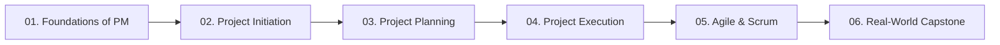

# Google Project Management Professional Certificate
## Comprehensive Learning Notes, Frameworks & Real-World Case Studies

> **Catatan Belajar & Dokumentasi Profesional Project Management**  
> Disusun oleh: **Dessy Rahmawati Chairullina, S.Kom**  
> Sumber Materi: *Google Career Certificates — Project Management Professional Program*  
> Playlist Referensi: [Google Project Management Certificate](https://www.youtube.com/watch?v=rck3MnC7OXA&list=PLcUrHMJVaGzA&index=1)

---

## 🎯 Tujuan Repositori
Repositori ini berisi dokumentasi terstruktur, intisari materi, bedah metodologi, dan **studi kasus aplikatif** dari kurikulum **Google Project Management Certificate**. Repositori ini dirancang sebagai standar acuan profesional dan portofolio implementasi manajemen proyek di industri teknologi, kesehatan (*healthcare*), dan sistem *enterprise*.

---

## 🗺️ Roadmap Kurikulum Project Management



| Bagian | Topik Kursus | Status | Dokumentasi |
| :--- | :--- | :---: | :--- |
| **Course 1** | **Foundations of Project Management** | 🟢 Selesai | [`COURSE-PROJECT-MANAGEMENT/`](./COURSE-PROJECT-MANAGEMENT/) |
| • Module 1 | Intro to Project Management (Role, Value, & Life Cycle) | ✅ Selesai | [01-intro-to-project-management.md](./COURSE-PROJECT-MANAGEMENT/01-intro-to-project-management.md) |
| • Module 2 | Finding Project Manager Jobs & Career Pathways | ✅ Selesai | [02-finding-project-manager-jobs.md](./COURSE-PROJECT-MANAGEMENT/02-finding-project-manager-jobs.md) |
| • Module 3 | How Company Culture & Structure Affects Projects | ✅ Selesai | [03-company-culture-and-project-management.md](./COURSE-PROJECT-MANAGEMENT/03-company-culture-and-project-management.md) |
| • Module 4 | Running Effective Meetings (Pre, During, Post Framework) | ✅ Selesai | [04-running-effective-meetings.md](./COURSE-PROJECT-MANAGEMENT/04-running-effective-meetings.md) |
| • Module 5 | Effective Communication for Project Managers | ✅ Selesai | [05-effective-communication-for-pms.md](./COURSE-PROJECT-MANAGEMENT/05-effective-communication-for-pms.md) |
| **Course 2** | **Project Initiation: Starting a Successful Project** | 🟢 Selesai | [`COURSE-PROJECT-MANAGEMENT/`](./COURSE-PROJECT-MANAGEMENT/) |
| • Module 6 | Key Components of Project Initiation & Project Charter | ✅ Selesai | [06-project-initiation-components.md](./COURSE-PROJECT-MANAGEMENT/06-project-initiation-components.md) |
| • Module 7 | Stakeholder Engagement & Communication (Power-Interest & RACI) | ✅ Selesai | [07-stakeholder-engagement-and-communication.md](./COURSE-PROJECT-MANAGEMENT/07-stakeholder-engagement-and-communication.md) |
| • Module 8 | Setting SMART Goals & OKRs for Measurable Impact | ✅ Selesai | [08-setting-smart-goals-and-okrs.md](./COURSE-PROJECT-MANAGEMENT/08-setting-smart-goals-and-okrs.md) |
| • Module 9 | Project Management Tools & Software Architecture | ✅ Selesai | [09-project-management-tools-and-software.md](./COURSE-PROJECT-MANAGEMENT/09-project-management-tools-and-software.md) |
| • Module 10 | Risk Management Fundamentals & Master Risk Register | ✅ Selesai | [10-risk-management-fundamentals.md](./COURSE-PROJECT-MANAGEMENT/10-risk-management-fundamentals.md) |
| **Course 3** | **Project Planning: Putting It All Together** | 🟢 Selesai | [`COURSE-PROJECT-MANAGEMENT/`](./COURSE-PROJECT-MANAGEMENT/) |
| • Module 11 | The Power & Benefits of Comprehensive Project Planning | ✅ Selesai | [11-power-of-project-planning.md](./COURSE-PROJECT-MANAGEMENT/11-power-of-project-planning.md) |
| • Module 12 | Creating a Master Project Communication Plan | ✅ Selesai | [12-project-communication-plan.md](./COURSE-PROJECT-MANAGEMENT/12-project-communication-plan.md) |
| • Module 13 | Project Budgeting, Cost Estimation & Procurement | ✅ Selesai | [13-project-budgeting-and-procurement.md](./COURSE-PROJECT-MANAGEMENT/13-project-budgeting-and-procurement.md) |
| **Course 4** | **Project Execution & Closing** | 🟢 Selesai | [`COURSE-PROJECT-MANAGEMENT/`](./COURSE-PROJECT-MANAGEMENT/) |
| • Module 14 | Leadership vs Management in High-Performing Teams | ✅ Selesai | [14-leadership-vs-management-in-teams.md](./COURSE-PROJECT-MANAGEMENT/14-leadership-vs-management-in-teams.md) |
| • Module 15 | Data Storytelling for Decision Making | ✅ Selesai | [15-data-storytelling-for-decision-making.md](./COURSE-PROJECT-MANAGEMENT/15-data-storytelling-for-decision-making.md) |
| • Module 16 | Quality Management & Continuous Improvement (QA vs QC) | ✅ Selesai | [16-quality-management-and-continuous-improvement.md](./COURSE-PROJECT-MANAGEMENT/16-quality-management-and-continuous-improvement.md) |
| • Module 17 | How & When to Close a Project (BAST & Lessons Learned) | ✅ Selesai | [17-project-closing-and-retrospective.md](./COURSE-PROJECT-MANAGEMENT/17-project-closing-and-retrospective.md) |
| **Course 5** | **Agile & Scrum Project Management** | 🟢 Selesai | [`COURSE-PROJECT-MANAGEMENT/`](./COURSE-PROJECT-MANAGEMENT/) |
| • Module 18 | Project Tracking Methods & Performance Metrics | ✅ Selesai | [18-project-tracking-methods-and-metrics.md](./COURSE-PROJECT-MANAGEMENT/18-project-tracking-methods-and-metrics.md) |
| • Module 19 | What is Scrum? Roles, Events, & Artifacts | ✅ Selesai | [19-what-is-scrum-framework.md](./COURSE-PROJECT-MANAGEMENT/19-what-is-scrum-framework.md) |
| • Module 20 | Agile & Scrum in the Real World: User Stories & Estimation | ✅ Selesai | [20-agile-and-scrum-in-the-real-world.md](./COURSE-PROJECT-MANAGEMENT/20-agile-and-scrum-in-the-real-world.md) |
| • Module 21 | The Scrum Master Playbook: Facilitation & Blocker Removal | ✅ Selesai | [21-scrum-master-guide-and-facilitation.md](./COURSE-PROJECT-MANAGEMENT/21-scrum-master-guide-and-facilitation.md) |
| • Module 22 | Agile Management & High-Impact Retrospectives | ✅ Selesai | [22-agile-management-and-retrospectives.md](./COURSE-PROJECT-MANAGEMENT/22-agile-management-and-retrospectives.md) |
| **Course 6** | **Capstone: Applying PM in the Real World** | 🟡 In Progress | [`COURSE-PROJECT-MANAGEMENT/`](./COURSE-PROJECT-MANAGEMENT/) |
| • Module 23 | Writing Project Closure Reports & Stakeholder Negotiation | ⏳ Antrean | - |
| • Module 24 | Advanced Sprint Planning & Capacity Management | ⏳ Antrean | - |
| • Module 25 | Scaling Agile, Hybrid PM & Career Portfolio Finalization | ⏳ Antrean | - |

---

## 📂 Struktur Repositori

```
project-management/
├── README.md                                         # Peta kurikulum & progress belajar
├── COURSE-PROJECT-MANAGEMENT/                        # Modul pembelajaran Google PM
│   ├── 01-intro-to-project-management.md             # Modul 1: Pengenalan PM, Value, & Siklus Hidup
│   ├── 02-finding-project-manager-jobs.md            # Modul 2: Lanskap Karier PM & Formula XYZ
│   ├── 03-company-culture-and-project-management.md  # Modul 3: Budaya Organisasi & Change Management
│   ├── 04-running-effective-meetings.md              # Modul 4: Cara Menyelenggarakan Rapat Efektif
│   ├── 05-effective-communication-for-pms.md         # Modul 5: Komunikasi Efektif Manajer Proyek
│   ├── 06-project-initiation-components.md           # Modul 6: Bagian Penting Inisiasi Proyek & Charter
│   ├── 07-stakeholder-engagement-and-communication.md # Modul 7: Analisis Stakeholder & Matriks RACI
│   ├── 08-setting-smart-goals-and-okrs.md            # Modul 8: Penetapan Sasaran SMART & OKRs
│   ├── 09-project-management-tools-and-software.md   # Modul 9: Alat Manajemen Proyek & Spreadsheet
│   ├── 10-risk-management-fundamentals.md            # Modul 10: Manajemen Risiko & Risk Register
│   ├── 11-power-of-project-planning.md               # Modul 11: Manfaat Perencanaan Proyek Terstruktur
│   ├── 12-project-communication-plan.md              # Modul 12: Rencana Komunikasi Master Proyek
│   ├── 13-project-budgeting-and-procurement.md       # Modul 13: Anggaran Proyek & Manajemen Pengadaan
│   ├── 14-leadership-vs-management-in-teams.md       # Modul 14: Kepemimpinan Tim & Keamanan Psikologis
│   ├── 15-data-storytelling-for-decision-making.md   # Modul 15: Bercerita dengan Data untuk Keputusan
│   ├── 16-quality-management-and-continuous-improvement.md # Modul 16: Manajemen Mutu (QA vs QC)
│   ├── 17-project-closing-and-retrospective.md       # Modul 17: Penutupan Proyek & Dokumen BAST
│   ├── 18-project-tracking-methods-and-metrics.md    # Modul 18: Pelacakan Proyek & Burndown Charts
│   ├── 19-what-is-scrum-framework.md                 # Modul 19: Framework Scrum (Peran, Acara, Artefak)
│   ├── 20-agile-and-scrum-in-the-real-world.md       # Modul 20: User Stories & Planning Poker
│   ├── 21-scrum-master-guide-and-facilitation.md     # Modul 21: Panduan Praktis Scrum Master
│   └── 22-agile-management-and-retrospectives.md     # Modul 22: Manajemen Agile & Retrospektif
├── templates/                                        # Template dokumen kerja PM (Charter, WBS, RACI)
└── case-studies/                                     # Studi kasus mendalam lintas industri
```

---

## 💡 Standar Format Setiap Catatan Belajar
Setiap modul di repositori ini disusun dengan standar baku:
1. **Executive Summary**: Intisari materi video dalam 3–5 poin kunci.
2. **Konsep & Framework Teori**: Pembahasan mendalam konsep PMBOK/Google PM.
3. **Studi Kasus Nyata (*Real-World Case Study*)**: Penerapan langsung pada skenario proyek IT/Enterprise riil (*Problem Statement ➔ PM Action ➔ Result & Metrics*).
4. **Actionable Checklist**: Panduan praktis yang siap diaplikasikan pada proyek kerja sehari-hari.

---
*© 2026 Dessy Rahmawati Chairullina • Learning in Public*
